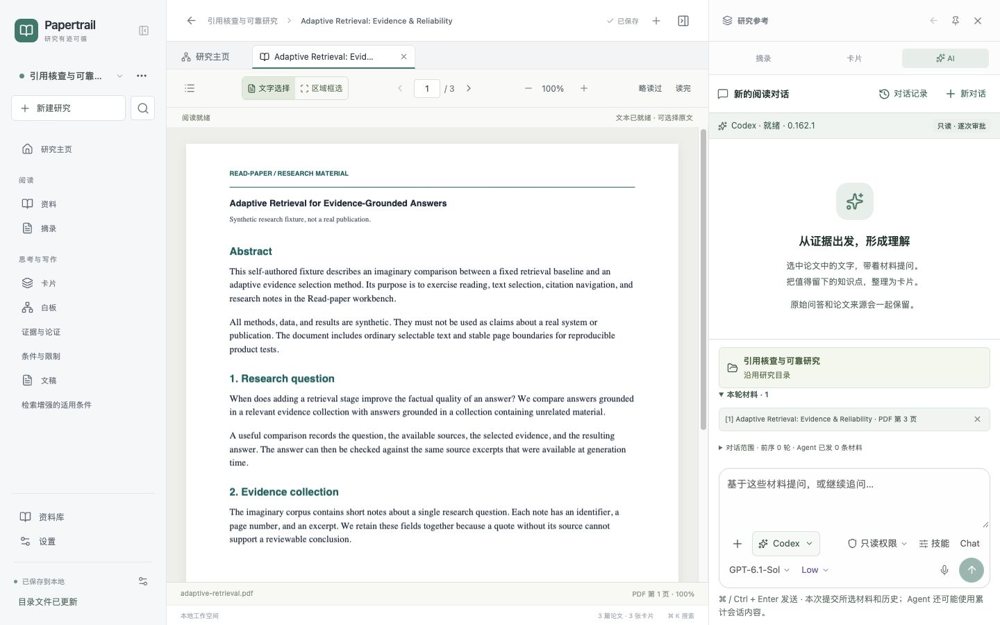
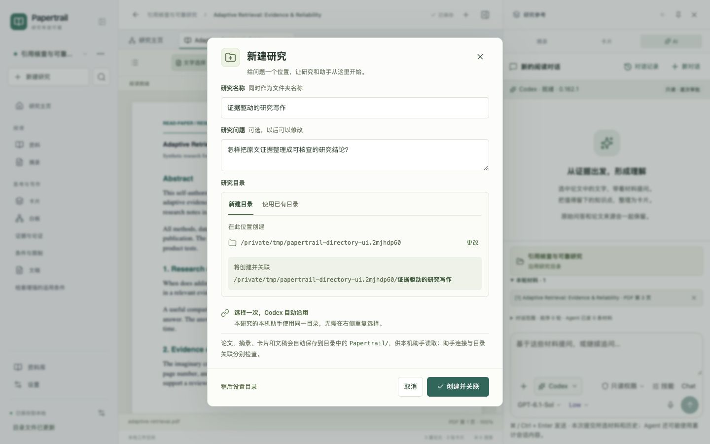

# Papertrail

白板新增“绘图”模式，使用开源 Excalidraw 直接画笔、形状、文字、箭头和图片，卡片与原文入口继续复用工作区实体。字体随应用本地打包。右侧 AI 的标题、材料和输入工具已压缩，腾出更多对话高度。实现范围与验证见[绘图](docs/verification/drawing/README.md)、[AI 空间](docs/verification/ai-space-expanded/README.md)及[最新 main 集成](docs/verification/main-integration/README.md)。

把论文读成自己的理解，再把理解写成有出处的结论。

Papertrail 是面向个人研究者的本地论文研究工作台。围绕一个研究问题，集中阅读 PDF、留下原文摘录、整理观点卡片、在白板上组织论证，并写出可以返回原文核查的研究文稿。AI 在同一个工作台里辅助阅读，人工整理流程也可以独立使用。

[下载安装](https://github.com/alovwang-sys/Read-paper/releases) · [快速上手](#快速上手) · [研究目录与-codex](#研究目录与-codex) · [开发运行](#开发运行) · [许可证与商业授权](#许可证与商业授权)

**个人非商业使用免费；任何商业使用须事先获得作者 alovwang-sys 的书面许可。** 完整条款见 [LICENSE](LICENSE)。



*截图来自实际工作台，论文是项目自制测试材料；不是设计原型或真实研究成果。*

## 下载安装

从 [GitHub Releases](https://github.com/alovwang-sys/Read-paper/releases) 选择最新技术预览，在 **Assets** 下载对应安装包。当前源码版本为 **0.1.11**，包含聊天白板、人工层级整理与 AI 补充草稿；0.1.8 保留为未公开发行的候选标签，0.1.10 为此前本机试用基线。公开状态、附件和验证范围以对应发行说明为准。

| 你的设备 | 选择的文件 | 安装方式 |
| --- | --- | --- |
| Mac / Apple 芯片 | 文件名含 `arm64` 的 `.dmg` | 打开后将 Papertrail 拖入“应用程序” |
| Mac / Intel | 文件名含 `x64` 的 `.dmg` | 打开后将 Papertrail 拖入“应用程序” |
| Windows / x64 | `Setup.exe` | 运行安装器 |

桌面安装包自带运行环境，无需安装 Node.js。使用 Codex、Claude Code 或 OpenCode 时，仍需另行安装并登录对应的本机运行组件。

当前是**未签名的技术预览**：尚未配置 macOS 公证、Windows 发行者签名和自动更新，系统可能显示信任提示。macOS Apple 芯片的本机安装与升级已验证；Intel 和 Windows 的安装器人工验收、干净环境检查等未完成项见各版本说明。构建通过不代表所有系统安装体验都已验证。Linux 和 Windows ARM 暂不提供安装包。

附件中的 `SHA256SUMS` 可用于核对下载完整性。平台要求、校验方式和分发流程见[桌面分发说明](docs/desktop-distribution.md)。

## 能做什么

| 研究环节 | 当前能力 |
| --- | --- |
| 收集资料 | 从 AI 回答查看或收录来源；粘贴 DOI、arXiv、网页链接补信息并尝试取得全文；导入 PDF；无全文条目稍后补 PDF；在研究之间复用资料 |
| 阅读与摘录 | PDF 目录、搜索、缩放和阅读位置恢复；选择文字留下摘录或随手记；框选图表、公式和扫描区域；在所选内容旁解释与追问 |
| 形成观点 | 人工写卡片，或从选中的摘录、AI 回答整理草稿；修改确认后保存，保留原文依据与相关问答 |
| 组织论证 | 白板摆放共享卡片与论文；自由布局或显式父子层级，大纲调序、折叠、紧凑展示和关联避障；聊天创建或补充方法与计划草稿，已有结构及新增草稿先确认，支持历史恢复 |
| 写作与核查 | 文稿插入卡片和结构化引用，通过出处链返回论文页码与摘录；导出带来源的 Markdown |
| AI 辅助 | 内置 Pi 阅读助手复用模型 API 配置，支持原文旁轻问与右侧讨论；本机 Codex／Claude Code／OpenCode 仍可选，另有明确选择的演示模式 |
| 本地管理 | 按研究恢复打开项与未发送输入；研究目录保存实际资料文件；完整工作区 ZIP 备份与恢复 |

收录链接后会通过本机服务补文献信息并尝试取得可访问的 PDF；全文获取失败仍保留条目，可在原条目补文件。作者摘要、AI 推荐说明与研究备注分别保存，资料收录不会自动扩大 AI 材料范围。网页正文快照和 Agent 自动批量收集尚未实现。区域框选保存图片，不进行 OCR。模型结论仍需人工核查。交互与技术边界见[来源收录设计](docs/source-intake/README.md)。

源码中的研究图增量尚未替换本机安装版，能力与验收见[研究图记录](docs/verification/tree-board/README.md)。

## 快速上手

1. **新建研究。** 输入研究名称与核心问题，选择父位置创建新文件夹，或关联已有文件夹。预览最终路径后点击“创建并关联”。也可以“稍后设置目录”，先完成人工阅读。
2. **添加资料。** 在“资料”点击“添加资料”，导入 PDF，或先记录标题、DOI、arXiv 等线索。首次启动也可使用内置的自制示例熟悉操作。
3. **留下依据。** 在 PDF 中选中文字，选择“摘录”“写成卡片”；也可点击“解释这段”立即在原文旁得到解释，或点“提问”输入问题后再发送。就地小窗可拖动标题栏移动、拖动右下角调整大小；聚焦移动或缩放控件后也可用方向键操作，Shift 加速。图表可以切换到区域模式框选，图片问答需要模型支持并开启图片能力。摘录与卡片都能回到原文。
4. **整理与写作。** 在“摘录”中选择材料形成卡片，把卡片放到白板组织关系，再插入文稿；通过来源编号核查结论，最后导出 Markdown。
5. **按需使用 AI。** 轻量解释与追问在原文旁完成，回答可“收为卡片”，编辑确认后保存。比较多份材料或继续较长讨论时使用右侧 AI；点击就地回答的“在右侧继续”会打开同一条问答，右侧原有会话与输入保留。当前开发分支的小窗还可沿用研究已选的 Codex，移到右侧仍续接同一线程。

左栏按“阅读”和“思考与写作”组织入口，不要求固定顺序。论文、卡片、白板和文稿统一在中央标签栏打开；右侧查看参考资料时保留主区。`⌘K` / `Ctrl+K` 搜索，PDF 选中文字后可用 `H` 摘录、`C` 写卡片。

**人工调整白板：** 左栏白板／文稿和研究卡片可拖动排序，也可点击手柄选择上移／下移。在白板选择模式下，Shift / Ctrl / ⌘ 多选后整体拖动；方向键移动 1px，Shift + 方向键移动 10px。卡片“编辑内容”在右侧修改共享正文，“历史与恢复”查看和恢复布局。连线随卡片实际边缘绘制曲线，可点击修改关系。见[本轮验收](docs/verification/human-board-control/README.md)。

**在聊天里生成白板：** 明确说“把刚才的讨论画成流程图”，或点击输入区“生成白板”，即可沿用当前 Codex／Claude Code／OpenCode 或模型连接生成草稿。结果保存在本研究，并在消息中展示关系图；点击“打开白板”才切换主区。新节点成为带对话出处、标记待核查的卡片。普通问答保持聊天；适合画图的结构性回答可能出现一次可忽略建议。修改已有白板须选定本次目标，移出资料、替换旧关系或移动或重新分组任一已有节点时先确认差异。使用方式、版本恢复和限制见[白板设计](docs/agents/whiteboard-skill.md)与[聊天白板验收](docs/verification/chat-board/README.md)。



PDF 默认连续滚动；每个窗格有独立标签组，可继续向四边拆分。拖标签到边缘创建窗格，拖到中间或标签栏移动，Option/Alt 拖动复制视图。支持论文、卡片、白板与文稿，分隔线可调整大小，窗格可放大还原或收拢，同篇各位置独立保存。右侧 AI／卡片面板保持可用。桌面全屏时顶部常显“退出全屏”，也可按 macOS ⌃⌘F／其他平台 F11。Codex 图片材料支持 PDF 区域截图，需选择本机明确支持图片的模型；最多 4 张、每张 8 MB。macOS 桌面“语音”请求系统听写，识别结果留在草稿中；其他平台提供系统快捷键指引。详见[多窗格设计与验收](docs/panes/README.md)、[全屏验收](docs/verification/fullscreen/README.md)和[图片与听写限制](docs/verification/reader-images/README.md)。

## 研究目录与 Codex

**目录选择一次，研究与右侧本机助手共用。** 切换研究后，助手跟随对应目录；旧研究也可以从项目名称旁的“…”补充关联。网页版本选择的是本机服务所在机器的目录，桌面版使用系统目录选择器。

关联后，应用会在研究根目录的 `Papertrail/` 中自动保存实际文件：

```text
你的研究目录/
├── Papertrail/
│   ├── README.md          # 本研究的文件入口
│   ├── research.md        # 研究问题
│   ├── research.json      # 结构化实体与资产索引
│   ├── library/           # 原始 PDF 与文献信息
│   ├── images/            # 区域截图
│   ├── excerpts/          # 原文摘录与页码
│   ├── cards/             # 观点卡片 Markdown 与来源
│   ├── boards/            # 白板布局与关系 JSON
│   ├── drafts/            # 文稿 Markdown 与引用
│   └── sessions/          # 可读对话、原生 Session ID 与续接索引
└── .read-paper/            # 项目标识、请求材料与原生历史归档
```

应用保留本地数据库与编辑恢复副本，同时更新这些文件。共享资料会在关联的研究目录各保存一份。侧栏底部和项目设置显示目录保存状态；本机助手提问前会先保存最新研究文件，失败时保留输入并提供重试。

用外部 Codex 打开**同一个研究根目录**，从 `Papertrail/README.md` 即可找到 PDF、卡片和文稿。原生 Session 日志与登录仍由 Codex 保存；`Papertrail/sessions/index.md` 记录已读取的对话及其原生 ID。同机保留原生日志时，可在研究根目录运行：

```sh
codex resume <Session-ID>
```

已通过真实 Codex 读取卡片、同工作目录发现/读取，以及本轮三轮保持同一线程、HTTP 断流恢复观察、手动压缩后继续记忆的验证。独立 Codex 桌面客户端的列表筛选和两端往返续接尚未验收；复制研究文件夹不会迁移原生会话数据库、登录或保证跨电脑续接。详见[研究目录验证](docs/verification/research-directory/README.md)和[原生连续对话验收](docs/verification/native-continuity/README.md)。

请从 Papertrail 编辑卡片和文稿。外部编辑、删除或替换已管理的文件会暂停后续覆盖，应用保留原文件并提示处理；**外部修改暂不回写应用，目录也没有独立恢复入口**。完整迁移请使用工作区备份。

## 配置 AI

人工阅读、摘录、白板和写作不要求模型连接。需要 AI 时，可选以下方式：

- **内置阅读助手（Pi）：** 无需另装 Pi 或本机 CLI。原文旁问答和右侧的模型连接共用内置 Pi Agent 运行时、模型、地址与密钥配置，各自保存明确选择的材料和对话；就地问答不会自动进入右侧历史。桌面版通过“文件 → 模型连接…”或设置配置 API 地址、模型和密钥。密钥经系统加密保存在应用资料目录，不返回工作台页面，也不进入资料备份。配置保存成功只代表格式与本机保存通过，连通性需实际发送消息确认。
- **本机助手：** 在 AI 输入区切换 Codex、Claude Code 或 OpenCode，使用各运行组件自己的本机登录和模型配置。当前仍需用户安装并登录 Codex；没有内置 Codex 二进制或独立账号授权界面。应用不接收这些 CLI 的登录密钥；本机调用仍可能使用联网模型。Codex 已通过真实问答及连续线程验证；Claude Code、OpenCode 的认证、额度及未验收范围分别见[助手验证](docs/verification/agents/README.md)。
- **演示模式：** 用于体验交互，界面明确标示，不代表真实模型回答。连接失败不会静默切到演示或其他供应商。

源码中的 Codex 聊天已改为固定原生线程：连续追问、刷新恢复和“再回答一次”沿用同一 `threadId`，每轮只发送新问题与新增或变化的材料。本机服务持有执行，断流后恢复观察，不重复提交；运行中可“补充本轮”，停止需等待原生确认。上下文由 Codex 管理，材料移除不代表历史被遗忘，需要独立范围时新建对话。每轮实际输入仍限 120,000 字符、当前材料最多 128 条；单次超大输入仍需缩小，不静默截断。历史分页、有序工具活动、接收未知与恢复边界见[原生连续对话设计](docs/agents/native-continuity.md)及[0.1.8 候选阶段验收](docs/verification/native-continuity/README.md)。0.1.8 未公开发行；v0.1.7 安装包不包含这次原生连续会话增量。

本轮材料由你明确选择，改变 PDF 选区不会自动发送。本机助手还可能通过工具读取已授权的研究目录与原生历史，发送前请查看范围和权限。Codex 默认只读；选择完全访问时需明确确认。AI 生成草稿不自动覆盖原正文，引用可返回来源，但软件校验不能保证模型结论正确。

内置 Pi 当前只处理所选材料的解释、追问与卡片草稿，不提供联网搜索、任意文件操作或自定义技能。模型配置就绪不等于模型回答已验证：2026-10-19 的 `glm-5.3-flash` 实际请求返回 429 额度或并发受限，未完成回答；本轮实现、模拟验证和真实模型结果分别记录于[就地 AI 验收](docs/verification/inline-ai/README.md)。

## 保存、备份与边界

桌面应用资料目录固定为 macOS 的 `~/Library/Application Support/Papertrail` 或 Windows 的 `%APPDATA%/Papertrail`。正常升级不清空资料；退出前停止生成并等待应用数据与研究目录保存，失败时返回工作台重试。浏览器与桌面使用各自独立的资料空间。

在“设置 → 工作区备份与恢复”导出完整 ZIP，再到目标环境导入，核对统计后确认替换。备份包含研究、原 PDF、区域图片、摘录、卡片、白板、文稿和聊天显示缓存，**不含 API 密钥、服务端会话映射或厂商原生日志**。恢复是整库替换，不合并两个设备分别新增的内容；恢复前会保留当前资料副本。

- 只接受应用直接导出的原始 ZIP32，请勿重新压缩。备份全部内容上限 256 MiB，单资产 64 MiB；研究目录保存同样限制单资产 64 MiB、文件集 256 MiB。
- PDF 导入上限 50 MB、1–2000 页，加密文件需先解密。扫描件可阅读或框选，完整 OCR 尚未实现。
- Markdown 导出用于交付研究结论，包含文献信息、PDF 页码与摘录，不包含原 PDF、区域图片或完整聊天，不能替代全量备份。
- 清除浏览器站点数据会删除其本地资料；研究目录文件也不能替代当前的完整工作区 ZIP 恢复。
- 当前面向桌面单用户，没有多人协作、跨设备自动同步、自动更新或产品内多 agent 编排。

## 开发运行

使用 **Node.js 24** 和 npm。工程采用 React、TypeScript、Vite、PDF.js；Electron / Electron Forge 负责桌面安装包，本机 Node 服务负责模型与助手调用。按锁文件安装依赖：

```sh
npm ci
npm run dev
```

打开 http://127.0.0.1:5173 。人工阅读可直接使用；研究目录与本机 AI 功能还需在另一个终端启动：

```sh
npm run ai
```

服务仅监听 `127.0.0.1:8787`，Vite 将 `/api/ai` 和 `/api/sources` 代理到它。来源解析与全文获取不要求模型密钥。更换前端端口时同步配置 `AI_APP_PORT`。浏览器目录绑定索引可通过 `AI_AGENT_STATE_DIR` 设置为私有持久目录；不设置时使用系统临时目录，可能被系统清理。

开发环境需要模型 API 时，将配置模板复制到本机文件后填写：

```sh
cp .env.example .env.local
chmod 600 .env.local
```

`.env.local` 已被 Git 忽略，不要提交密钥。模板默认使用智谱 `glm-5.3-flash` 的 Chat Completions 接口，可配置 `AI_BASE_URL`、`AI_MODEL` 和 `AI_API_KEY`；图片能力确认模型支持后再设置 `AI_IMAGES=true`。修改后重启服务。本机助手沿用其自身配置，OpenCode 的 `OPENCODE_MODEL` 仅作可选覆盖，通常无需重复填写。

### 检查与测试

```sh
npm run check             # TypeScript
npm test                  # 业务单元测试
npm run test:server       # 本机服务与运行时边界
npm run test:desktop      # Electron 协议、设置与保存边界
node --test .github/scripts/release.test.mjs
npm run build             # 检查并构建 dist/
npx playwright install chromium
npm run test:e2e           # Chromium 用户路径
```

普通自动测试使用确定性适配器，不调用付费模型。真实模型结果与限制单独记录在对应验收文档中。

### 桌面开发与打包

在目标操作系统运行：

```sh
npm run desktop:dev       # 构建并启动桌面开发应用
npm run desktop:package   # 生成 out/ 下的可运行应用
npm run test:desktop:e2e  # 验证已打包应用，使用隔离资料目录
npm run desktop:make      # 生成 out/make/ 下的安装文件
```

macOS 生成 DMG 与 ZIP，Windows 生成安装器及配套 Squirrel 文件。CI 对 macOS arm64、macOS x64、Windows x64 分别构建和验证；公开版本在合并 `main` 后，由发行工作流为固定 tag 重跑检查、汇总安装包与 `SHA256SUMS`，核对草稿后发布技术预览。详细流程见[桌面分发](docs/desktop-distribution.md)与[开发协作约定](docs/development-workflow.md)。

## 许可证与商业授权

本项目采用 **Papertrail 个人非商业使用许可证 1.0**。个人可以免费用于非商业的学习、兴趣项目和个人研究，并可在保留许可证与版权声明、标注修改的前提下，无偿分享原版或修改版。

**商业使用必须事先获得作者 alovwang-sys 的明确书面许可。** 企业内部业务使用、有偿咨询或委托研究、商业产品集成、收费分发、订阅或托管服务、广告变现等均属于商业使用；以个人名义使用、免费提供服务或尚未盈利，不自动免除授权要求。代表其他组织开展工作或部署服务，也须单独取得书面授权。

商业授权请通过[项目仓库](https://github.com/alovwang-sys/Read-paper)联系[作者](https://github.com/alovwang-sys)，说明预期用途；未收到明确书面同意前，不得开展商业使用。

这是限制用途的源码公开许可证，不属于允许自由商用的开源许可证。完整权利与限制以 [LICENSE](LICENSE) 为准。第三方依赖和材料遵循各自许可证；用户自行导入的资料和创作的研究内容不因使用本软件而自动受本许可证约束。

## 文档

| 入口 | 内容 |
| --- | --- |
| [产品规划](docs/product-plan.md) · [开发任务](docs/agent-backlog.md) | 产品方向、实现范围与依赖 |
| [知识链路](docs/knowledge-flow/README.md) | 资料、摘录、卡片、出处链与文稿的需求与设计 |
| [AI 阅读](docs/ai-reading/README.md) · [就地 AI 实现与验收](docs/verification/inline-ai/README.md) · [本机助手设计](docs/agents/design.md) | 原文旁问答、内置 Pi、材料范围、草稿、原生助手与权限 |
| [研究目录设计](docs/agents/research-directory-design.md) | 一次关联、实际文件与失败恢复 |
| [项目会话需求](docs/agents/project-sessions-requirements.md) · [Codex 连续对话](docs/agents/native-continuity.md) | 原生会话发现、读取、持续运行与恢复边界 |
| [验收总览](docs/verification/README.md) | 实际测试、真实模型结果、截图与已知限制 |
| [知识链路验收](docs/verification/knowledge-flow/README.md) · [研究目录验收](docs/verification/research-directory/README.md) | 本轮实现证据与三尺寸验证 |
| [桌面分发](docs/desktop-distribution.md) | 架构选择、安装包、校验和与发布门槛 |

设计原型只用于讨论；是否可用，以实现、测试和对应版本的发行说明为准。
