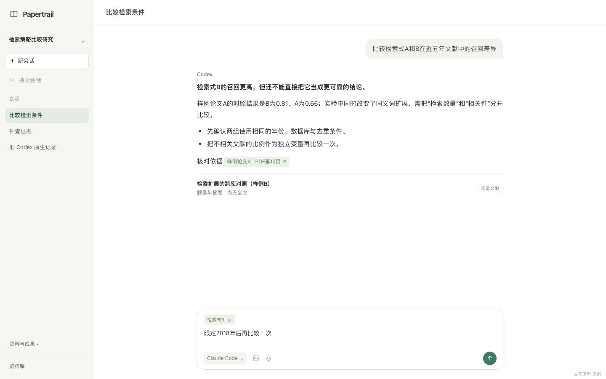

# Papertrail 对话工作台重设计

2026-10-23。用户要求重新画设计稿、与 Claude Code 讨论六轮以上，并特别强调美观性。本轮完成 **7 轮真实讨论**、Claude 原创稿、最终可点击原型和16项交互验证；正式应用与本机安装未改动。

后续五点反馈的最新方案见[连续工作区](workspace-continuity.md)与[新布局预览](http://127.0.0.1:5173/docs/agent-native-evolution/conversation-redesign/workspace-preview.html)：明确研究／全局资料范围、输入权限和系统听写、资源旁同会话聊天、原生 Excalidraw 绘图与框选、就地浮窗；追加浏览器式可拖标签分屏、标题下拉选／新建会话和本地相关建议。[新一组7轮讨论](review/workspace-continuity/README.md)、[17项交互检查](verification/workspace-preview/README.md)与[6项拖拽专项](verification/workspace-tabs/README.md)独立记录，不改变下方第一版的历史验收范围。

随后补充[原文选区摘录／制卡](verification/workspace-reader-notes/README.md)：选中样例文字后直接存原句或在小浮窗写观点，出处关联保留；保存项在本篇笔记查看。仍为内存预览，本次增量未另送 Claude 看图，正式应用未修改。

[打开可点击原型](http://127.0.0.1:5173/docs/agent-native-evolution/conversation-redesign/prototype.html) · [设计规则](design.md) · [本地 HTML](prototype.html) · [七轮讨论与取舍](review/README.md)

## 改了什么

| 用户遇到的问题 | 新设计 |
| --- | --- |
| 发送后还要去右侧找会话、找回答 | 中央默认就是当前完整对话；从原文、白板或文稿发送后直接回到该会话 |
| 会话列表一条占很大面积 | 会话移至左栏，每条36px、一个标题，移除摘要、日期、助手与“当前”重复标签 |
| 换助手出现大段说明，实际还换了话题 | 输入区一个选择按钮；普通切换保留同一产品会话、草稿和旧回答归属 |
| 查来源容易丢失当前问题 | 引用在右侧打开同页原文；全文和成果可返回，只有明确添加的材料进入问题 |
| 页面显得杂乱 | 暖灰侧栏、白色正文、统一品牌绿；压低辅助操作层级，统一引用、菜单、字号与留白 |

原生绑定记录无法由另一助手继续时，对应菜单行只显示“新会话”，复制草稿与材料，原记录保留。图片能力不足时保留附件并阻止提交，不静默改成只发文字。这些能力边界仍需要正式工程实现与真实连接验证。

## 建议体验三条路径

1. 直接输入问题并发送：输入清空，本轮回答就在中央。切另一会话再回来，草稿各自保留。
2. 点回答中的页码引用，打开原文，加入本轮材料并提问：中央直接显示本轮问答；可回到同页原文。
3. 打开输入框的助手按钮：普通换助手不换话题；再从“资料与成果”打开白板或文稿，编辑后提问并返回，编辑仍在。

还可体验停止、失败重试、迟到回复不抢当前页面、“查看新回复”、文献收录到资料库与去重。图片和语音按钮只是设计入口示例。

2026-10-23 白板补正：用户指出白板只能加入提问。原稿此前确实只是三张静态卡片清单，不能充当白板展示。现已补为有关系连线的画布：从“资料与成果 → 白板”打开，点击卡片正文可展开、修改并返回；拖动卡片上沿调整位置，连线跟随。单卡与整板的“加入提问”是独立动作，保存当时正文快照，发送后可回到原白板位置。本次新增范围与三尺寸截图见[白板专项验收](verification/board-open/README.md)；这次补正未再次送 Claude 审查，之前7轮结论的范围不扩大。

## 先确认旧问题

以0.1.14源码、全新浏览器上下文、五个合成会话和示例PDF复现：PDF下发送后，中央仍是PDF，完整回答没有出现在中央；底部只说“会话已有回复，可返回继续”。原列表每行实测 **127.875px**，另有10px间距；新稿36px约减少72%的单行高度。原助手配置展开216px，含三段解释。

[发送后的现状](baseline/01-pdf-sent-history-1440.png) · [原助手配置](baseline/02-assistant-menu-1440.png) · [复现步骤与测量](baseline/reproduction.json)。截图均为合成资料，不是用户真实研究。

源码中的 `changeResearchAgent` 在会话有消息或草稿时实际新建话题。新稿因此同时修正目标行为，不能仅把说明藏起来就宣称解决。生产代码仍保留原有行为。

## Claude 原稿和最终取舍

[需求与验收路径](brief.md)作为讨论输入。第3轮成功答复实际生成[Claude 原创 HTML](claude-design-v1.html)，原样提取且未修改，来源与hash见[原稿证明](review/claude-design-v1-provenance.json)。随后由 Codex 修正交互、集成并打磨为[最终原型](prototype.html)，保留原稿便于比较。

本轮共7次成功讨论；第5轮实际读6张图，第7轮实际读7张最终图，共13张。一次超时和一次认证失败均排除计数，旧任务讨论也不计入。每轮双方意见、反驳、修正与原始答复见[讨论记录](review/README.md)和[状态汇总](review/status.json)。Claude 最终认为可以交给用户体验；这属于静态看图审查，实际点击由 Codex 和验收 agent 完成。

采纳：左侧紧凑会话、中央问答、右侧参考；1024下并列参考、助手菜单右对齐、统一引用样式。否决：继续堆解释卡、额外大块底部空白、将“收录文献”误作加白板，以及含图时默认只发送文字。

## 验证

- [16/16交互检查与截图](verification/qa/README.md)：发送、草稿隔离、换助手、资源返回、引用、重试、未读、收录去重与窄屏实际提交；无运行错误、无非本地请求。
- [14张视觉截图及尺寸测量](verification/visual/measurements.json)：1440×900、1280×800、1024×800及900／901／1100／1101／1247／1248断点。1024下中央664px、参考360px并列；≤900发送后收参考覆盖。断点保证阅读宽度，不表示宽度完全没有跳变。
- JavaScript语法检查通过。此轮没有修改正式功能，不以原型检查代替应用回归测试。

原型由现有开发服务提供。在仓库运行 `npm run dev -- --port 5173` 后可打开上方链接；独立复核可运行 `node docs/agent-native-evolution/conversation-redesign/verify-prototype.mjs`。

## 边界

原型使用固定样例回答与内存状态，刷新会复位；模型连接、图片和语音均未调用真实服务。PDF、白板和文稿为交互示例，不是完整阅读器、Excalidraw或持久化编辑器。未验证原生线程续接、跨供应商上下文、真实研究检索质量或数据迁移。

正式应用仍为原版本，本轮没有重装、发布或修改真实研究数据。下一步正式实现应按[最小切片](design.md)接回共享状态和已有功能，再做真实连接、保存恢复和安装包验收。
