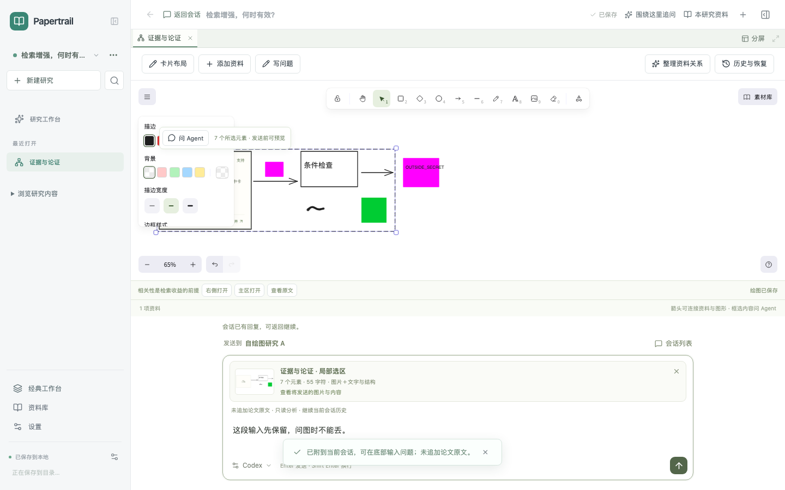

# 自绘选区问 Agent · 实施与验收

2026-10-21，用户确认继续后实施[两轮 Claude Code 评审确定的首切片](../../review/drawing-agent/README.md)。

在新版 Agent 工作台的白板“绘图”中：**框选 → 问 Agent → 核对底部预览 → 输入问题并发送**。矩形、文字、箭头、自由笔迹、导入图片、共享卡片和论文入口使用同一入口，回答进入当前会话；不强制转卡片，不增加输入框或跳回经典面板。原有经典路径保留。

## 本轮到底发送什么

- 一张仅包含所选元素的 PNG，最长边 2048px、最多 2MiB；不截整块页面，不内嵌完整场景 JSON。导入图片先实际解码，缺图／坏图明确失败。
- 最多 100 个选中元素及其位置、文字、箭头标签与方向。明确选择的组、框架包含其子元素及绑定文字；箭头不自动扩展其他节点，跨界端点仅标选区外。
- 所选卡片的完整标题、正文、ID 与位置；论文入口只附标题、作者、年份、页数信息。PNG 里的卡片／论文为写明“文字另附”的占位块，完整文字可在预览中核对，不声称像素包含 React 卡片正文。
- 所选文字、资源标题／正文和连线标签合计最多 12,000 字符；超限拒绝并保留输入，不默默省略。
- 当前会话最近六轮内、合计最多 12,000 字符的已完成问答。不读取其他会话，不重新附送历史图片。历史文本可能包含之前的引文，但不自动成为本轮可引用的原文。

**问图默认 `sources=[]`，不运行 PDF 抽取，也不携带旧文稿修改目标。** 图片和图中文字是用户想法；论文引用仍必须来自本轮真实读取的来源，不能为图编造 PDF 页码。问图不修改画布或原卡片。

## 保存、失败与连接

待发送附件属于原研究、原会话；普通选区变化不替换它。实际 PNG、结构和文字形成 SHA-256 校验的不可变快照，进入 IndexedDB、完整 ZIP 备份和研究目录的 `images/`／`research.json`／可读会话归档。原图后来改变或移除，不影响历史快照。

停止、失败和刷新保留输入与附件；刷新中的运行按既有约定标为中断。重试使用原图、原结构和提交时历史。切换会话或研究后，迟到结果只归原请求；图片导出期间切换目标则拒绝误附。问图结果不覆盖上次选定的文稿。

本轮图片研究工具只接本机 Codex：探测当前配置模型的 `inputModalities`，经 HTTP 校验 PNG 字节、尺寸和 hash 后写入本轮私有临时目录，以官方 app-server 的 `localImage` 输入发送，成功或失败均清理。运行时再次核实模型能力并禁止悄悄切换供应商。[官方协议](https://learn.chatgpt.com/docs/app-server)

图片能力未确认时保留附件、阻止图片发送；有有效文字时，用户可明确选择“仅发送文字和结构”，界面与模型说明均写明未看图。纯笔迹没有有效文字时不提供这种替代。Claude Code、OpenCode、模型直连及演示仍保留已有能力，不宣称接通本轮图片研究工具。

## 实际验证

真实模型与受控事件流分开记录：

- [真实视觉 HTTP 冒烟](vision-smoke.json)：本机 Codex 0.162.1，真实 app-server 图片输入；合成样例中三个英文标签和随机四位数字仅在 PNG 像素里，问题及结构元数据均未给答案。模型正确读出 `Collect → Filter → Synthesize` 和 `5627`，且未调用论文工具或创建文稿；约 118 秒是本次测量，不是速度承诺。[实际输入图](vision-input.png)
- 浏览器直接操作真实 Excalidraw 选择、导出与本地保存；仅模拟 Agent 事件和项目服务。验证 PNG 不含包围框内未选的品红元素、包含选中的本地导入图片、所选卡片正文完整、无其他会话私有内容、`sources=[]`、单一输入与发送入口。覆盖当前会话回答、刷新、失败／重试、停止、迟到响应和明确文字模式。
- 1440×900、1280×800、1024×800 的真实应用截图：[1440](screenshots/selection-composer-1440.png)、[1280](screenshots/selection-composer-1280.png)、[1024](screenshots/selection-composer-1024.png)、[展开预览](screenshots/selection-expanded-1440.png)、[当前会话回复](screenshots/current-conversation-reply-1024.png)、[冻结重试](screenshots/retry-frozen-snapshot-1440.png)。
- 单元覆盖上下文隔离、缺图／篡改／超限、只读文稿保护、停止、刷新、重试、备份及研究目录归档；HTTP／协议检查覆盖真实 PNG 格式与 `turn/start.localImage`、能力拒绝和临时文件清理。命令、计数及运行限制见 [checks.json](checks.json)。

当前按图联网检索论文、Claude/OpenCode 的图片研究适配、通用改图执行器尚未实施；现有手动 OpenAlex 检索仍可用。没有专项评估潦草手写、小字号、复杂公式或真实论文研究质量，没有打包／签名／发布新桌面版本。
