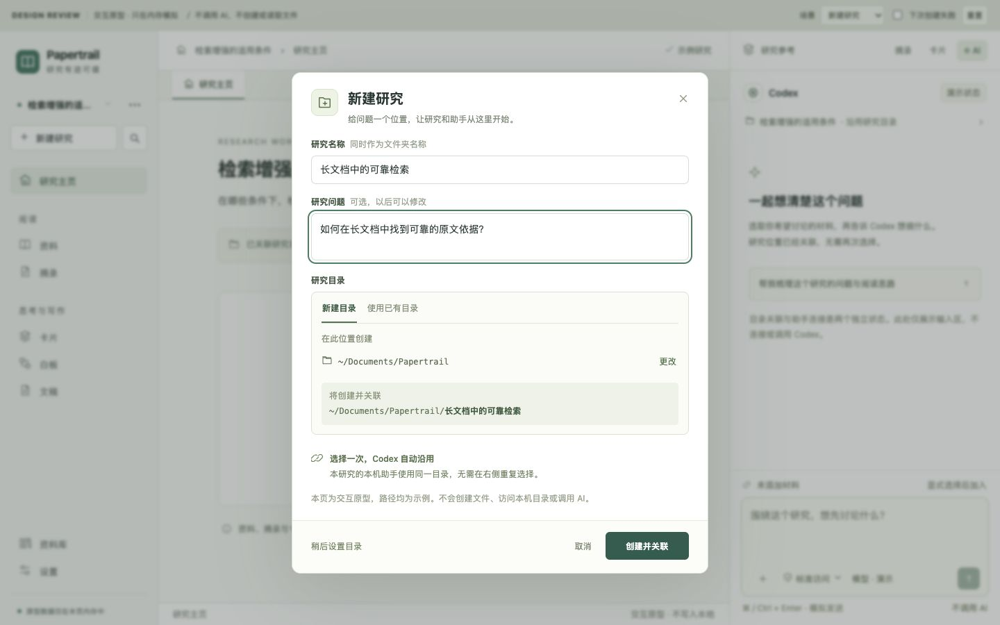
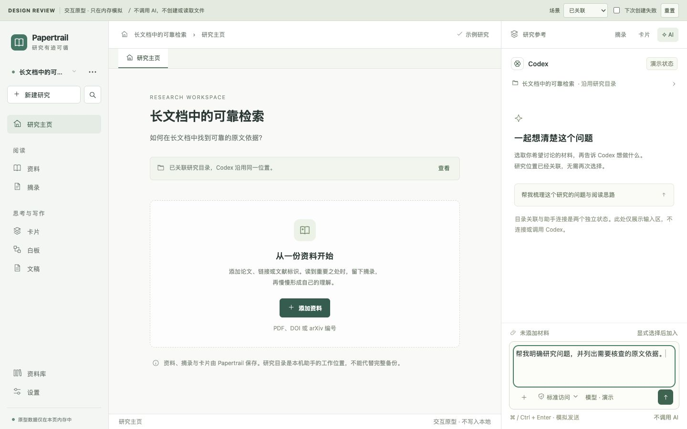

# 新建研究时关联目录：产品检查与 UI 设计

2026-10-17。状态：已接入正式工作台并完成本轮打包验收。依据用户认可的设计，补齐“创建研究时选一次目录，右侧 Codex 自动沿用”，并按用户最新要求增加研究文件的自动保存。配套[原型](research-directory-prototype.html)保留设计评审基线，实际结果见[验收记录](../verification/research-directory/README.md)。原型不能代替实现证据；外部桌面列表与目录独立恢复仍单独验收。

## 本轮新增：实际研究文件与 Session

用户明确希望同目录中的 Codex 能访问论文、卡片和讨论，本轮不再只做目录归属。绑定后自动生成 `Papertrail/README.md`、`research.json`、`library/` 原始 PDF/文献信息、`images/`、`excerpts/`、`cards/`、`drafts/`、`boards/`、`sessions/`。文件集只包含本研究与其来源依赖，不复制其他研究的私人对话。卡片、摘录和文稿包含 PDF 页码与相对原文链接；尚无全文的条目保留元数据，不伪造 PDF。

目录文件随应用编辑自动更新，侧栏与项目设置分别显示状态和重试。资产按 hash 校验，未变 PDF 不重传/重写；所有文件限定在专用 `Papertrail/`，不改研究根目录已有文件。保存事务先暂存、保留旧字节、最后提交清单；失败可恢复。用户或 Codex 改过的导出文件会被保留并阻止后续覆盖，不自动回写应用。应用数据库继续提供编辑与恢复副本；共享来源在各研究目录各存一份。单资产 64 MiB、文件集 256 MiB 上限在错误中明确显示。

`sessions/index.md` 和会话 Markdown 保存已获得的讨论、原生 Session ID 与续接提示；真正的原生日志仍由 Codex/其他助手管理。同机用 Codex 打开研究根目录，可读取文件；保留原生记录时用 `codex resume <ID>` 定位对应会话。[官方 CLI 文档](https://learn.chatgpt.com/docs/cli/reference)。本轮一次真实生产适配器调用验证了读取卡片、正确回答、同 cwd 的 list/read 与原生 ID 匹配，见[探针](../verification/research-directory/codex-files-probe.md)。独立 Codex 桌面列表和第二轮接续未验，目录复制到新电脑不承诺恢复原生身份。

## 产品判断

需求合理，应作为研究创建流程的一部分。研究者在创建研究时已经确定归属，再到 AI 面板选目录没有增加有效决定。产品应负责把同一个选择传给右侧助手，并在切换研究时保持一致。推荐一个研究对应一个固定工作目录；右侧显示继承关系，使用同一个项目设置入口。

“只选一次”指为每个研究首次设置一次。之后打开研究、切换助手、在该研究里新建对话，都沿用绑定。研究 A 和研究 B 各自有目录；它们不共享一份全局“最近选择的 AI 目录”。目录权限、AI 是否认证和本轮材料范围仍是不同状态。

默认在创建时新建目录，同时提供“使用已有目录”。保留低强调的“稍后设置”：人工阅读、整理资料及模型直连不必被本机目录阻塞。稍后使用原生助手时补设一次，后续仍自动继承。

## 实际检查：已有能力与缺口

以下记录实现前 `d4818c0` 的检查基线，行号仅供历史定位。已实际打开当时安装版新建表单确认缺口；本轮代码位置与结果以验收记录为准。

| 检查点 | 实际行为及依据 | 对本次设计的含义 |
| --- | --- | --- |
| 研究保存目录 | [`Research.directory`](../../src/domain/types.ts#L13) 已有稳定 binding ID、project ID、规范路径 | 继续保持唯一目录来源，无需第二套 Codex 项目状态 |
| 新建研究 | [`App.tsx`](../../src/shell/App.tsx#L647) 只收名称与问题，调用 [`createResearch`](../../src/services/workspace.ts#L485)，立即创建研究、白板、文稿与会话 | 目录应前移到此流程；不能先产生可见研究再让绑定失败留下半成品 |
| 当前目录选择 | [`ResearchDirectory`](../../src/features/research/ResearchDirectory.tsx#L7) 在左侧项目设置、右侧缺目录提示共用 | 复用其选择、预览、重连能力，并让新建流程使用同一服务 |
| 右侧取值 | [`AIPanel`](../../src/features/ai/AIPanel.tsx#L220) 检查当前研究绑定；第 1020 行将同一 `directory.path` 传给 Codex 输入区 | 底层已继承，问题主要在创建入口与可见反馈 |
| 提交 AI 请求 | [`agentResponder`](../../src/services/ai.ts#L156) 提交 binding ID；[`handleAgents`](../../server/agents.mjs#L282) 校验并将普通聊天的 cwd 设为研究路径 | 客户端不能再提交任意独立 cwd；服务端绑定仍为依据 |
| Codex 执行目录 | [`createCodexRuntime`](../../server/codex-runtime.mjs#L562) 将 cwd 用于 `thread/start`、`thread/resume` 和 `turn/start` | 可以实现一次选择、后续沿用；仍须验证切换与恢复 |
| 创建文件夹 | [`canonical`](../../server/projects.mjs#L53) 已接受已存在父目录下的新一级目录；`bind` 会创建它 | 不需要完整文件管理器；补“父位置＋目录名”的入口与模式校验即可 |
| UI 阻断新目录 | [`browse`](../../src/features/research/ResearchDirectory.tsx#L45) 先浏览目标，再预览，浏览要求路径已存在 | 不能仅在原输入框填一个新路径；新建模式应浏览父目录，再预览子路径 |
| 创建前预览 | [`projectIdentity`](../../src/services/agents.ts#L39) 要求研究已在共享数据中 | 新建草稿须预分配稳定身份，预览不能依赖先提交研究 |
| 项目名称 | [`bindResearchDirectory / getResearchDirectory`](../../src/services/agents.ts#L62) 成功时按真实目录名更新研究名称 | 确认前就显示最终名称，避免提交后突然改名 |
| 冲突与重连 | [`preview / bind / binding`](../../server/projects.mjs#L94) 校验规范路径、manifest 和归属；已绑定研究不能直接改绑 | 保留保护；错误要给具体恢复入口，不让用户误以为可搬迁旧会话 |
| 保存位置 | [`projects.materialize`](../../server/projects.mjs#L236) 保存材料快照；论文、卡片等仍在 IndexedDB，厂商保存原生日志 | “共用工作目录”不能写成“全部研究文件已保存在目录”或“已完成备份” |

当前普通聊天使用研究目录；卡片起草等内部任务仍可能使用独立材料目录（`purpose !== 'chat'`），这是实现隔离，不另暴露一个用户需要选择的工作目录。

## 需要明确的产品边界

| 用户可能理解的承诺 | 本轮设计采用的规则 |
| --- | --- |
| 左侧研究和内嵌 Codex 使用同一目录 | 应支持，已有服务基础；此次补创建入口与反馈 |
| 切到不同研究，Codex 也跟着切换 | 恢复该研究自己的助手、对话、输入和绑定；不把 A 的原生会话改成 B 的 cwd |
| 外部 Codex 桌面应用自动新增/切换项目 | 本轮不承诺；这是外部客户端定位/交接能力，需要单独实机验收 |
| 选择目录后 AI 已能工作 | 目录关联和助手认证分别判断；未登录时保留关联，提供连接恢复 |
| 选择目录后所有文件都交给 AI | 不自动批量上传论文或扫描提交整个资料库。本轮材料仍显式选择；原生工具可能按当前权限读取工作目录与项目指令，不能宣称它完全看不到未勾选文件 |
| 把目录复制到另一台电脑就恢复整个研究 | 当前不成立；继续使用工作区 ZIP，项目目录独立恢复另属 PS4/P08 |

Codex 官方接口允许在新建线程时指定 cwd，线程列表也支持按 cwd 过滤；这是协议基础，不等于所有原生桌面界面已互通。[官方 App Server 文档](https://learn.chatgpt.com/docs/app-server)。本项目运行时已有对应调用，避免为了此次入口变化替换接入方案。

## 主流程与命名

1. 点击左侧“新建研究”，打开一个表单，标题“新建研究”，说明“设定研究问题，并为研究和 AI 选择同一个工作目录”。
2. 填研究名称；研究问题可选。目录区默认“新建目录”，另可切“使用已有目录”。
3. 新建模式只选父位置；目录名跟随研究名称，直接预览最终路径。例如研究 `检索增强的适用条件`，父位置 `文稿 / Papertrail`，最终路径为 `…/Papertrail/检索增强的适用条件`。不自动翻译或 slug 化名称。
4. 已有目录模式点击“选择目录”，使用选中文件夹名作为研究名。名称只读并说明“使用文件夹名称”；核心问题仍可编辑。无需另问 AI 用哪个目录。
5. 点击“创建并关联”才创建子目录和项目清单、保存研究、切到研究主页。右侧显示该研究的目录继承状态，不自动发送消息、不自动调用模型。
6. 点击“稍后设置”只创建未绑定研究；点击“取消”不创建研究、不写磁盘、不改变当前研究。

名称与目录名继续遵循现有规则。新建模式不接受 `/`、`\`、`.`、`..`、空白名称或当前平台禁止的文件名；保留 Unicode/空格，去除首尾空白后的结果需在预览中一致显示。存在重名文件或文件夹时提示，不静默覆盖或自动加后缀；用户可改名、换父位置，或显式转“使用已有目录”。同名研究在不同位置允许存在，由完整路径与稳定 ID 区分。

首次父位置来自系统的文稿目录 API，不能硬编码 `/Users/.../Documents`。可以建议 `文稿/Papertrail`；如建议父目录尚未存在，最终确认时明确创建它，预览阶段不创建。后续记住上次成功使用的父位置；父位置不可用时让用户更改，不静默落到临时目录。macOS 优先系统目录选择器；浏览器本机服务沿用已有浏览器件，并明确选的是运行本机服务的机器上的目录。原型中的路径只是示例。

## UI 规格

沿用现有灰白工作台、深绿主按钮、灰绿选中背景和 Lucide 图标，保留研究内导航、中央统一标签及一个右侧宿主，不引入额外文件树。参考图用于结构观察，界面资产来自本产品与内联矢量图标。

| 区域 | 设计 |
| --- | --- |
| 新建弹窗 | 宽约 600px，最大高度为窗口减 48px；标题、内容、固定操作区；超高时内容内滚动 |
| 字体与间距 | 标题 20px，字段/正文 14px，辅助信息 12–13px；按现有 4px 节奏使用 8/12/16/24px 间距 |
| 目录方式 | 双选项单选组“新建目录 / 使用已有目录”，文字描述动作，不加第三层向导 |
| 父位置 | 文件夹图标、可读位置、“更改”次操作；完整路径可展开或复制，不依赖悬停才能读到 |
| 最终预览 | 显示“将创建”或“将关联”、最终文件夹名及完整路径；一条低强调说明“右侧 AI 自动沿用” |
| 主操作 | “创建并关联”，40px 高；“取消”次按钮；“稍后设置”文字动作，三者层级清晰 |
| 右侧继承行 | 聊天内容/输入区附近一行 Folder＋当前研究名＋“沿用研究目录”；点击打开同一个项目设置。目录就绪不代替助手连接状态 |
| 项目设置 | 显示完整路径、目录连接状态；未绑定可补设；失联可重试原绑定。正常绑定没有独立“Codex 目录”设置 |
| 左侧研究切换 | 继续保留一行研究名称＋“…”；不常驻第二行长路径。切换列表提供位置辅助区分同名项目 |
| 长路径 | 详情按路径分段自然换行、允许选中；窄行截断时有可访问的完整名称，不用小字号硬塞 |

右侧未绑定提示：“为这个研究关联目录”，动作“设置研究目录”；失联提示：“研究目录暂不可用”，动作“重新连接”。两者都打开统一项目设置，不让用户在第二套选择器里改 Codex 项目。

新研究主页使用空态“收下一份与你的问题有关的资料”，主要动作“添加资料”；没有资料时不显示“引用已全部核实”一类假完成信息。目录操作不强制展开右栏，也不替换中央 PDF。若右栏已开，则原位更新继承行。

## 状态、错误和恢复

| 状态 | 可见反馈与动作 | 必须保留 |
| --- | --- | --- |
| 创建前加载位置 | “正在读取位置…”；位置控件禁用，取消仍可用 | 名称和问题 |
| 正在创建并关联 | 主按钮“正在创建…”；禁重复提交；避免后台提交时关闭造成结果不明 | 同一次创建身份 |
| 创建成功 | 切到新研究；轻提示“研究已创建，AI 将沿用此目录” | 原研究会话与输入 |
| 无权限 | “无法在此位置创建目录，请更换位置”；主动作不能假成功 | 全部表单值 |
| 名称冲突 | “此位置已存在同名文件夹”；改名/换位置/显式使用已有目录 | 问题、父位置 |
| 重复关联 | “这个目录已属于研究「…」”；提供“打开已有研究”，同时可换目录 | 未提交表单；不能接管旧归属 |
| 其他工作区的清单 | 说明目录已有项目；只能换位置或进入独立的恢复流程，不能跳到本地不存在的研究 | 原 manifest |
| 目录失联 | 仍可阅读、编辑和看缓存；原生发送禁用，提供“重新连接” | 路径、历史、材料和未发送输入 |
| 绑定结果未知 | “目录可能已创建，正在核对关联”；按同一身份检查后重试，不立即再创建研究 | 稳定 research ID 与原表单 |
| 业务保存失败 | 留在恢复界面，说明尚未完成；重试相同创建，必要时回到可恢复草稿 | 已创建目录与元数据；不盲删可能有用户文件的目录 |
| Codex 未登录/不可用 | “目录已关联”仍成立；单独显示连接问题与重试，不再次要求选目录 | 已绑定目录 |
| 旧版原生会话 | 保留旧记录；明确“旧版阅读对话”，提供在研究目录中新建对话 | 旧原生身份、输入和来源 |

已经绑定的研究不在本入口直接换成任意新目录。失联只重连原归属；移动目录、改绑和旧原生会话迁移属于单独后续设计，不能通过静默改 cwd 完成。

## 键盘、尺寸与原型范围

字段都有标签；目录方式用单选语义，支持键盘；弹窗打开后焦点进入名称字段或当前设置，Tab/Shift+Tab 限于弹窗，Escape 关闭并返回触发按钮。原型的文件选择是子层任务，Escape 先返回表单。错误文本关联字段并可朗读，状态不只靠颜色。普通点击目标至少 36×36px，主要按钮至少 40px。

1440×900 左栏约 220–240px，右栏约 360–400px；1280×800 保持三栏并避免中央横向溢出；1024×800 左栏折为抽屉，中央与右栏优先可读。更小宽度右栏沿用覆盖抽屉。新建表单在三种尺寸都能看到最后操作，长路径不撑破布局。原型评审工具条与产品界面分离，明确标为模拟。

原型演示新建、已有目录、稍后设置、切换研究与输入保留、统一设置、失联、重复关联、无权限和名称冲突。它只保存在内存，刷新重置，不访问真实文件系统，不调用 AI；可点击不代表真实创建、认证或持久化已通过。

## 最小实现切片与验收

| 切片 | 负责文件与范围 | 完成条件 |
| --- | --- | --- |
| RD0 创建合同 | 集成负责人：`src/services/workspace.ts`、`src/services/agents.ts`、必要共享类型；`server/projects.mjs`、`server/agents.mjs` | 预分配研究 ID 和一次创建身份；新建/已有两种意图显式校验；预览不写入；确认后绑定与本地提交可重试。目标已存在时只允许核实为本次创建的恢复，其他情况拒绝，不能直接复用 bind 的 EEXIST 容忍 |
| RD1 新建与设置 | UI 执行者：`src/features/research/` 组件/CSS，集成负责人接 `src/shell/App.tsx` 与必要的桌面目录选择 IPC | 同一表单完成创建与关联，保留稍后设置；现有研究补绑沿用同一个目录选择器；系统选择器取消不写入，网页回退可用；名称、预览、取消和错误一致 |
| RD2 右侧继承 | AI 执行者：`src/features/ai/AIPanel.tsx` 与局部 CSS | 目录行来自 `Research.directory`；打开统一设置；切换助手不重新选目录；目录与助手连接状态独立 |
| RD3 集成验证 | 集成/验收：`tests/unit/`、`server/projects.test.mjs`、`server/agents.test.mjs`、相关 E2E 与桌面测试 | 以下行为通过，三尺寸留本产品实际截图；单列真实模型/桌面列表/未验项 |

当前 `createResearch(title, question)` 仍供稍后设置路径使用。推荐轻量的共享创建编排：表单持有稳定草稿 ID，服务端目录操作接受显式 workspace/research 身份，确认完成绑定后才把研究、默认白板/文稿/会话和 directory 一起提交到共享数据。不先向研究列表塞临时条目，也不另造通用事务框架。文件系统和 IndexedDB 没有共同事务；必须保留同身份重试和结果核对，不能靠删除目录“回滚”。

确认创建时，在首次文件系统写入前可靠保存一份小型待完成记录（创建 ID、workspace/research ID、创建模式、规范目标路径和表单值）；保存失败就不开始创建。服务端以同一创建 ID 记录归属；目标已存在时，仅在路径、清单及服务端创建记录共同匹配后作为本次恢复，不能仅凭名字或 research ID 认领。页面刷新或响应丢失后先核对，再完成同一次本地提交；仅创建了空目录而无可核实清单/成功记录时显示结果待确认，不接管或删除。业务研究可靠保存成功后清除待完成记录。预览/取消不写项目文件。

冲突须保留结构化错误码与可校验的归属信息，现有 `projectRequest` 只抛文字错误，需要小幅补齐。仅同一 workspace 且对应 research ID 在本地存在时显示“打开已有研究”；其他情况提供换位置或独立恢复入口，不按名称猜研究，不披露其他工作区的实体细节。共享契约由集成负责人统一修改，各执行者不复制目录状态。

| 验收 | 通过条件 |
| --- | --- |
| RV01 | 点击新建、改名、切目录方式、选位置、取消，不产生业务研究或磁盘写入 |
| RV02 | 一次确认创建唯一目录/manifest/研究；双击与超时重试不重复创建；服务端重查存在性，覆盖并发冲突 |
| RV03 | 已有目录只关联，确认前可见最终名称；不移动、覆盖或批量发送其中内容 |
| RV04 | 创建 A 后用 Codex 新对话，校验服务收到 A 的 binding、运行时 cwd 为 A；右侧没有第二次目录选择 |
| RV05 | A→B→A 恢复各自目录、助手、会话、材料和输入；A 的迟到响应仍归 A；生成期间切换不改当前任务 cwd |
| RV06 | 切 Codex/Claude Code/OpenCode 均继承同一个研究目录；认证问题不丢绑定，不自动换供应商 |
| RV07 | 稍后设置研究不要求目录；首次原生聊天补绑；刷新恢复后不再询问 |
| RV08 | 无权限/重名/目录已关联/manifest 不符都有具体反馈；不覆盖用户文件；能直接打开本地已有归属，或换位置 |
| RV09 | 目录失联与本地服务离线分别显示；输入/正文可编辑、缓存可读，发送禁用，重连原归属 |
| RV10 | 旧研究与旧临时对话仍可读，未绑定内容不迁移；新目录不偷偷接管旧会话 |
| RV11 | 三尺寸、长中文名/长路径、抽屉、Tab 围栏、Escape 子层返回与焦点恢复通过 |
| RV12 | 打包桌面用系统选择器实际创建一次研究，重新启动恢复目录，执行器实测 cwd；真实模型调用与外部 Codex 桌面列表分别记录 |

本轮已把 PDF 原件和可读知识内容复制保存到研究目录，同时保留应用数据副本；不删除或搬走原始文件。尚不实施外部编辑自动回写、目录独立导入恢复、跨设备同步、外部桌面自动切项目、任意原生会话改 cwd。完整工作区恢复继续使用 ZIP；目录独立恢复仍属 PS4/P08。
