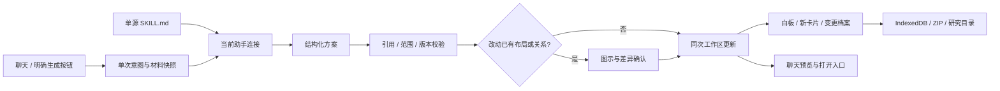

# 聊天驱动白板

日期：2026-10-19。对应 [issue #6](https://github.com/alovwang-sys/Read-paper/issues/6) 的可操作切片；本轮[验收记录](../verification/chat-board/README.md)。

## 用户与 Agent 的约定

2026-10-20 用户补充“生成后由人微调与决定顺序”，新增[人工调整设计](human-board-control.md)。人工布局受保护：AI 改动任一已有节点的位置或分组，都必须先预览并由用户应用。

聊天是入口。用户不必先打开白板，不必选择 Skill，也不必换 Agent。沿用当前 Codex、Claude Code、OpenCode 或模型连接及其设置。

| 用户行为 | 产品行为 |
| --- | --- |
| 普通提问，询问画图能力，转述、否定或条件性的画图描述 | 保持普通聊天，不新增白板 |
| 明确说“把刚才的讨论画成流程图”，或点击输入区“生成白板” | 使用当前对话和本轮显式材料，生成并保存新白板草稿；消息内展示关系图，不改变中央阅读位置 |
| 回答含多项步骤、依赖或比较，可能适合图示 | 显示一次轻量建议，说明用途，提供“生成关系图 / 暂不需要”；不自动生成、不弹窗 |
| 点击“打开白板” | 在主区打开结果，可以继续编辑和查看来源 |
| 点击“撤销创建” | 移除该板及未修改、未复用的新卡片；保留已编辑或被其他内容使用的卡片；聊天保留历史预览并可恢复 |
| 选择“修改已有白板”，或在板上点“让 Agent 整理” | 显示明确目标与材料范围，仅用于下一次提交；提交后消费目标，不把后续问答持续变成白板操作 |
| 修改已有板，涉及移出节点、替换或删除旧关系，或任一旧节点的位置/分组改变 | 先显示差异与只读图示，点击“确认应用此批变更”才写入 |

新建白板和仅摆放已有资源（保留旧标题、布局、位置、父级、顺序、分组与关系）在范围及版本校验后自动保存。已有图新增草稿卡也先确认。既有板没有明确目标时要求先选目标；不按当前主区或历史猜测覆盖对象。重新生成新板会新建独立结果；重新生成已有板的方案须重新选择原目标，以当前明确范围重取快照。

最新文字优先于先前选择的目标：明确“新建”时创建另一张板；否定操作、仅要求解释或校对时恢复普通聊天。显式点击生成按钮则按该按钮的创建意图执行。

空态展示自然语言示例；输入区保留轻量“生成白板”入口。结构性回答的建议使用保守本地规则，不额外请求模型，当前每个会话最多一次。忽略状态随会话保存。点击回答建议不会发送或清空尚未完成的输入。识别不能覆盖所有自然语言表达，未命中时用户可用显式按钮；它不代表模型理解了所有画图意图。

## 材料和实体

新建图以聊天历史、本轮显式证据为材料，不自动发送全库或整篇 PDF。新概念写成标准卡片，标记待核查，保存请求、对话、模型与原文快照。没有论文证据的卡片允许创建，但不伪造引用。卡片正文内 `[n]` 只对应该卡片的证据列表，所有引用都必须在提交范围内且资产 hash、页索引、摘录仍一致。

已有白板可选“白板上的资料”或“本研究资料和卡片”：卡片发送标题、正文和证据标识，论文发送标题；原文仍以“本轮材料”为准。最大 80 项资料/节点、160 条连线、60,000 字符请求快照。结果节点支持已有卡片/论文引用，或在新建／明确勾选“允许补充方法、计划和待验证问题草稿”时生成新卡片。该选项只用于下一次提交，重新生成重新读取所选授权与当前显式原文。

无全文资料合并继续沿用既有来源校验，并将历史快照中的该资料 ID 同步指向合并后保留的资料；布局和连线不变，冻结的 AI 请求材料不改写。仅资料 ID 归并不生成空的布局恢复版本。

卡片正文与白板摆放分离。移动、分组和移出只作用于 `placementId`；同一卡片在多个白板共享正文。现阶段不自动修改既有卡片正文，也不做合并或全库删除。

## 实现边界

规则文件只有一份：[papertrail-board/SKILL.md](../../skills/papertrail-board/SKILL.md)。模型直连经 raw import 使用，本机助手读取同一文件，桌面打包包含它。改规则后需重新构建/启动相应进程。Skill 负责表达方式，操作能力和权限边界由代码决定，不会因为提示词声称“能操作”就获得新权限。已有原生 Skill 选择保持独立，应用内规则不冒充安装到了厂商客户端。

模型输出 `BoardPlan` 的标题、节点、分组、关系和 `preserve / tree / groups / flow` 布局，不输出执行脚本或直接坐标。应用分配新卡片、摆放和连线 ID，确定性计算布局。层级方案的聊天预览显示可滚动的完整大纲、草稿标记和交叉关系，差异中可核对旧节点的父级与顺序；其他布局仍显示最多六个节点的关系概览。它们是只读预览。父子线来自摆放的 parentPlacementId，语义连线不参与层级排版。

连线 `label` 可省略或为空，统一保存为空文字连线；端点、引用和重复连线仍校验。已完成但解析失败的白板回答提供“重新解析白板”，只读取已保存的原始结果和冻结快照，不再次调用模型、不改写原回答，继续经过来源、版本及自动应用规则。错误单独显示为白板方案解析问题，不误标成引用失败。见[本地恢复验收](../verification/native-history-state/README.md)。

复用 `purpose: chat`、停止、重试、重新生成及现有会话。每轮绑定提交时的研究和材料，切研究后的结果仍归原会话。普通追问保留已生成图的节点与关系作为历史数据，不继承白板操作；白板规则只随明确操作的那一轮注入。

0.1.9 托管 Codex 聊天固定绑定原生线程。材料范围调整、资料内容变化、目标变化或退出白板操作都不会自动新建线程；重试与重新生成也在原线程新增回合。已送入原生线程的材料和历史不能撤回，需要排除旧内容时须明确新建对话。原生历史由 Codex 保留和压缩，普通追问不重复粘贴全部历史；页面重连时观察原回合，或核对原生历史后恢复有效白板提案，不自动重发问题。详见[原生连续对话设计](native-continuity.md)。

非托管的旧 Agent 通道仍按提交范围校验会话复用：材料范围缩小、资料内容变化、目标变化或白板操作结束时，服务端必要时新建同一助手的原生会话，避免继续携带旧范围。模型直连沿用显式材料与所选历史范围。生成失败或确认停止不创建空板；保存失败保留完成的方案，提供独立保存重试。

## 历史、撤销和恢复

共享 `updateData` 为人工与 Agent 的白板修改记录操作者、说明、请求 ID、before/after 完整快照和递增版本。新建白板及其卡片、引用和历史在同一工作区更新保存。重复应用或保存重试复用同一批实体，不产生重复板或历史。

应用前比较目标版本、布局快照与授权资料；过期结果拒绝覆盖。已有板的历史恢复只回滚布局、父级、顺序与关系，不回滚共享正文或 PDF。后续有修改时拒绝覆盖，可恢复为独立副本。恢复本身产生一条新记录。历史引用的已有卡片被移出研究后，要求先重新关联。

撤销创建仅在该板没有后续修改时执行，同时清理各研究会话中的打开项、历史入口、视口和选区。未修改、未复用的新卡片移入变更档案；已编辑、其他研究/白板/历史/文稿/草稿引用的卡片继续保留。恢复被撤销的创建时，仅重建缺失的同研究归档卡片，不覆盖仍存在的卡片，并再次校验引用来源。

schema 3 的新增字段可选。导入检查端点、父级归属、循环、顺序、版本、特殊键和卡片出处；ZIP 含历史与卡片档案。研究目录 `research.json` 仅导出当前研究的历史和依赖资料，已撤销卡片放在 `archivedCards`，不伪装成当前卡片。目录仍是单向归档，外部编辑不会自动回写应用。

## 范围与限制

本轮复用现有助手、共享实体和本地存储，没有新增多 Agent 编排、通用插件平台或 MCP 服务。它已能把新概念画成有卡片和关系的架构草稿；任意自由绘图、全知识库版本管理、跨窗口并发隔离仍未实现。完整快照未做压缩和保留策略，高频编辑会增加存储量；配额错误可见并保留待保存内容。

确定性管线与真实模型验收分开。先前两次真实 Codex 探针在 90 / 120 秒内未完成，详见[旧探针边界](../verification/board-agent/codex-probe.md)。2026-10-20 新增[综合生成实测](../verification/board-reasoning/README.md)：不设整轮截止，一次 Codex 请求在 167.561 秒完成 18 节点/27 连线；新建路径的内容、解析与引用范围通过，复杂展示未通过。该结果来自明确提示与合成材料，不代表普通短句、已有白板补新卡或任意复杂图均已通过。Claude Code / OpenCode 真实白板输出仍未验收；演示适配器、UI 截图和打包成功不能替代真实生成。

2026-10-20 后续[既有图真实扩展](../verification/research-map/ai-existing-map/content-review.json)已完成：一次自然短句请求保留 3 旧卡并新增 8 草稿；原文依据、建议与待验证条件分段说明，6 条语义关系使用待验证语气。生产解析和内容复核通过，页面回放与人工可控路径见[研究图验收](../verification/tree-board/README.md)。旧探针脚本也移除整轮硬截止，--self-check 不请求模型。
