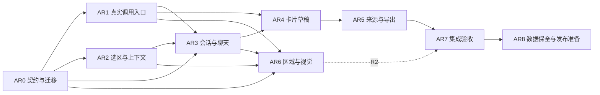

# AI 阅读与知识卡片开发计划

日期：2026-10-16（Asia/Shanghai）。本文件第 1–5 节保留开工前冻结的需求与任务规格，各条目不作为实时进度。文字闭环与区域问答核心路径已经实现；实际任务进度见[总清单](../agent-backlog.md)，运行结果、合同落地差异、截图和剩余项见[本轮验收记录](../verification/ai-reading/README.md)。

本计划把「选择论文内容 → 连续对话 → AI 整理知识点 → 修改并确认入库 → 回查论文与讨论」转成可派工的开发切片。范围、交互以[产品需求](requirements.md)和 [UX 设计](ux-design.md)为准；[交互原型](prototype.html)用于评审。沿用[现有产品规划](../product-plan.md)、[总开发清单](../agent-backlog.md)与 [AGENTS.md](../../AGENTS.md) 的统一工作台约束。

## 1. 基线、范围与交付顺序

### 1.1 已有工程基础

以下是代码现状，不是本计划新增功能的完成记录。

| 项目 | 当前事实 | 本次开发的增量 |
| --- | --- | --- |
| 技术栈 | React / TypeScript / Vite / PDF.js；已有三栏和单个右侧宿主 | 复用已有导航、阅读器和面板，不新建应用框架 |
| 选区 | PDF 文本层拖选，形成摘录与 0 起始页索引 | 操作菜单、明确的目标会话、区域选择另列 R2 |
| AI | `demoResponder`；`AIRequest` 保存一次问题、证据快照和演示回答 | 真实调用、多轮历史快照、流式、停止、严格重试语义 |
| 草稿 | 直接编辑或清空 `AIRequest.body`，整段另存卡片 | 冻结原始回答，独立 `CardDraft`，整条/片段整理及 AI 修订 |
| 来源 | `Card.evidenceIds` 可回论文；无对话来源 | 保存回答片段、问答、整理请求与原文证据的来源链 |
| 存储 | `WorkspaceData.schemaVersion: 1`；IndexedDB `papertrail` v1 的 `workspace` / `assets`；`papertrail-recovery-v1` 存整个工作区恢复缓冲 | 协同迁移 schema、恢复缓冲和图像资产；不把大图塞入 localStorage |
| 导出 | 结论 Markdown 含文献信息、页码和摘录，未附 PDF | 保留卡片对话来源文本快照，准确说明图像与 PDF 的导出边界 |

现有实现与历史验证见[验证记录](../verification/README.md)。其中 AI 成功与失败用例使用演示或测试适配器，不能作为真实供应商验证证据。

### 1.2 分期与放行条件

| 阶段 | 包含任务 | 可对用户提供的行为 | 放行条件 |
| --- | --- | --- | --- |
| R1：文字闭环 | AR0–AR5、AR7 的 R1 用例、AR8 的 R1 准备 | 文字证据、多轮流式对话、历史、卡片草稿、双来源、文本导出 | 确定性验收通过；已配置的真实模型完成文字多轮、停止与卡片生成冒烟；无配置时只开放清楚标注的演示模式 |
| R2：区域阅读 | AR6、AR7 的 R2 用例、AR8 的 R2 准备 | 框选图表、公式、扫描页，预览后向图像模型提问 | 坐标/裁图/刷新恢复验收通过；真实图像模型冒烟通过；说明 OCR 与复杂语义提取边界 |

R1 覆盖有文本层 PDF 的文字选择主需求，不宣称任意框选已支持。R2 是后续规划，独立排期，不是本次 R1 的必做承诺或放行条件；可在 AR0 契约和 AR1 图像能力接口稳定后准备，合入前须对 R1 回归。完整 OCR、整篇自动上传、检索库、多人协作、通用消息分支平台和产品内多 agent 编排不在本计划中。

真实模型冒烟是 R1 完成的必要条件。只有演示适配器时，最多交付“演示预览已验证”，不能将 R1 标为已完成或真实 AI 已通过。

### 1.3 依赖图

AR1、AR2、AR3 的隔离界面可在 AR0 后基于同一 fixture 并行；真实集成以依赖通过为准。AR5 的导出测试与来源视图骨架可在 AR4 期间基于 fixture 并行。共享文件由集成负责人串行合入，不能让各执行者分别改一套契约。

### 1.4 需求到开发的追踪

| 需求 | 主交付任务 | 集成验证 |
| --- | --- | --- |
| PR01 选择材料并提问 | AR2；后续区域由 AR6 承担 | V03、V17；R2 的 V19 |
| PR02 连续聊天与阅读 | AR1、AR3 | V04–V07、V18 |
| PR03 历史会话 | AR0、AR3、AR5 | V13、V15 |
| PR04 整理知识卡片 | AR1、AR4 | V11、V18 |
| PR05 编辑并确认 | AR0、AR4 | V11、V12 |
| PR06 双重来源 | AR0、AR5；后续区域由 AR6 承担 | V10、V13、V14；R2 的 V21 |
| PR07 保存恢复与隔离 | AR0、AR3、AR4 | V01、V02、V05、V08、V12、V15 |
| PR08 真实模型与可靠性 | AR1、AR3、AR8 | V04–V10、V18、V22 |
| PR09 区域框选（后续） | AR6 | V19–V21 |
| PR10 来源生命周期与导出 | AR0、AR5、AR8 | V01、V13、V16；R2 的 V21 |

AR7 汇总上述验证；AR8 记录对应阶段实际放行情况，不用新增文档替代功能验收。

## 2. 开工前冻结的合同

以下是待落地的接口草案，由 AR0 集成负责人统一确定最终名称与类型。

| 合同 | 最小约定 |
| --- | --- |
| 问答 | 继续用 `AIRequest` 表达一次问答 turn，记录研究、会话、问题、提交时间、用途、模型信息和发送快照；无需另建通用消息/分支平台 |
| 发送快照 | 保存显式证据、实际发送的历史消息正文/引用快照、当前问题和配置版本；`allowedEvidenceIds` 由实际发送材料推导，不能把未发送的历史元数据当可引用材料 |
| 历史范围 | 提交前清楚显示本次将发送的历史轮次与证据；容量超限时要求用户缩小范围，不静默截断。移除当前证据不会擦去旧消息中的原文；提供新会话以开始更干净的范围 |
| 回答不可变 | 流式中只追加本次输出；完成、停止或中断后冻结原始正文。用户编辑只改 `CardDraft`。重试/重新生成创建新 `requestId`，保留原记录与关联字段 |
| 重试与重生成 | 失败重试复制原问题、原证据和原历史快照；重新生成只对最新一轮开放，按用户当前可见范围建立新快照；新完成版进入后续默认历史，旧版与已有卡片的引用保持稳定。两者在 UI 中区分；来源失效不能悄悄换材料重试 |
| 请求状态 | 至少区分 queued / streaming / completed / stopped / interrupted / failed；传输完成后经结构校验才可成为完整可引用回答。停止/断网/刷新保留已持久化的部分，不能伪装 completed |
| 卡片草稿 | `CardDraft` 与结论 `Draft`、原始问答分别存储；记录所属研究、原问答、选择快照、生成与修订请求、标题正文、引用、保存状态、确认入库结果 |
| 卡片来源 | `Card.provenance` 至少保留原研究 ID、会话 ID、原问答 ID、回答选择快照与 hash、整理生成请求 ID、后续 AI 修订请求 ID、证据快照；来源独立于用户之后修改的卡片正文 |
| 来源边界 | 论文依据用于核查原文，对话来源用于回顾解释。无论文证据也可整理卡片，默认标记「仅对话来源 / 待核查」；不能伪造论文引用 |
| 引用校验 | 检查 ID 属于本次实际上下文、原文实体/资产/版本存在、页索引有效、正文编号能映射；这是结构和来源完整性校验，不承诺语义正确 |
| 确认入库 | `commitCardDraft(draftId, submissionKey)` 返回同一 `cardId`；连续点击、超时后重试和刷新后重试不能重复建卡，不覆盖已有卡，不自动加白板或结论 |
| 生命周期 | 会话可归档并恢复；已被卡片引用的问答及来源快照不得随归档或移出研究删除。跨研究复用卡片时，论文照现有服务关联，聊天来源仍指向原研究与原会话 |
| 本地保存 | 对话、卡片草稿、活动会话、输入、滚动锚点按研究/会话恢复；使用 dirty / saving / saved / error。请求身份绑定提交时对象，不读取回调时的当前研究 |

## 3. 可派工任务

每份派工必须附上本节对应任务和以下共同约束：**你不是唯一在修改代码的人。保留并适配其他人的改动；公共契约需要变化时交集成负责人统一落地。** 所列新增文件是建议位置，实施者先检查实际目录；文件拆分服务已存在的需要。

### AR0 共享契约、来源模型与数据迁移

**原始任务规格。** 负责人：集成负责人。依赖：无；这是其余实现的接口门槛。关联：PR02–PR10。

**目标用户行为：** 原有论文、卡片、研究和输入升级后保留；新对话和卡片来源能够完整恢复。

**负责文件：** `src/domain/types.ts`、`src/domain/citations.ts`、`src/services/workspace.ts`、`src/data/storage.ts`、`src/data/seed.ts`；建议新增 `src/data/migrations.ts`、`tests/unit/migrations.test.ts`。公共文件由本任务独占，其他任务提交修改建议。禁止顺带重构白板、阅读器或改模型 UI。

**接口草案：** `migrateWorkspace(raw, recovery?) → {data, migrationReport}`；`createConversation(researchId) → conversationId`；`selectConversation(researchId, conversationId)`；`captureSendSnapshot(...) → SendSnapshot`；`saveCardDraft(...)`；`commitCardDraft(draftId, submissionKey) → {cardId, created}`；`resolveCardProvenance(cardId) → 原始所属研究与定位信息`。

子任务：

- 增加新 schema 版本与运行时校验；定义最小 `CardDraft`、来源、请求状态、会话列表/活动项/滚动锚点、文本/区域证据兼容类型。旧 `Card` 默认为人工或来源未知，不臆测 AI 来源。
- 同时定义结论使用卡片时的来源记录，保存 cardId 及插入时来源快照；卡片后续修改不能改写结论已使用的出处。AR5 使用此合同完成来源传递，避免导出时仅按当前 cardId 反推历史。
- 迁移 `schemaVersion: 1`；原 `conversation-${researchId}` 保留原 ID 并登记进该研究历史。旧请求标记 `legacy` / 演示来源；现存 `body` 可能曾被编辑或清空，不能声称恢复了原始模型回答。
- 新旧 IndexedDB 记录与 `papertrail-recovery-v1` 同时存在时，先选出可恢复输入并迁移，再在持久化事务成功后移除旧缓冲；不能先删除缓冲或以样例覆盖。v1 缓冲没有修订号，首次迁移沿用其有效缓冲优先的既有恢复规则；增加新的恢复格式版本/修订号，避免旧缓冲覆盖已成功迁移的新数据。
- 迁移前保留可恢复副本；迁移失败、未知未来版本、损坏的旧缓冲都禁止自动写回。提供原因、重试与工程恢复路径，保留原始数据；未知版本沿用现有拒绝覆盖行为。
- 决定 IDB 是否升版本以及新增 store；业务 schema 与 IDB 版本分别处理。图像 Blob 存 `assets` 或专用 IDB store，工作区只留资产 ID、hash、尺寸、mime 和区域元数据。
- 为流式输出提供内存合并与有限频率的 IDB 检查点，避免每个 token 都 `structuredClone` 全工作区并同步写 localStorage。小型输入/草稿恢复可继续使用有界缓冲；大图、完整二进制和无限增长聊天不得进入 localStorage。
- 明确“已保存”的耐久边界：只有本次提交已落 IDB 才显示已保存；刷新时最多恢复到最近检查点，剩余内容标中断，不假装全部已保存。完成/停止/失败时尽快写终态。
- 实现幂等建卡及卡片/研究/论文关联的原子性；来源带原研究身份，跨研究共享卡不复制聊天或改写原会话。

**可验证 AC：** 带旧恢复缓冲的 v1 样例可迁移两次且结果一致；论文资产/hash、卡片正文、布局、未发送输入完整；注入迁移写失败后原记录与缓冲仍在；未知版本无覆盖；已完成回答不能被草稿编辑动作改写；同一 `submissionKey` 连续/并发提交仅一张卡。

**风险与产物：** 当前恢复缓冲优先于 IDB，不能仅改类型就升级。产物为 schema 说明、v1/损坏/未来版本 fixture、迁移报告、失败恢复说明与测试，不是一次重置种子数据。

### AR1 供应商选型、受控模型调用与流式协议

**原始任务规格。** 负责人：集成负责人或指定 AI 服务执行者。依赖：AR0；供应商与配置验证是本任务研发前置，无需先确定品牌才能开展其他任务。关联：PR02、PR04、PR08、PR09。

**目标用户行为：** 配置真实模型后可发送并逐步看到回答；无配置、认证失败、超时、停止均有准确状态。

**负责文件：** `src/services/ai.ts`；建议 `src/services/aiTransport.ts`、`server/ai/*`、`tests/unit/ai.test.ts`。依赖、`package.json`、Vite proxy、环境模板、README 由集成负责人按最终方案修改。禁止执行者直接改 schema、应用宿主或把密钥写进浏览器。

**接口草案：** `getModelCapabilities() → {text, images, limits, configured}`；`runAI({requestId, purpose, snapshot}, {signal, onEvent}) → Promise<TerminalResult>`；事件为 `started / textDelta / citations / completed / failed`，携带 requestId 与单调 seq；`cancelRequest(requestId)`。

子任务：

- R1 用固定文字样例做供应商小实验，记录实际可用的流式、取消、结构化引用、费用计量与配置方式；只依赖官方接口资料，最终选择写 ADR，不在计划中捏造供应商能力。图像试验与限额是 AR6 的 R2 前置工作，R1 允许 `images:false`，不要求所选文字模型具备图像能力。
- R1 推荐最小本地 HTTP 服务作为浏览器到供应商的出口，默认监听 `127.0.0.1`，Vite 开发代理和生产运行共用同一应用 API 路径，例如 `/api/ai/*`。不是让浏览器直接携密钥访问供应商；若以后部署，替换为同合同的受认证后端。
- API key 仅由本地服务/后端环境变量读取，不进入 `VITE_*`、IndexedDB、localStorage、请求快照、导出或前端日志。浏览器只查询连接状态和可用模型；服务固定供应商目标，不接受任意用户 URL，限制 origin、请求尺寸、超时与并发。
- 确定传输采用 fetch 流式（SSE 或 NDJSON，择一）并约定增量、终态、错误码和结束帧。适配供应商事件，只暴露应用合同；保留独立 `demoResponder`，模式明示。
- 将问题、显式证据、已展示历史快照送入模型；发送前做容量检查，保留当前 4,000 字符问题、16 条 / 24,000 字符证据限制作为起点，另加历史与总 token/输出预算，不能把字数当供应商 token 数。边界与边界加一均需测试。
- 处理停止与完成竞态：先落本地终态，abort 到服务和供应商；终态后忽略迟到 chunk/完成帧，单个请求只能确认一个终态。客户端取消不保证供应商已产生费用全部撤销。
- 失败重试以新 requestId 复用原快照；重生成仅限最新一轮，以新快照和 `regeneratedFrom` 保存。最新成功版本进入后续默认历史；失败/停止/中断版本不进入默认历史，旧版仍可回看和被卡片引用。`retryOf` / `regeneratedFrom` 不把旧正文改为新正文。
- 请求分用途支持聊天、卡片整理和草稿修订；卡片生成必须返回受校验的标题、正文、引用 ID。模型配置缺失、401/403、429、超时、网络断流、非法输出分别可恢复，重试不自动改变模型或范围。
- 恶意 PDF 内容视为资料；不赋予模型文件操作、任意网络或工具权限。Markdown/公式渲染不执行模型 HTML/脚本。保留结构引用校验，不能以 prompt 代替代码校验。

**可验证 AC：** 真实文字回答有逐步输出；第二轮确实收到第一轮选定历史；无配置不发送网络请求；认证失败保留问题与材料；停止后迟到完成不变 completed；断流保存 partial；在研究 A 运行时切 B，结果只写 A；密钥不出现在前端构建产物与存储；非法范围引用不能生成可保存卡片。

**风险与产物：** 本地服务新增了运行依赖；须交付实际启动命令、环境模板、错误码合同、adapter 测试和脱敏真实冒烟记录。后续可能新增 npm 脚本，本项目目前没有这些服务脚本，不能提前宣称可运行。

### AR2 PDF 文字选区与显式上下文

**原始任务规格。** 负责人：阅读执行者。依赖：AR0；可与 AR1 并行。关联：PR01、PR07、PR08。

**目标用户行为：** 拖选论文文字后选择「向 AI 提问」或「加入当前会话」，看清来源和将发送的范围，再输入问题。

**负责文件：** `src/features/reader/PdfReader.tsx`、`reader.css`、`src/features/evidence/EvidenceList.tsx`；建议相关 reader/context 测试。禁止直接改 `types.ts`、`workspace.ts`、`storage.ts`、`App.tsx`、全局设计变量和依赖。

**接口草案：** 沿用 `setSelection`；`createEvidence({documentId, pageIndex, quote, ...anchor}) → evidenceId`；`addContext({researchId, conversationId, evidenceIds})`；从全局资料使用明确的“加入当前研究并用于对话”共享动作。

子任务：

- 在现有文本层捕获选区，保留文档 ID、hash、页索引、摘录和可选定位信息；文本摘录是回退定位依据。选择新文字不自动扩大 AI 范围。
- 按 UX 完成“解释这段”“向 AI 提问”“加入当前对话”“创建卡片”的邻近操作菜单、目标会话指示和已加入反馈。“解释这段”展示默认问题后快捷发送，首次外部模型发送先完成范围说明/连接设置；其他问答动作先放入输入区。人工创建卡片沿用现有入口。
- 新增证据和加入会话采用共享服务，失败时保留选中文字；不能把快捷发送误实现为任何选区变动都自动发送。
- 上下文卡展示文献、PDF 第几页、摘录预览，支持移除/查看；不把印刷页码和 PDF 页码混用。
- 不再写死 `conversation-${researchId}`；使用当前研究的活动会话。没有活动会话时按合同创建，不能把 A 的选区送到 B。
- 原文缺失、无文本层、文本提取失败、超长、跨页面/跨视图无效选区显示原因与可操作替代；当前 8,000 字符选区上限保留并验证边界，不能绕过总上下文限制。R1 的扫描件仍可阅读，区域入口按 R2 可用状态展示。
- 处理工具条点击导致 DOM 选区消失、面板切换、阅读器重绘、PDF 缩放与键盘选择；选区作用域绑定 viewInstanceId。

**可验证 AC：** 同一篇文本 PDF 在主区/右侧选区互不串用；双栏样例摘录准确；未点加入不发送；A 选区后切 B 不误加；刷新后已加入证据仍在；移除证据时提示旧历史消息仍可能含其内容并可新建会话。完成 1440×900、1280×800、1024px 的实际选区截图。

**风险与产物：** 当前阅读器每次选择仅覆盖当前页；R1 不暗示跨页矩形/跨页选择。产物为可点击路径、选区/上下文状态截图和正确页码/摘录 fixture。

### AR3 会话历史与多轮聊天交互

**原始任务规格。** 负责人：AI 前端执行者。依赖：AR0；基于测试 transport 可提前开发，真实集成依赖 AR1、AR2。关联：PR02、PR03、PR07、PR08。

**目标用户行为：** 新建或继续研究内会话，连续追问、停止、重试、查看历史，并从完整回答中选择知识点。

**负责文件：** `src/features/ai/AIPanel.tsx`；建议 `ConversationList.tsx`、`ChatMessage.tsx`、`AnswerSelectionMenu.tsx`、AI 局部样式。`src/shell/App.tsx` 与全局样式接入由集成负责人修改，执行者禁止自建第二右栏、路由或全局 store。

**接口草案：** `create/select/rename/archiveConversation(...)`；`submitChat({researchId, conversationId, prompt, historyRange, evidenceIds}) → requestId`；`retryRequest(id)`、`regenerateRequest(id, currentRange)`、`stopRequest(id)`；`selectAnswer({requestId, text, range?, answerHash}) → AnswerSelectionSnapshot`。

子任务：

- 把静态可编辑 textarea 回答改为用户/AI 消息；支持 Markdown、代码、列表、公式、引用、复制、整条整理、选段整理。选择显示文本时保存对应原回答的文本快照与 hash，不能把另一条回答误当来源。
- 输入区支持中文 IME、Enter 换行 / Ctrl或⌘+Enter 发送及明确按钮，组合输入时不发送且提示快捷键；生成中允许编辑下一条输入；首版每会话只运行一个聊天请求，同会话重复发送幂等或禁用。
- 显示逐步输出、停止、失败、部分回答、引用校验失败；未完成、停止、断流输出不显示“完整答案整理入卡”入口。允许复制 partial，但必须保留不完整标记。
- 引用无效时原始回答保持只读，提供修复来源后重试；用户也可复制至保留对话来源的人工卡片草稿，明确移除失效引用后作为“仅对话来源 · 待核查”保存，避免禁用 AI 整理后没有可用修复入口。
- 发送前的上下文区域同时说明显式证据和历史轮次；无论文证据的普通追问允许发送并标明“无论文依据”。容量超限要让用户选择历史范围或新会话，禁止静默丢历史。
- 实现研究内历史列表、新建、重命名、查找、归档/恢复、空历史；默认名来自首个问题，列表显示更新时间和关联论文，归档不得删来源。当前选择、未发送输入和滚动锚点按研究/会话恢复。
- 跟随输出仅在用户接近底部时生效；主动向上阅读时显示“新内容”跳转；刷新/切会话恢复原锚点，定位来源消息时高亮但不覆盖原滚动记录。
- 同会话的 retry/regenerate 版本能回看并明确当前显示记录；重新生成只限最新一轮，较早问答可复制到新会话，不展开复杂分支树。后续默认历史使用最新完成版；失败/停止/中断不进入默认历史；已有卡片继续指向创建时版本。
- 使用单右侧宿主的返回记录在聊天、卡片草稿、原文来源间切换；主区保持阅读位置；1024px 用既有抽屉并管理焦点。

**可验证 AC：** 测试 transport 断言第二轮 payload 含实际历史；历史输入与选中会话经过 A→B→A 和刷新仍恢复；向上滚动不被新 token 拉回；中文输入确认不误发；停止后禁止整理 partial；已归档来源仍可从卡片打开；键盘可到达消息操作且窄屏无横向溢出。

**风险与产物：** 聊天 Markdown 选择不是原始 Markdown 字节范围；以冻结文本快照保证可查，精确高亮失败时仍定位整条回答并展示所选摘录。产物为聊天状态截图、历史与滚动恢复 E2E、真实多轮调用证据。

### AR4 知识点整理、独立草稿与确认入库

**原始任务规格。** 负责人：卡片执行者。依赖：AR0、AR1、AR3；卡片表单可基于 fixture 并行。关联：PR04、PR05、PR06、PR07。

**目标用户行为：** 对完整回答或一段知识点点击“整理为卡片”，让 AI 生成标题正文，手动修改或要求 AI 修订，再确认加入当前研究卡片。

**负责文件：** 建议 `src/features/cards/CardDraftEditor.tsx`、相关卡片局部样式、`tests/unit/cardDraft.test.ts`；原 `CardEditor.tsx` 仅必要接入。草稿/幂等服务由 AR0 负责人维护，禁止直接编辑原始请求或在 UI 中复制保存逻辑。

**接口草案：** `createCardDraft({researchId, conversationId, sourceRequestId, answerSelection}) → draftId`；`generateCardDraft(draftId) → generationRequestId`；`reviseCardDraft({draftId, instruction, baseRevision}) → revisionRequestId`；`updateCardDraft(...)`；`commitCardDraft(draftId, submissionKey) → cardId`。

子任务：

- 单次生成一张可编辑知识卡片，生成标题、核心观点/解释/条件和保留来源；禁止把整段聊天无整理地当成唯一结果，也不默认生成多张批量卡。
- 冻结所选回答快照与原问答 ID；生成/修订调用另存请求 ID，输入只含用户选择内容、允许的必要证据和明确展示的草稿，不自动附整篇论文或全研究库。
- 草稿状态覆盖生成中、可编辑、AI 修订中、失败、待保存、保存失败、已入库；手动编辑不改原回答，放弃草稿也不清空聊天。
- AI 修订以当前草稿 revision 为基准，结果始终先展示候选预览，由用户点击“应用修改”后生效；用户在等待期间继续编辑时标“基于较早版本”，允许比较或重新生成，不能覆盖较新的手动内容；保留修订前内容用于撤销本次应用。
- 重新整理整条或片段不覆盖已保存卡片；用户确认前只在草稿区。返回聊天、换面板、切研究、刷新都恢复未确认草稿。
- 确认时校验标题/正文非空、来源与正文编号；无论文依据可保存但显式“仅对话来源/待核查”。用户解除“待核查”不自动移除“仅对话来源”。非法或已失效引用不能冒充完整论文引用入库，提供修复或明确移除失效引用的编辑流程。
- 确认保存使用持久化提交键；保存失败保留草稿，重试返回同一 cardId；成功显示“查看卡片”，不自动加白板/结论。

**可验证 AC：** 编辑、AI 修订、放弃草稿后原问答 hash 不变；选一段生成的来源快照只记录这段及对应问答；修订中手改不被覆盖；双击/网络或存储错误后重试/刷新后再确认只产生一张卡；保存卡片拥有原文与聊天来源，无证据卡有正确标识。

**风险与产物：** 不能复用结论 `Draft` 存卡片草稿；用户改正文后来源快照仍应保留其生成过程而不承诺修改内容都受原论文支持。产物为草稿全过程、幂等/冲突测试、保存前后来源数据样例和截图。

### AR5 双重来源、会话回查与 Markdown 来源链

**原始任务规格。** 负责人：来源/导出执行者。依赖：AR0、AR3、AR4；导出 fixture 可提前并行。关联：PR03、PR06、PR10。

**目标用户行为：** 打开卡片，分别核对论文原文和当时对话；在其他研究复用后仍能找到原讨论；导出不丢来源链。

**负责文件：** `src/features/cards/CardEditor.tsx`、`src/features/evidence/EvidenceList.tsx` 的来源展示、`src/features/export/exportMarkdown.ts`、`src/features/writing/WritingView.tsx` 的来源传递、`tests/unit/export.test.ts`。其中与 AR2/AR4 重叠的文件按主负责人串行集成；公共导航、资源锚点与引用映射由集成负责人改。

**接口草案：** `resolveProvenance(cardId) → {paperSources, conversationSources, issues}`；`openConversationSource({originResearchId, conversationId, requestId, selectionSnapshot}, target)`；扩充结论的结构化卡片来源引用或等价关联，供 `exportMarkdown` 查询来源链，不能只复制卡片正文和 evidenceIds。

子任务：

- 卡片来源区分别展示“论文依据”和“相关对话”：文献/页码/摘录、会话/问题/原回答选择/生成时间与模型（如有）、整理/修订记录；区分 legacy、仅对话来源和来源缺失。
- 对话入口定位原 requestId 并高亮选择快照；正文定位不一致时展示冻结摘录和原回答，不能跳到另一条记录。论文入口复用阅读器页码/摘录/区域锚点。
- 来源在当前单右宿主显示只读原研究会话信息；继续聊天才明确切到原研究会话，不把原聊天迁入当前研究。主区不被右侧回查替换，返回草稿/卡片保留位置。
- 卡片在研究 B 被复用时，论文按现有 `linkCard` 规则关联 B；聊天仍以 originResearchId 指向研究 A，显示出处；A 会话归档或卡片移出 A 后仍可查快照。
- 对话/原文实体缺失时保留可读快照、显示缺失原因与修复入口；原 PDF 不在时可读保存摘录，不宣称已核查当前文件；新模型请求仍应按 AR1 的来源可用策略阻止或明确重选。
- 结论插入卡片时保存卡片 ID 与使用时来源快照，卡片之后编辑不改变已插入结论的出处；Markdown 增加去重的“相关对话来源”附录，包含原问题、选中回答快照、会话/请求/卡片标识、时间与可用模型信息；必要时包含整理来源记录，导出顺序可重复且引用编号正确。
- 导出说明本地跳转 ID 在独立文件中不是可打开的云链接；正文和附录应能离线阅读。R1 不附 PDF；R2 纯 Markdown 只含区域元数据/文字说明，不暗示图像已包含。若图像导致离线不可核查，明确列出未附资产和本地原件要求。

**可验证 AC：** 从研究 B 卡片打开 A 对话不丢 B 工作位置；归档后仍能查原问答；缺失会话也能展示冻结摘录并标缺失；原文缺失不跳错页；结论插入两张共享同源卡，导出来源去重且可区分知识点；导出文件同时含论文依据和对话快照，不含密钥/整篇未选原文。

**风险与产物：** 现有结论只保存 evidenceIds，若不增加卡片来源关联，导出阶段无法再反推来源；必须在本任务完成数据合同补充后才放行 R1。产物为来源面板、实际下载 Markdown 与校验测试、生命周期说明和截图。

### AR6 矩形区域、图像证据与视觉问答（R2）

**原始任务规格。** 负责人：阅读执行者与 AI 服务执行者，集成负责人负责共享类型。依赖：AR0、AR1、AR2、AR3；R1 稳定后合入。关联：PR01、PR06、PR08、PR09、PR10。

**目标用户行为：** 在图表、公式或扫描页拖框，先看裁图与来源，再发送给支持图像的模型，并沿用相同卡片流程。

**负责文件：** `src/features/reader/PdfReader.tsx`、`reader.css`、`src/services/pdf.ts`、图像 transport adapter 与对应测试；公共类型、IDB、依赖和界面接入分别由集成负责人合入。禁止另做上传整篇 PDF 的隐式后门。

**接口草案：** `captureRegion({documentId, pageIndex, normalizedRect, rotation}) → {assetId, hash, dimensions, sourceAnchor}`；`createRegionEvidence(...) → evidenceId`；`renderRegionPreview(...)`；`runAI` 复用 snapshot 的 image 引用，服务按能力/尺寸校验。

子任务：

- 文本/区域工具明确切换；单页拖框、调整/取消、预览、添加到当前会话；不以 OCR 已就绪作为阅读前提。
- 以 PDF 页内规范坐标存区域并保留旋转/裁剪信息；按所选区域重新渲染裁图，不截取工具栏或其他文档；缩放、设备像素比与页面旋转后定位一致。
- 图像 Blob 与稳定 hash 存 IDB，快照仅引用资产并保存来源文档 hash、页索引、区域和必要说明；区分原始区域图与可选人工/OCR 描述。
- 图像尺寸/像素/字节数/数量在预览与服务端共同限额；具体阈值由本任务图像能力试验确定，超限给调整入口。模型不支持图像时阻止发送并保留已选区域。
- 在 R2 开始时补做图像供应商能力试验，确定前项限额；可以沿用或补充一个图像模型，不改变已经通过的 R1 文字模型合同。
- 区域图是可追踪的证据资产，可无文字摘录；修改现有“quote 不能为空”的验证为按证据类型校验，不能填假文字绕过。
- 在卡片、聊天来源和导出中复用双来源；资产缺失、PDF hash 不匹配、裁图失败和存储配额失败有恢复说明。删除临时预览不删除已被请求/卡片引用资产。
- 图像模型只解释所选图片与明确历史，不自动 OCR 全文、不承诺复杂表格数值和公式推导正确；用户编辑后仍保留区域快照。

**可验证 AC：** 正常/旋转/缩放/高 DPI 页面裁图与框内内容一致；扫描样例无文本也能问图像模型；刷新后区域与图片还在；移动选框或改页面不改变已经发送的快照；图片过大/资产缺失/图像能力关闭均不误发；区域卡可回原页定位；Markdown 准确列出未附图像/PDF。

**风险与产物：** 图片比文字占空间且可能产生较高费用，容量与降采样只能在用户可见范围内处理；避免大图恢复缓冲阻塞主线程。产物为图像测试 PDF、裁图坐标测试、真实图像调用脱敏记录与区域闭环截图。

### AR7 集成、真实调用与体验验收

**原始任务规格。** 负责人：主集成负责人 + 独立验收者。依赖：R1 为 AR0–AR5；R2 再加 AR6。关联：PR01–PR10。

**目标用户行为：** 在统一工作台内完成完整路径，并在失败、切换研究和刷新后继续工作。

**负责文件：** `tests/unit/*`、`tests/e2e/*`、`docs/verification/ai-reading/*`；仅为发现的确定缺陷修改责任模块，公共改动由集成负责人执行。禁止为通过验收将真实调用换成无标签演示、把失败状态改成成功，或用参考截图充当产品证据。

**接口输入输出：** 使用 AR0 fixture、AR1 可控事件 transport 与真实已配置服务；输出验收矩阵结果、失败复现、实际截图、下载文件和脱敏请求记录。

子任务：

- 对照下节验收矩阵逐项执行；用可控 transport 精确注入乱序终态、迟到 chunk、断流、认证失败、非法引用等情况。
- 完整路径：文字选区 → 两轮问答 → 选回答片段 → AI 整理/人工改/AI 修订 → 确认 → 刷新 → 双来源回查 → 跨研究复用 → 插入结论 → 下载 Markdown。
- 三种组合均回归：主区 PDF＋右侧卡片/草稿；主区白板＋右侧原文；主区结论＋右侧 AI。检查返回、面板切换、主区位置、保存失败和未保存编辑。
- 1440×900、1280×800 实际页面点击与截图；1024px 复用折叠/抽屉，检查焦点、选区菜单与输入按钮可达、无横向溢出。包含空/加载/失败/有内容状态。
- 真实文字多轮、卡片生成与停止独立冒烟；R2 再跑图像。记录模型、日期、配置方式、用例、请求标识和结果，不记录密钥。没有配置时记为未验证，不能标 R1/R2 的真实 AI 验收通过。
- 新建一个实际使用量 fixture，例如每研究 10 个会话、每会话 50 轮、20 张草稿、数百条证据；记录存储量、会话切换、长回答渲染、输入延迟与检查点行为。先测现有路线，超出基线才增加分页/虚拟化，不先建通用性能平台。
- 验证模型输出含 HTML、代码链接和恶意资料指令时不会执行脚本或扩大请求范围；校验报错不丢回答，提供安全重试/编辑路径。

**可验证 AC：** 矩阵 P0 场景全部通过；没有重复建卡、跨研究写错、原始回答被编辑、来源丢失或静默截断；现有人工阅读/白板/导出路径回归通过；实际证据齐全。性能测量采用固定设备/浏览器与数据量记录，不把未测数字当承诺。

**风险与产物：** 确定性测试只能证明应用合同，真实冒烟只能证明记录条件下的供应商连通和实际行为，两者都需要。产物单独记录完成项、模拟项、未运行项和遗留问题。

### AR8 数据保全、运行说明与发布准备

**原始任务规格。** 负责人：集成负责人。依赖：对应阶段 AR7 通过；不自动授权发布外部系统。关联：PR07、PR08、PR10。

**目标用户行为：** 知道数据保存在哪、连接如何配置、失败如何恢复，以及导出能保留什么。

**负责文件：** README、环境模板、供应商/运行 ADR、迁移恢复说明、`docs/verification/ai-reading/*`；必要的恢复辅助脚本与测试由集成负责人控制。禁止把工程迁移副本宣称为现成的用户跨浏览器备份功能。

**接口输入输出：** 输入是迁移报告、资产引用清单、阶段验收记录和实际服务脚本；输出可复现启动/构建/验证步骤、数据边界、脱敏运行记录和工程恢复步骤。

子任务：

- 写清前端与本地 AI 服务的真实安装/启动/生产运行命令、环境变量、支持模型、演示与真实模式切换；从 `package.json` 的最终配置抄录，不杜撰未建立脚本。
- 迁移前副本与恢复辅助工具包含版本、工作区、所需资产 ID/hash 清单，做一次失败恢复演练；说明单独 JSON 若不带资产就不能恢复原 PDF/区域图片。
- 明确浏览器本地数据边界：清除站点数据或换浏览器可能失去资料；Markdown 是可读研究产出，不是完整备份。用户级完整导出/导入包若尚未实现，明确列为后续，不能把外部 URL/本地 ID 伪装可迁移资产。
- 检查归档、移出研究、草稿放弃、来源引用与资产清理规则；有来源引用的快照不能清理；暂不实现通用自动 GC，先保留并记录容量。
- 整理已验证/未验证供应商与浏览器范围、已知问题、数据迁移说明；同步总规划和总清单的实际状态，只有带证据的功能标完成。

**可验证 AC：** 新开发者按 README 能启动真实或明确演示模式；密钥未出现在代码、构建、导出和快照；迁移失败恢复演练成功且资产 hash 核对；R1/R2 范围、未附资产和备份边界与真实能力一致。

**风险与产物：** 本任务不新增同步、云备份或通用运维平台；数据可恢复是工程交付条件，完整可迁移用户备份是单独产品能力。产物是可复现运行手册、恢复演练记录和阶段放行清单。

## 4. 验收矩阵

所有场景状态均为**待开发 / 待验证**。P0 是所属阶段放行阻断项；R2 项不阻断 R1。

| 编号 / 级别 | 场景与操作 | 关键断言 | 主要任务 / 验证方式 |
| --- | --- | --- | --- |
| V01 / P0 R1 | v1 工作区同时有 IDB 与旧恢复缓冲后升级 | 恢复最新可用编辑；迁移幂等；legacy 标识正确；无资料丢失 | AR0；迁移单测＋真实 IDB E2E |
| V02 / P0 R1 | 损坏、未知未来版本、迁移写失败 | 原始数据不被样例/空数据覆盖，旧缓冲不先删除，可重试 | AR0、AR8；故障注入 |
| V03 / P0 R1 | 文字选区、加入会话、换选区再发送 | 请求仅含明确范围，页索引正确；换选区不自动添加 | AR2；阅读器 E2E＋payload 断言 |
| V04 / P0 R1 | 第二轮追问，移除证据但保留老消息 | 实际发送的历史可查；历史内原文仍明确；新会话能移除旧历史 | AR1、AR3；transport 单测＋E2E |
| V05 / P0 R1 | 生成时 A→B，A 迟到完成/失败 | 只更新 A 原会话；B 输入和消息不变；回 A 可查 | AR1、AR3；竞态单测＋E2E |
| V06 / P0 R1 | 停止与完成竞争、终态后迟到 chunk | 只有一个终态，不转回 completed；部分输出保留且不能当完整答案入卡 | AR1、AR3；可控事件序列测试 |
| V07 / P0 R1 | 失败后改当前范围，再点“重试”或“重新生成” | 重试同原快照；最新轮重生成新快照；较早轮无重生成；新 requestId；新成功版进入默认历史，旧卡仍指旧版 | AR1、AR3；快照深比对＋E2E |
| V08 / P0 R1 | 流式中断、刷新；IDB 写失败/恢复缓冲配额不足 | 最近检查点保留并标中断；保存状态真实；草稿可重试，无大图 localStorage | AR0、AR1；存储/断流注入 |
| V09 / P0 R1 | 未配置、认证失败、限流、超时 | 输入材料不丢；准确提示；不在前端/存储/日志暴露 key | AR1、AR3、AR8；transport＋构建检查＋真实冒烟 |
| V10 / P0 R1 | 引用越界、假编号、原文/资产缺失、hash 改变 | 阻止伪引用生成可入库结果；保留原输出；快照可读并标原因 | AR0、AR1、AR4、AR5；引用单测＋E2E |
| V11 / P0 R1 | 整条/片段整理，手改、AI 修订、放弃草稿 | 原回答不变；草稿来源准确；迟到修订不覆盖用户新改动 | AR3、AR4；revision 单测＋E2E |
| V12 / P0 R1 | 双击确认、写入失败后重试、刷新后确认 | 一个提交键仅一个 cardId，关联原子完成，不动旧卡/白板/结论 | AR0、AR4；幂等/故障单测＋E2E |
| V13 / P0 R1 | 卡片 A 来源在 B 复用，再归档 A 会话/移出 A | 文献关联 B；聊天仍定位 A；快照不丢；B 主区位置保留 | AR0、AR5；服务单测＋来源 E2E |
| V14 / P0 R1 | 无论文依据聊天整理卡片 | 可保存，标仅对话来源/待核查；无伪造 evidenceIds | AR1、AR4、AR5；单测＋E2E |
| V15 / P0 R1 | 多会话、输入、草稿、滚动 A→B→A＋刷新 | 各会话隔离恢复；上翻不被 token 自动拉底；来源定位后能返回 | AR0、AR3、AR4；E2E |
| V16 / P0 R1 | 两卡同源插入结论，之后编辑卡片并实际下载 Markdown | 论文编号映射正确；使用时来源保持；对话附录含问题/回答片段/标识，去重且离线可读 | AR5；导出单测＋下载内容核对 |
| V17 / P0 R1 | 三种主区/右侧组合，三种尺寸与键盘/IME | 主区不被右侧替换；无编辑丢失、焦点陷阱、误发送或水平溢出 | AR2–AR5、AR7；实际点击＋截图 |
| V18 / P0 R1 | 实际模型两轮 → 生成卡片 → 回查 | 真供应商已调用；多轮与卡片符合合同；记录条件不外推准确性 | AR1、AR7；脱敏真实冒烟 |
| V19 / P0 R2 | 图表/公式/扫描页，缩放/旋转/高 DPI 框选 | 图像与规范区域一致；hash/来源稳定；无文本也能问图像模型 | AR6；坐标单测＋E2E＋真实视觉冒烟 |
| V20 / P0 R2 | 图像超限、不支持图像、Blob 缺失、配额失败 | 不误发；选择保留；有恢复入口；清理预览不删已引用资产 | AR0、AR1、AR6；故障注入 |
| V21 / P0 R2 | 区域卡回查并导出 | 定位原页区域；对话快照保留；未附图像/PDF 明示 | AR5、AR6；导出单测＋实际文件 |
| V22 / P1 | 容量边界和约定实际使用量 | 超限无静默截断；检查点无 token 级同步大写；性能有测量记录 | AR0、AR1、AR7；容量单测＋性能记录 |

## 5. 测试与证据执行方式

### 5.1 当前实际存在的命令

命令来自当前 `package.json`，不是本轮已运行的结果。本轮为文档规划，不重新宣称实现验收通过。

| 命令 | 目前用途 |
| --- | --- |
| `npm run dev` | Vite，默认 `127.0.0.1:5173` |
| `npm run check` | TypeScript 检查 |
| `npm test` | Vitest 单元测试 |
| `npm run build` | TypeScript 检查后生产构建 |
| `npm run test:e2e` | Playwright；配置会启动/复用 Vite，Chromium，默认 1440×900 |
| `npm run preview -- --port 4173` | 构建后本地预览 |
| `npm run fixtures` | 生成合法 PDF 样例；仅在样例需要更新时执行 |

现有测试位于 `tests/unit/workspace.test.ts`、`pdf.test.ts`、`export.test.ts`、`tests/e2e/workbench.spec.ts`、`persistence.spec.ts`。已有 AI 用例期待演示 textarea 和旧重试行为，AR3/AR4 接入时更新断言，同时保留其引用范围、迟到隔离与编辑恢复的真实保障。

### 5.2 新增测试范围

- 领域/存储：迁移幂等、旧缓冲与新 IDB 协同、失败无覆盖、原回答不可变、幂等建卡、跨研究来源身份、引用编号和资产 hash。
- AI transport：历史快照、retry 与 regenerate、正常/乱序流、停止竞态、终态重复、断流恢复、未配置/认证/超时/限流、文本与图像容量、非法引用。
- 草稿：选择快照、生成与修订来源、revision 冲突、手改不被覆盖、独立放弃、确认入库失败/重试。
- 来源/导出：卡片来源传递到结论、跨研究会话定位、归档保留、缺失回退、Markdown 离线快照、R2 未附资产说明。
- E2E：新增建议 `tests/e2e/ai-reading.spec.ts`、`ai-provenance.spec.ts`，在现有持久化用例上补迁移和流式中断；不要只断言按钮存在，要断言实际请求范围、持久化实体与下载文本。

每个批次先跑受影响单测与 `npm run check`；集成阶段跑现有及新增全量单测、构建和相关 E2E。检查通过后不为凑数量重复测试；出现新改动/失败再补相应验证。真实模型冒烟需要配置和网络，不让日常确定性测试依赖供应商、费用或输出措辞。

### 5.3 交付证据

实施阶段新建 `docs/verification/ai-reading/README.md`，按矩阵记录：运行日期、命令、结果、真实/演示模式、环境、失败复现、截图、实际下载文件、未验证项。关键截图至少覆盖文字选区与上下文、连续对话、片段整理、草稿确认、双来源、历史恢复、停止/断流、保存失败及窄屏；R2 增加框选预览和视觉问答。

不编排期日期或将估工视为承诺。待 AR0/AR1 的迁移和真实调用小实验完成后，可按已确定供应商、单用户桌面、无 OCR、沿用现有 UI 的假设估算剩余工作；依赖放行和验收证据优先于任务数量。
