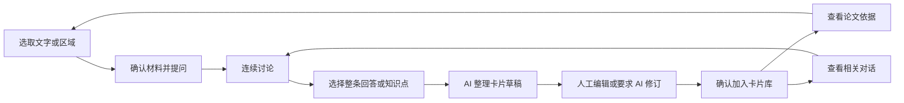
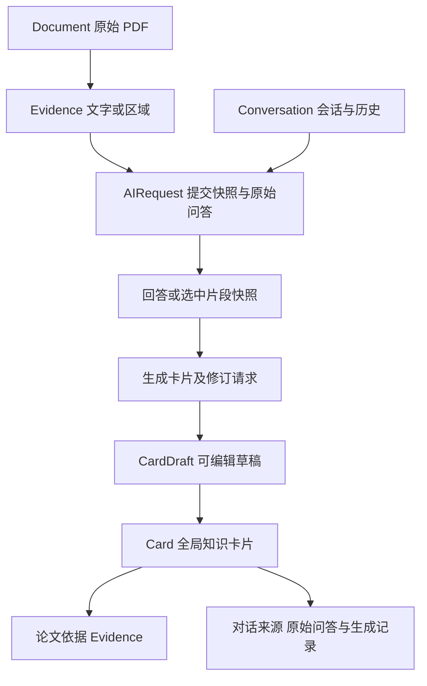

# AI 阅读与知识卡片产品需求

版本：设计基线 v0.2。日期：2026 年 10 月 16 日。状态：待开发。

面向围绕研究问题阅读论文的个人研究者，提供“选取材料 → 连续对话 → 整理知识卡片 → 修改确认 → 回查原文与对话”的完整路径。用户能够留下自己的理解，并在之后确认这条理解依据什么材料、经过怎样的讨论。

本文定义产品行为；[UX 设计](ux-design.md)定义界面与状态；[开发计划](development-plan.md)定义实施依赖与验收。现有工作台继续承担导航、资料管理、白板和写作；本轮扩展沿用同一份实体数据。

## 用户问题与产品价值

用户在阅读一段难懂的文字、公式或图表时，需要直接围绕所选材料提问，连续讨论术语、机制、适用条件和限制。将理解保存成卡片时，手动复制聊天内容容易丢失问题背景、原文位置和引用关系，也容易保存一段难以独立理解的长回答。

产品将“保留原始讨论”和“编辑知识成果”分开。论文依据用于核查原文，对话来源用于回顾解释过程，卡片用于表达用户最终保留的理解。AI 解释的存在不等于论文已经支持其中每一个判断。

### 代表性任务

| 用户任务 | 产品应提供的结果 |
| --- | --- |
| 看不懂论文中的一段话 | 选取后提问，保持 PDF 位置，回答可返回该段原文 |
| 想追问前一个解释 | 后续请求携带可见范围内的历史问答，能理解“这里”“上面这个条件” |
| 只想保留回答中的一个知识点 | 选取片段或整条回答，让 AI 整理成独立可读的卡片草稿 |
| 想调整 AI 整理结果 | 可以手动修改，也可以要求 AI 改写；确认后才进入卡片库 |
| 数周后重新核查一张卡片 | 同时找到原文位置、当时的问题与回答，以及创建时选中的内容 |

## 现有能力与缺口

以下为本项目代码基线。现有 AI 全部使用确定性演示适配器。

| 领域 | 已有基础 | 本次待开发 |
| --- | --- | --- |
| PDF | 单页文本层拖选、页码和缩放恢复 | 选区问答入口优化；区域框选与图片证据 |
| 证据 | 文档 ID、页索引、摘录、来源跳转 | 精确锚点、区域资产、统一证据快照 |
| 对话 | 按研究保存请求、问题、回答、证据快照 | 真实模型、多轮历史、流式、停止、多会话管理 |
| 卡片 | 编辑回答后另存整段内容、修改标题正文 | AI 提炼知识点、独立草稿、AI 修订、确认入库 |
| 追溯 | 卡片通过 evidenceIds 返回 PDF | 卡片关联问答与生成过程；原始回答不被编辑覆盖 |
| 恢复 | IndexedDB 和 localStorage 恢复缓冲 | 新对象迁移、流式中断恢复、草稿与来源关系恢复 |

代码入口：[阅读器](../../src/features/reader/PdfReader.tsx)、[AI 面板](../../src/features/ai/AIPanel.tsx)、[请求服务](../../src/services/ai.ts)、[共享类型](../../src/domain/types.ts)、[持久化](../../src/data/storage.ts)。历史验收仍以[现有记录](../verification/README.md)为准。

## 产品范围与分期

| 版本 | 范围 | 放行结果 |
| --- | --- | --- |
| R1 文字阅读闭环 | 文本选区、真实多轮聊天、流式展示、会话历史、整条或片段整理卡片、AI 修订与人工编辑、双来源、恢复、文本来源导出 | 对有文本层的 PDF，完整完成阅读到可追溯卡片的路径 |
| R2 区域阅读 | 框选图表、公式、扫描页；区域图片证据；支持图像的模型；区域来源定位 | 用户能对所框区域提问，并从卡片恢复同一区域 |

R2 是后续区域阅读的规划范围，独立排期，不作为 R1 放行条件。R1 覆盖用户通过文字选择开始阅读对话的需求，不能描述为已经支持任意内容框选。OCR、跨页一次框选、自动发送整篇论文、自动整理整个研究库、多人协作、通用消息分支、联网检索和自动更新已有卡片均不进入两期范围。

## 核心用户路径

“整理为卡片”创建待确认草稿；“加入卡片”提交已检查的成果。用户可以直接接受首稿，也可以反复修改。成功提示提供“查看卡片”和“继续阅读”，保存不自动把卡片放入白板或追加结论。

## 功能需求与验收

### PR01 选择材料并开始提问

R1 沿用浏览器文字拖选，提供“解释这段”“向 AI 提问”“加入当前对话”“创建卡片”。“解释这段”使用可见的默认问题并立即发送；其余问答动作先将材料放入输入区，由用户发送。首次使用外部模型前，先完成发送范围说明和连接设置，再执行快捷发送。用户也可以从既有证据列表添加材料。

选区附近展示紧凑操作条，长摘录在上下文预览中展开。材料至少包含论文标题、PDF 第几页和摘录。改变当前选区不自动替换已选上下文；未发送的材料可移除。全局资料模式由用户明确选择目标研究，服务完成资料关联后继续提问。

验收：选取文本后，输入区展示一致的原文与页码；取消选择或重选不扩大实际发送范围；PDF 始终保留阅读位置。空摘录、跨页选区和容量超限提供修正入口。

### PR02 连续聊天与消息阅读

用户和助手的消息分开呈现。助手回答默认以 Markdown 阅读，支持列表、代码、表格和数学公式；公式显示失败时保留原始文本。证据引用采用结构化关联，显示可点击编号。

每轮请求使用本次问题、显式证据及发送前可见的前序问答。默认延续当前会话已完成的问答；用户可查看本次包含哪些轮次。超出模型容量时停止发送，并提供缩小范围或新建会话入口；R1 不静默摘要或截断历史。

输入区显示“本轮材料 N 条 · 历史问答 N 轮”。移除材料只改变显式证据列表，旧消息仍可能包含原文；界面说明这一点，提供不携带旧消息的新会话。程序同时列明本轮实际允许引用的证据，包含已选历史消息对应且仍有效的证据快照。

生成过程中逐步显示内容，允许停止；用户向上阅读时保持位置，新内容用“回到最新”提示。正常完成后才开放“整理为卡片”和引用操作。停止、断流和刷新中断保留部分内容，标记“未完成”，不混入后续默认历史；重试可用。

验收：对同一选段连续两轮提问，第二轮确实使用第一轮问答；停止后迟到片段不能续写或覆盖终态；引用未通过校验时保留可读回答并提示修复，禁止作为有效引用保存。用户可修复来源后重试，或复制到保留对话来源的人工卡片草稿，明确移除无效引用后标记“仅对话来源 · 待核查”；该操作不改写原始回答。

### PR03 历史会话与继续讨论

每个研究可以新建、重命名、查找和归档多个会话。默认名称来自首个问题；列表显示最近更新时间和关联论文。历史入口位于右侧 AI 标题区域，采用同一面板内的列表子视图。

切换会话恢复各自的输入、已选材料与滚动位置。打开旧会话默认展示完整原始问答，可继续发送新问题；归档会话可回看，恢复后继续讨论。R1 不提供永久删除会话或编辑已提交历史问题的功能。

验收：退出应用后重新打开同一浏览器，能够找到历史会话及完整问答；新建会话不会自动继承旧对话或材料。研究之间的列表与活动会话隔离。

### PR04 从回答整理知识卡片

每条完成的回答提供“整理为卡片”；文字片段被选中后提供“将选中内容整理为卡片”。R1 每次生成一张卡片，默认围绕一个主要观点，不自动拆成多张。

AI 基于所选内容生成标题、正文和允许的结构化引用。正文应独立可读，按内容需要保留概念、解释、适用条件或限制，避免照搬无关的整段聊天。生成请求保存选中片段、所属完整问答及实际使用的证据；辅助上下文在提交前可展开查看。

选取片段不能使它脱离解释背景：保留原回答全文的稳定引用、选中内容快照及所属问题，必要的上下文在预览中显示。整理过程不得编造新文献或引用未发送的证据。

验收：整条与片段两种入口都能生成独立草稿；标题由生成结果提供而非截取用户问题；生成失败保留原始选择并可用同一范围重试。

### PR05 编辑草稿并确认加入

卡片草稿在 AI 面板内部子视图中打开，包含标题、正文、论文依据、相关对话和保存状态。用户可以直接修改；也可以输入“再简短一些”“补充适用条件”等要求，让 AI 提供一版修订预览。

AI 修订基于提交时的草稿版本和固定来源，结果由用户点击“应用修改”后生效。用户在生成时继续编辑，则结果提示“基于较早版本”，允许比较或重新生成，不能直接覆盖新输入。应用前可以取消；上一版草稿可以恢复。

“加入卡片”在标题和正文非空、来源结构校验通过后可用。卡片以同一保存操作关联目标研究、论文依据及对话来源；重复点击只创建一张。保存失败保持草稿并允许重试。用户离开草稿保留未完成编辑；明确“放弃草稿”才丢弃这个草稿。

验收：修改标题正文后确认，卡片库读取同一实体；返回聊天不改变原始回答；重试保存不生成重复卡片；关闭面板、切研究、刷新后仍可恢复草稿。

### PR06 原文与对话双来源

卡片的来源区包含两组信息。

| 来源 | 展示内容 | 打开行为 |
| --- | --- | --- |
| 论文依据 | 文献标题、PDF 页码、原文摘录；R2 增加区域预览 | 在右侧预览该页并定位；提供“在主区打开”，返回恢复原任务 |
| 相关对话 | 会话名、原始问题、回答摘录、创建时间、选中内容；可展开整理记录 | 在右侧定位并高亮创建时的问答版本，能展开前后问答 |

仅由聊天解释形成、没有可核查论文依据的卡片允许保存，展示“仅对话来源 · 待核查”。用户可解除“待核查”，但系统仍保留“仅对话来源”标签，直到加入有效论文依据。移除论文引用不会把 AI 解释转换为论文证据。

卡片在另一研究中复用时，论文关联沿用共享服务规则；查看相关对话默认预览来源研究的记录，不切换主区。用户选择“去原研究继续讨论”才切换研究，并保留当前任务缓冲。归档会话仍可访问。活记录缺失时展示卡片创建时的来源快照和缺失原因。

验收：从卡片库、白板和写作引用打开卡片，均能找到同一来源；定位到具体问答和原文，返回后草稿、阅读位置与白板视口保留。原 PDF 缺失时仍能查看保存的摘录和对话，并提示重新导入同一资产。

### PR07 保存恢复与研究隔离

会话、已提交问答、请求快照、卡片草稿、来源和活动会话状态按研究持久化。卡片仍为全局实体；共享复用不复制卡片正文。统一使用 dirty、saving、saved、error 表示保存状态。

正在进行的聊天和卡片整理请求都绑定提交时的研究、会话、草稿版本和快照。切换研究或会话不改变归属。迟到完成只更新所属对象，并通过不打断当前编辑的提示告知用户。

刷新后，尚未完成的请求转为“已中断”，保留已持久化的部分内容；重试创建新尝试。存储加载失败时阻止写入，避免生成空数据覆盖历史。保存失败提供重试，并明确是否只有内存中的最新片段尚未保存。

验收：包含生成、编辑和保存失败的完整路径在切换研究与刷新后可恢复；不把研究 A 的回复写入研究 B；恢复缓冲和数据库能迁移到同一版本。

### PR08 模型连接与请求可靠性

产品提供“未配置”“已连接”“演示”三种明确状态。真实调用通过受控的本地服务或后端转发，凭证保存在服务端环境；浏览器持久化业务数据不包含 API key。演示模式保持可用，但文案不能将演示生成描述为真实模型结果。

每个请求保留用途、模型标识、时间、当次实际发送的问题、历史问答、证据与内容版本、最终状态和错误原因。用户可以查看发送范围；应用不自动发送整篇 PDF、整个资料库或未选中的其他研究内容。

“重试”使用原问题和原快照创建新尝试；“按当前范围重新生成”使用当前可见范围创建新记录。R1 采用线性问答历史：重新生成只针对最新一轮，以新回答替代旧回答进入后续默认历史；旧版仍可回查，已有卡片仍指向旧版。更早的问答可查看或复制到新会话，不构建分支树。

验收：错误区分无配置、认证、网络、限流、上下文过长和取消；不会自动重复提交产生未知费用；真实文本模型完成至少一次多轮生成与来源保存冒烟后，才能标记 R1 真实调用通过。

### PR09 区域框选与图像问答

R2 在阅读器中增加“文字选择 / 区域框选”模式。用户在当前单页框出图表、公式或扫描内容，确认缩略图与页码后加入对话。区域可取消、重新选择；页面缩放后定位不漂移。

区域证据保存文档 ID、内容 hash、从 0 开始的页索引、独立图片资产、PDF 坐标系中的位置与尺寸；有文本时附带摘录。纯图片证据用图片及区域说明表达，不能用伪造摘录填充文字证据。坐标需处理页面旋转与裁剪边界。

模型不支持图像或截图失败时，说明原因并保留区域供重试；允许回到文字选择。有图像能力的模型可以直接读取扫描区域，OCR 不作为本期前置依赖。图片数量、像素和请求容量在实现阶段依据所选模型确定并写入连接能力配置，超限时提供重新框选。

验收：真实图像模型能解释测试图表和扫描区域；卡片刷新后可返回同一区域。来源资产缺失显示失效提示，不能跳到其他文档或伪称识别成功。

### PR10 来源生命周期与导出

原始问答在完成后保持稳定；卡片草稿和最终正文独立编辑。来源记录保存稳定对象 ID 及创建时的摘录快照，不能只依赖可变标题或当前界面位置。归档会话不移除被卡片引用的记录。

R1 沿用现有 Markdown 导出入口。结论引用卡片时保存卡片 ID 及使用时的来源快照，后续编辑卡片不改写结论已使用的来源；导出列明文献、PDF 页码和摘录，并为相关卡片附上对话来源的用户问题、所选回答片段、时间和关联标识。应用内链接以可读文本作为补充，外部阅读无需链接也能理解来源。完整聊天记录继续在应用内保存，不随每次导出默认全部公开。

R2 导出包含区域来源的文献、页码和区域说明，明确该 Markdown 未附带区域图片与原 PDF。打包图片、PDF 或整个数据库的可迁移备份另立后续任务；本轮不声称跨浏览器完整恢复已具备。

旧数据迁移保留原文、卡片和现有请求。旧请求的 body 可能已被用户编辑，标记“旧版记录，原始回答不可确认”；无来源关联的旧卡片不反推生成对话。迁移失败保留旧数据，提供重试读取，不能重建样例覆盖。

验收：卡片被复用、会话归档、导出结论或迁移旧数据库后，已有来源不丢失；不能恢复的旧历史如实标识。

## 数据关系与约束

沿用现有 Conversation 和 AIRequest；AIRequest 可继续表示一组问答，补充真实发送的历史和用途，不为本轮建立通用消息平台。CardDraft 是独立的可恢复对象。Card 在 evidenceIds 之外增加对话来源关联和创建时快照；草稿生成与修订也留下请求记录。

论文引用必须来自该请求实际发送且仍有效的证据；代码校验身份、文档版本、页码与引用编号。模型负责生成解释，用户核查解释的含义；结构校验通过只表示来源可追溯。卡片手动编辑后仍保留其来源过程，不能声称人工改写部分已被 AI 自动核实。

## 交付与试用判定

R1 的发布用例必须真实完成：导入有文本层的 PDF → 选段提问 → 连续追问 → 选中一个知识点 → AI 整理 → AI 修订与手动修改 → 确认入库 → 刷新 → 从卡片返回原文和具体问答。随后验证研究切换、保存失败恢复和另一研究复用该卡片。

R2 增加图表、公式和扫描页各一组固定样例，实际跑通图像问答和区域来源恢复。所有规划中的任务保持“待开发”，只有有运行证据的能力才能改为完成。

试用期以本地可查看的测试记录统计首次形成卡片的步骤与耗时、草稿采纳及修改情况、来源定位成功情况、恢复失败和引用拦截。首次试用建立基线后再确定体验指标目标；本轮不引入远程行为采集。固定验收集中的来源完整性、研究隔离与保存恢复必须全部通过。

## 开发前需要收敛的配置

| 决策 | 当前处理方式 | 落地位置 |
| --- | --- | --- |
| 模型供应商和具体模型 | 研发核对文本、多轮、流式和图像能力，先接一个真实供应商 | AR1，R2 在 AR6 核对图像能力 |
| 调用服务的运行方式 | 默认面向本机单用户服务；供应商凭证通过环境配置 | AR1，实际命令落到 README |
| 模型容量和费用提示 | 根据实际模型配置输入容量、图像限制和必要提示；不编造价格 | AR1 和 AR6 |
| 上线后的体验目标 | 首轮真实试用建立基线再定量 | AR7 和 AR8 |

这些配置影响真实调用的放行，不阻塞共享契约、交互设计和本地恢复逻辑的开发。
