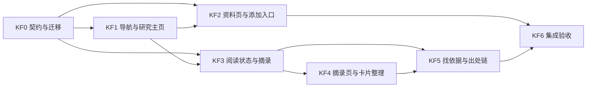

# 知识链路开发计划

日期：2026-10-17。状态：本轮已实施；本文件保留切片设计，实际验证与边界见验收记录。实际进度见[总清单](../agent-backlog.md)；完成后的运行结果、截图和剩余问题记录在 `docs/verification/knowledge-flow/README.md`。

本计划把[产品需求](requirements.md) KR01–KR10 转为可派工的切片。交互以 [UX 设计](ux-design.md)为准，[原型](prototype.html)仅用于评审。所有切片都遵守[产品规划](../product-plan.md)、[AGENTS.md](../../AGENTS.md)，以及统一工作台、共享实体和 AI 显式材料约束。

## 1. 基线与交付顺序

### 1.1 开工基线（规划提交 69679f5）

| 领域 | 开工前事实 | 本轮增量 |
| --- | --- | --- |
| 导航 | [App.tsx](../../src/shell/App.tsx) 的 `collections` 列出收件箱、论文库、研究空间、卡片库、研究产出；`openCollection` 总是切到 library 会话；研究内的概览、白板、文稿以资源方式打开 | 研究内页面：主页、资料、摘录、卡片、白板、文稿；library 会话只保留资料和卡片两个集合 |
| 资料 | [pdf.ts](../../src/services/pdf.ts) 的 `importPdf` 以 `document-${hash}` 作为 ID；`PaperDocument` 必须有 `filename/hash/assetId/pageCount`；[migrations.ts](../../src/data/migrations.ts) 与 [backup.ts](../../src/services/backup.ts) 都按此校验 | 允许无全文条目，增加标识；补 PDF 时保留原 ID |
| 阅读状态 | `readingStatus: 'unread' \| 'reading' \| 'read'`；首次打开时，未读改为在读 | 增加 `skimmed` |
| 摘录 | `createEvidence` 可单独创建并按文档、页和原文去重；没有来源研究；阅读器选区菜单为解释、提问、加入对话、创建卡片 | 记录来源研究、“不需要”标记和随手记；工具条改为摘录、写成卡片、问 AI |
| 卡片与文稿 | 文稿 `[n]` 指向 `Draft.evidenceIds`；`insertCardReference` 只在卡片有对话来源时写入 `cardSources` | 文稿记录所有插入过的卡片，供可信度推导与出处链使用 |
| AI | 卡片草稿 `CardDraft.source` 来自一次对话回答（AR4） | 支持以所选摘录作为显式材料，起草卡片草稿 |
| 存储 | `WorkspaceData.schemaVersion: 2`；恢复缓冲 `papertrail-recovery-v2` | schema 3 迁移；备份兼容新旧格式 |

### 1.2 依赖



KF0 和 KF1 由集成负责人串行完成。之后 KF2 与 KF3 可由两个执行者并行；KF4 与 KF5 的视图骨架可基于 KF0 样例提前做，真实集成以依赖通过为准。共享文件只由集成负责人合入。

### 1.3 需求追踪

| 需求 | 主交付 | 验证 |
| --- | --- | --- |
| KR01 导航与入口归位 | KF0、KF1 | KV01、KV02、KV15 |
| KR02 研究主页 | KF1 | KV03 |
| KR03 单一添加入口 | KF2 | KV04、KV05 |
| KR04 无全文与就地补全文 | KF0、KF2 | KV06、KV07、KV14 |
| KR05 阅读状态 | KF0、KF3 | KV08 |
| KR06 阅读时摘录 | KF3 | KV09 |
| KR07 摘录页 | KF4 | KV10、KV11 |
| KR08 找依据 | KF5 | KV12 |
| KR09 可信度与出处链 | KF0、KF5 | KV13 |
| KR10 迁移、保存与隔离 | KF0 | KV14、KV15、KV16 |

## 2. 开工前冻结的契约

以下是接口草案，最终名称和类型由 KF0 集成负责人确定。改动集中在共享类型和服务，各功能模块不另存第二份资料、摘录或导航状态。

```ts
// 资料：文件字段整体可选；同一时刻要么全部存在，要么全部缺失
type PaperDocument = {
  id: string; title: string; authors: string; year: string;
  identifiers?: { doi?: string; arxiv?: string; url?: string }; // 规范化后保存
  filename?: string; hash?: string; assetId?: string; assetRevision?: number; pageCount?: number;
  sampleUrl?: string;
  readingStatus: 'unread' | 'reading' | 'skimmed' | 'read';
  textStatus: 'pending' | 'ready' | 'empty' | 'error'; // 无全文时不显示
  finishPromptShown?: boolean;
};
declare function hasFullText(doc: PaperDocument): boolean; // 所有读者、导出、备份都经此判断

// 摘录：复用 Evidence
type Evidence = /* 现有字段 */ { researchId?: string; dismissed?: boolean; note?: string };

// 文稿：记录插入过的卡片
type Draft = /* 现有字段 */ { cardRefs?: { cardId: string; insertedAt: string; evidenceIds?: string[] }[] };

// 研究内页面与资料库集合
type ResearchViewId = 'home' | 'sources' | 'excerpts' | 'cards' | 'boards' | 'drafts';
type CollectionId = 'documents' | 'cards'; // 仅 library 会话
type LibraryFilter = 'all' | 'unassigned' | 'research';
type PanelMode = 'excerpts' | 'cards' | 'ai';
type PanelState = /* 现有字段 */ { findEvidenceFor?: string /* cardId */ };

declare function openResearchView(researchId: string, view: ResearchViewId): void;
declare function addSource(input:
  | { kind: 'identifier'; raw: string }
  | { kind: 'title'; title: string }
  | { kind: 'library'; documentId: string }, target: WorkspaceScope): { documentId: string; created: boolean };
declare function attachPdf(documentId: string, file: File): Promise<{ conflict?: { into: string } }>;
declare function mergeDocuments(stubId: string, intoId: string): void;
declare function captureExcerpt(researchId: string, range: { documentId: string; pageIndex: number; quote: string }): string;
declare function attachEvidenceToCard(cardId: string, evidenceId: string): void; // 去重，并把卡片标为待核查
declare function conclusionIssues(data: WorkspaceData, researchId: string): ConclusionIssue[]; // 纯函数，不落存储
declare function normalizeIdentifier(raw: string): { kind: 'doi' | 'arxiv' | 'url'; value: string } | undefined; // 纯函数
```

| 契约 | 约定 |
| --- | --- |
| 无全文条目 ID | 使用 `document-${uid}`，补 PDF 后不变。新导入的有全文资料继续用 `document-${hash}`。代码不得根据 ID 推断 hash |
| 补 PDF | 只能在 `hasFullText` 为假时调用；校验、hash 计算和资产保存沿用 `importPdf` 的内部步骤。若 hash 已属于另一条资料，不写入，返回冲突，由界面询问是否合并 |
| 合并 | 在一次 `updateData` 中把无全文条目的研究关联、白板 `resourceRef`、打开项和标识迁到目标条目，再删除无全文条目。无全文条目不可能有摘录，若存在则拒绝合并并报告；同类标识值冲突也拒绝合并，保留两条记录 |
| 标识去重 | DOI 统一转小写，去掉 `https://doi.org/` 前缀；arXiv 去掉版本号和 `arXiv:` 前缀；URL 去掉片段。同一规范值复用已有条目 |
| 摘录来源研究 | 新摘录必须带 `researchId`，同一研究内按文档、页与原文去重；其他研究可分别留下自己的摘录。来源未记录的旧摘录继续复用。迁移推断：引用它的卡片属于哪些研究，以及包含它的对话和文稿属于哪些研究；恰好一个研究时写入，否则留空。留空的摘录在包含其文档的所有研究中显示 |
| “用到” | 一条摘录被本研究任一卡片的 `evidenceIds` 引用，即为“已用于卡片”，由推导得出，不存状态 |
| 文稿卡片记录 | `insertCardReference` 对所有插入都追加 `cardRefs`，保存插入时的证据 ID，卡片后来移除依据仍能回查当时的卡片。旧文稿由 `cardSources` 推导；只有论文依据、从未写入 `cardSources` 的旧插入无法还原，不补造 |
| 可信度推导 | `conclusionIssues` 按 KR09 列出四类问题，并为每类问题附上目标对象和动作。不存储结果，只用单元测试覆盖 |
| 会话迁移 | 研究会话中，`{kind:'research'}` 当前项映射为 `home`；文档、白板、文稿等资源项保留。library 会话中，`inbox` 映射为 `documents` 加 `unassigned` 筛选，`documents` 和 `cards` 保持不变，`researches` 和 `drafts` 映射为 `documents`。面板模式：`evidence`→`excerpts`，`references`→`cards`（保留 `panel.ref`），`info`→`excerpts`，`ai` 保持不变 |
| AI 起草 | 摘录起草沿用 `purpose: 'card'` 的请求与 `CardDraft`：显式材料只有所选摘录，`CardProvenance` 增加 `origin: 'excerpts'`，`answer` 为空，`selection` 为摘录快照；引用校验、草稿修订与幂等确认沿用 AR4。具体字段由 KF0 定稿 |
| 备份 | `backup.ts` 的资产校验只检查 `hasFullText` 为真的资料；schema 2 的备份导入时先走迁移 |

## 3. 可派工任务

每份派工都附上本节对应任务和以下约束：**你不是唯一在修改代码的人。保留并适配其他人的改动；公共契约需要变化时，交集成负责人统一落地。** 所列新文件是建议位置；实施前先检查实际目录。

### KF0 契约、迁移与样例

负责人：集成负责人。依赖：无。关联：KR01、KR04、KR05、KR09、KR10。

负责文件：[types.ts](../../src/domain/types.ts)、[migrations.ts](../../src/data/migrations.ts)、[seed.ts](../../src/data/seed.ts)、[workspace.ts](../../src/services/workspace.ts)、[backup.ts](../../src/services/backup.ts)、[exportMarkdown.ts](../../src/features/export/exportMarkdown.ts)（只改 `cardRefs` 写入与 `hasFullText` 判断）。测试：`tests/unit/migrations.test.ts`、`tests/unit/backup.test.ts`，新增 `tests/unit/knowledge-flow.test.ts`。

子任务：

- 实现 §2 的类型；schema 升级为 3；迁移前保留可恢复副本，失败时不写回。
- 迁移旧会话、面板模式和摘录来源研究；旧 `read` 保持不变（读完）。
- 实现 `hasFullText`、`normalizeIdentifier`、`captureExcerpt`、`attachEvidenceToCard`、`mergeDocuments`、`conclusionIssues`、`openResearchView` 和 `addSource` 的服务部分；`attachPdf` 的资产写入与 KF2 协作完成。
- 样例中增加一条无全文条目、一条略读过的资料、一张没有依据但已插入文稿的卡片，以及一条来源研究未记录的旧摘录。
- 所有读取 `pageCount`、`hash`、`assetId` 的地方都改走 `hasFullText`，或在调用处先判断。

验收：用现有 schema 2 样例和 E2E 产生的数据迁移，所有实体数量和引用不变；迁移函数幂等；schema 2 和 3 的备份都能导入；`conclusionIssues` 的四类问题各有单元测试；`normalizeIdentifier` 覆盖带版本号的 arXiv、doi.org 链接和大小写差异。

### KF1 导航与研究主页

负责人：集成负责人（应用框架）。依赖：KF0。关联：KR01、KR02。

负责文件：[App.tsx](../../src/shell/App.tsx)、[ResourceTabs.tsx](../../src/shell/ResourceTabs.tsx)、[ResearchView.tsx](../../src/features/research/ResearchView.tsx)（改为研究主页）、[LibraryView.tsx](../../src/features/library/LibraryView.tsx)（资料库：资料、卡片两个标签及筛选）、[styles.css](../../src/ui/styles.css)。白板和文稿列表页可新建 `src/features/research/ResourceListView.tsx`。

子任务：

- 左栏按 KR01 重排；删除 `collections` 中的五个全局入口；白板和文稿条目缩进显示。
- 中央标签栏第一个标签跟随当前研究页面，资源标签沿用现有 `openItems / active / pinnedIds`。
- 研究主页显示问题、接着上次、结论站得住吗（调用 `conclusionIssues`）和最近记录。“最近”记录可从现有实体的时间字段推导，不足时由 KF0 增加有上限的活动记录。
- 资料库加上“未加入研究”筛选和每条资料、卡片的“用于”显示。
- 1024px 及以下，左栏变为抽屉；键盘可打开抽屉，并从抽屉返回原位置。
- 更新依赖旧入口文案的 E2E：`workbench.spec.ts`、`resource-tabs.spec.ts`、`persistence.spec.ts` 等。

验收：KV01–KV03、KV15；现有 E2E 回归通过。

### KF2 资料页与单一添加入口

负责人：执行者 A。依赖：KF0、KF1。关联：KR03、KR04、KR05（资料分组）。

负责文件：新建 `src/features/library/SourcesView.tsx`、`src/features/library/AddSourceDialog.tsx`、`src/features/library/DocumentDetail.tsx`；修改 [pdf.ts](../../src/services/pdf.ts)，拆出可复用的“校验 → hash → 存资产”步骤，供 `attachPdf` 使用；[ImportPDFButton.tsx](../../src/features/reader/ImportPDFButton.tsx) 改为打开添加对话框，或由其替代。不得修改共享类型；需要新字段时向集成负责人提出。

子任务：

- 资料页：按在读、未读、读过分组；筛选项见 KR05；显示“摘录 n · 卡片 m”；无全文条目显示补救动作；提供空状态、加载和错误状态。
- 添加对话框：目标研究和更改入口；本地识别标识；匹配资料库；按标题新建；回车执行第一项；`A` 快捷键；`Esc` 关闭并把焦点还给触发按钮。
- 多文件选择与窗口级拖放：拖放遮罩说明目标研究；逐个导入，单个失败不影响其他文件；完成后汇总新建、复用和失败数量。
- 无全文详情页：显示文献信息编辑和拖放区；补 PDF；遇到 hash 冲突时显示合并确认，列出将要转移的内容。

验收：KV04–KV07。

### KF3 阅读状态与阅读时摘录

负责人：执行者 B。依赖：KF0、KF1。关联：KR05、KR06。

负责文件：[PdfReader.tsx](../../src/features/reader/PdfReader.tsx)、[reader.css](../../src/features/reader/reader.css)、[EvidenceList.tsx](../../src/features/evidence/EvidenceList.tsx)（改为右侧“本篇摘录”）。与 AI 的衔接只调用现有 `addContext` 和请求入口，不修改 [AIPanel.tsx](../../src/features/ai/AIPanel.tsx) 的内部状态。

子任务：

- 工具栏加“略读过”和“读完”；读完且本篇有摘录时显示一次可关闭的提示，用 `finishPromptShown` 记录。
- 选区工具条：摘录（`H`）、写成卡片（`C`）、问 AI（菜单：解释这段、加入当前对话）；已摘录句子显示高亮和对应的工具条；撤销摘录；被引用的摘录不可取消。
- 区域框选（R2）的预览确认后，也走“摘录 / 写成卡片 / 问 AI”。
- 本篇摘录面板实时更新，每条提供写成卡片和定位。
- 找依据状态存在时（KF5），工具条最前面显示“作为「卡片标题」的依据”。KF3 预留插槽，并读取 `panel.findEvidenceFor`。

验收：KV08、KV09；现有 `ai-reading.spec.ts` 的选区提问路径按新工具条更新后通过。

### KF4 摘录页与卡片整理

负责人：执行者 A 或 B（在 KF2/KF3 中先完成的一方）。依赖：KF3。关联：KR07。

负责文件：新建 `src/features/evidence/ExcerptsView.tsx`；[CardEditor.tsx](../../src/features/cards/CardEditor.tsx)（支持带预置依据新建卡片）；AI 起草调用 AR4 的草稿入口，入口接线由集成负责人在 [ai.ts](../../src/services/ai.ts) 合入。

子任务：

- 摘录页：按论文分组；提供全部、还没用到、已用于卡片三个筛选；可编辑随手记；“看原文”在主区定位。
- 多选操作条：写成一张卡片、AI 起草、不需要（可恢复）。
- “其他研究的摘录”展开区；“来源研究未记录”标注。
- 卡片页：保留现有卡片网格；筛选为全部、待核查、未上白板；“添加已有卡片”沿用 `linkCard` 关联规则。

验收：KV10、KV11。

### KF5 找依据与出处链

负责人：集成负责人与执行者协作：面板状态归集成负责人，视图归执行者。依赖：KF3、KF4。关联：KR08、KR09。

负责文件：[CardEditor.tsx](../../src/features/cards/CardEditor.tsx)（卡片详情的找依据入口）；新建 `src/features/cards/FindEvidencePanel.tsx`；[WritingView.tsx](../../src/features/writing/WritingView.tsx)（右侧卡片列表标注无依据和待核查，点击 `[n]` 打开出处链，补引用入口）；新建 `src/features/writing/TraceChain.tsx`。`panel.findEvidenceFor` 的状态读写由集成负责人在 [workspace.ts](../../src/services/workspace.ts) 实现。

子任务：

- 找依据子视图：列出候选摘录，提供作为依据、去资料里找和完成；在切换标签、模式和研究时都保留状态。
- 阅读器插槽接线（KF3 预留）：保存摘录并调用 `attachEvidenceToCard`。
- 出处链：`[n]` → `cardRefs` 中包含该证据的卡片 → 摘录 → 在主区打开原文；原 PDF 缺失时显示保存的摘录。
- “补引用”：打开文稿，右侧突出显示该卡片的新依据，并提供“在光标处插入引用”。

验收：KV12、KV13。

### KF6 集成验收

负责人：主 agent 与独立验收 agent。依赖：KF1–KF5。

新增 `tests/e2e/knowledge-flow.spec.ts` 覆盖 KV 场景，回归运行全部现有单元测试和 E2E；在 1440×900、1280×800 和 1024×800 下截图，存放于 `docs/verification/knowledge-flow/`；写验收记录，列出实际命令、结果、截图位置、未覆盖项和已知限制。验证“主区 PDF＋右侧找依据”“主区文稿＋右侧出处链”“主区摘录页＋右侧卡片草稿”三种组合，以及返回、刷新恢复和未保存内容保留。

## 4. 验证矩阵

| 编号 | 场景 | 类型 |
| --- | --- | --- |
| KV01 | 原五个入口的内容都能在新位置找到；资料库“未加入研究”筛选等于原收件箱 | E2E |
| KV02 | A、B 两个研究分别恢复页面、标签和右侧模式；资料库操作不改变研究打开项 | E2E |
| KV03 | 主页：编辑问题后刷新仍在；接着上次回到原页码；无问题、无资料两种空状态 | E2E |
| KV04 | DOI、arXiv、URL 规范化与去重；资料库复用后关联正确 | 单元 + E2E |
| KV05 | 多选三个 PDF（一个重复）：新建两条、复用一条；坏文件单独报错 | E2E |
| KV06 | 无全文条目补 PDF 后，ID、白板摆放和研究关联都不变 | 单元 + E2E |
| KV07 | 补 PDF 遇到 hash 冲突：合并后无悬空引用；取消后两条都不变 | 单元 + E2E |
| KV08 | 略读过和读完的分组与刷新；读完提示只出现一次 | E2E |
| KV09 | 按 `H` 摘录、撤销、刷新；重复摘录去重；文本层不可用时有说明 | E2E |
| KV10 | 摘录多选写成卡片；一条摘录用于两张卡片；“不需要”可恢复 | E2E |
| KV11 | AI 起草只发送所选摘录；草稿确认入库并标为待核查；演示与真实模式分别记录 | 单元 + E2E（真实模型另做冒烟） |
| KV12 | 找依据：从列表设为依据；去资料里找，在阅读器中设为依据；切换标签和研究后状态保留 | E2E |
| KV13 | `conclusionIssues` 四类问题；出处链从 `[n]` 回到 PDF 正确页；PDF 缺失时显示摘录 | 单元 + E2E |
| KV14 | schema 2 数据与备份迁移：实体数量、引用、打开项不变；ZIP 往返后新字段一致 | 单元 |
| KV15 | 1440、1280、1024 截图，无重叠和横向滚动；1024 抽屉可用键盘开关 | E2E + 截图 |
| KV16 | 保存失败时，摘录、补依据、补 PDF 和合并都可重试，不丢失输入 | E2E |

## 5. 放行与记录

- 实际命令以 `package.json` 为准：`npm run check`、`npm test`、`npm run test:e2e`、`npm run build`；涉及桌面打包时再运行 `npm run test:desktop:e2e`。
- 只有实际跑通、并留下证据的切片才能在总清单中标为完成。AI 起草在没有真实模型配置时只能记为“演示路径已验证”。
- 实现若改变本计划或 UX 设计中的行为，需同步更新需求、UX 设计和产品规划。

## 6. 风险

| 风险 | 应对 |
| --- | --- |
| 文件字段改为可选后，遗漏的调用处可能在运行时出错 | KF0 先改类型，让 TypeScript 报出全部调用处；用 `hasFullText` 统一判断；样例中加入无全文条目，让 E2E 覆盖 |
| 会话迁移导致用户打开项丢失 | 迁移只映射集合和模式，不删除资源项；KV14 校验迁移前后打开项一致 |
| 旧摘录来源研究推断错误，导致摘录被隐藏 | 无法确定时留空并在所有相关研究中显示；只有推断结果唯一时才写入 |
| 找依据状态与右侧面板其他子视图冲突 | 状态只存在 `panel.findEvidenceFor`，由集成负责人统一处理优先级；明确“完成”和“返回卡片”两个退出方式 |
| 改动现有 E2E 文案造成大量回归 | KF1 统一修改受影响的用例，并在合入说明中列出 |


## 7. 本轮落地细节

- `src/domain/knowledge.ts` 放置 `hasFullText`、标识规范化、研究摘录筛选与结论问题推导；引用解析复用 `mapCitationNumbers`，不把代码和数学中的 `[n]` 当引用。
- 研究页面使用 `Session.active.kind = 'researchView'`，`researchView` 记录中央首标签；`recentItems` 仅保留最近八个资源。资料库保留独立会话。
- “补引用”使用 `insertEvidenceReferences`，只在光标位置插入编号，不重复写入卡片正文。正文编辑与“预览引用”共用同一文稿；编号点击打开出处链。
- 摘录的“全部”提供“显示标为不需要的摘录”开关；默认隐藏，不删除原文与高亮。
- 近期列表按摘录创建、资料/阅读状态更新时间及卡片补依据时间推导，不另建无限增长的活动日志。
- 运行结果、截图与未覆盖项以 [本轮验收](../verification/knowledge-flow/README.md) 为准。
