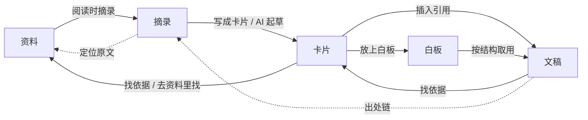

# 知识链路产品需求

版本：设计基线 v2。日期：2026 年 10 月 17 日。状态：本轮已实现；实际验证与限制见[验收记录](../verification/knowledge-flow/README.md)。

本文定义行为与验收。界面结构和调研依据见 [UX 设计](ux-design.md)，实施切片、契约与验证矩阵见[开发计划](development-plan.md)。本轮改造沿用现有统一工作台、共享实体、AI 显式材料契约和保存状态，不另建框架。

## 用户问题

围绕一个问题阅读多篇论文的研究者，现在面对的是按对象类型并列的全局入口（收件箱、论文库、研究空间、卡片库、研究产出）。用户看不出资料、原文片段、自己的理解和结论之间的关系；阅读时一选中文字就要决定“解释、提问、加入对话还是创建卡片”；只有链接或 DOI 的论文无法先收下；写结论时发现缺证据，也没有直接回头找证据的路径。

调研表明，真实研究并不是线性推进的：阅读和思考交替进行，研究问题会随阅读改变，许多论文只需略读，写作会反过来推动阅读。因此本轮的目标是：

- 材料从原文到结论逐步成熟，并可逐级追溯；
- 用户可以从任意环节进入，也能双向移动，界面不规定先后；
- 界面只提醒会影响结论可信度的事，不制造“待读、待整理”的欠账。

## 范围

| 本轮包含 | 本轮不包含 |
| --- | --- |
| 研究内导航与入口归位、研究主页 | 联网补全元数据、自动下载开放 PDF |
| 单一添加入口：本地识别标识、资料库复用、按标题建条目、选择或拖入多个 PDF | AI 推荐资料一键加入（依赖 issue #3 文献检索） |
| 无全文条目及就地补 PDF | 批量导入进度面板、从本机目录批量导入 |
| 阅读状态增加“略读过” | 研究内资料分组、标签体系 |
| 阅读时一键摘录、摘录页、由摘录写卡片或让 AI 起草 | 白板 AI 分析、自动发现矛盾 |
| 从论点出发找依据，阅读时直接设为依据 | OCR、跨版本锚点迁移 |
| 结论可信度提示与出处链 | 多人协作、Zotero 接入 |

## 核心路径

实线是用户的动作，方向不固定；虚线是溯源。界面不对这些环节编号。

## 功能需求与验收

### KR01 研究导航与入口归位

左栏自上而下依次为：当前研究切换器（含“…”项目设置）、搜索、研究主页；“阅读”组（资料、摘录）；“思考与写作”组（卡片、白板、文稿）；底部为资料库和设置。白板和文稿的具体条目缩进显示在类型下。左栏不显示编号、连线或待办计数。

打开的论文、白板和文稿只显示在中央标签栏；第一个标签显示当前所在的研究页面，左栏点到哪里，它就切换到哪里。原入口按下表归位：

| 原入口 | 新位置 |
| --- | --- |
| 收件箱 | 资料库的“未加入研究”筛选 |
| 论文库 | 研究内“资料”；跨研究使用资料库 |
| 研究空间 | 研究切换器 |
| 卡片库 | 研究内“卡片”；跨研究使用资料库的“卡片”标签，或“添加已有卡片” |
| 研究产出 | 研究内“文稿” |
| 左侧打开项 | 中央标签栏 |

资料库使用独立的 library 会话，显示所有研究共用的资料与卡片，可筛选“全部 / 未加入研究 / 本研究”，每条显示“用于哪些研究”，并提供“加入本研究”。

1024px 及以下，左栏折叠为抽屉；主区与右侧面板继续并列。

验收：每个原入口的内容都能在新位置找到；切换研究时，各研究恢复自己的页面、标签和右侧面板；资料库中的操作不改变当前研究的打开项；1440、1280、1024 三种宽度下不重叠、无横向滚动。

### KR02 研究主页

研究主页依次显示：

1. **我想回答的问题**：可直接编辑，并提示问题会随阅读变具体。
2. **接着上次**：最近在读的论文及页码、最近编辑的文稿和白板，点击回到原位置。
3. **结论站得住吗**：只列出影响结论可信度的问题，规则见 KR09。
4. **最近**：记录摘录、补依据、收录资料、读完或略读等动作，以及发生时间。

主页不显示“下一步”提示、流程条，也不显示未读或未整理的数量。

验收：编辑问题后，切换研究并刷新，内容仍在；在“接着上次”中点击论文，回到上次的页码；没有问题时显示“文稿里的每处引用都能回到原文”；新研究没有资料时显示添加入口。

### KR03 单一添加入口

“添加资料”在资料页右上角和空状态中央提供，快捷键为 `A`。它打开同一个输入框，顶部始终显示“添加到：<研究名>”，可改为其他研究或“仅存入资料库”。

| 输入 | 首版行为 |
| --- | --- |
| arXiv 编号或链接 | 本地识别格式，规范化后保存 `arxiv` 标识，建立无全文条目，并提供“打开原链接” |
| DOI 或 doi.org 链接 | 规范化后保存 `doi` 标识，建立无全文条目 |
| 其他网页链接 | 保存 `url`，标题默认为链接主机名，可编辑 |
| 标题关键词 | 先列出资料库匹配项：已在本研究的显示“已在本研究中 · 打开”，其他显示“用于哪些研究 · 复用原文和已有摘录”；无合适项时可“按标题新建条目” |
| 选择或拖入 PDF | 支持多选；拖到窗口任意位置都显示“松开即加入「研究名」”；每个文件走现有 PDF 校验、hash 去重和资产保存流程 |

回车执行第一项。在研究里收下的资料同时保存在资料库；从资料库页面添加时，默认“未加入研究”。

标识去重：同一规范化 DOI 或 arXiv 编号已有条目时，直接复用并关联到目标研究，不新建条目。PDF 去重沿用 hash 规则；同一文件再次导入时，提示“与已有资料相同，已直接复用”。

验收：三类标识各自规范化并去重；在资料库搜索后加入，本研究出现同一条资料，其他研究的关联不变；多选三个 PDF（其中一个重复）时，新建两条并提示复用一条；导入失败的文件给出原因，不影响同批其他文件。

### KR04 无全文条目与就地补全文

没有 PDF 的资料是普通资料条目：有稳定 ID、标题、作者、年份和标识，在资料行显示“无全文 · 添加 PDF · 打开原链接”。打开后，主区显示文献信息详情页，中央是拖放区，说明“把这篇的 PDF 拖到这里，就能开始阅读”。

补 PDF 时，条目 ID、研究关联、白板摆放和已有引用都不变，只为该条目首次挂上文件资产，因此不违反“替换文件建立新资产”的规则。已有全文的条目不提供“添加 PDF”，更换文件仍按现有规则建立新资产。

若补上的 PDF 的 hash 已属于另一条资料，界面提示两者可能是同一篇，提供“合并为一条”：保留已有全文的条目，把无全文条目的研究关联、白板摆放和标识转移过去，再删除无全文条目；也提供“取消”。同类 DOI、arXiv 或 URL 标识值不一致时，拒绝合并并保留两条资料，避免覆盖来源。合并前展示将要转移的内容，转移在同一次保存中完成。

无全文条目不能摘录、问 AI 或导出页码引用；这些入口禁用，并说明需要先补全文。

验收：补 PDF 前后条目 ID 相同，白板摆放和研究关联仍在；hash 冲突时可合并，合并后原有关联都指向保留条目，不留下悬空引用；取消合并时两条资料都不变；刷新后状态保持；备份与恢复能处理无全文条目。

### KR05 阅读状态

阅读状态为：未读、在读、略读过、读完。首次打开论文时，未读自动变为在读（沿用现有规则）。阅读器工具栏提供“略读过”和“读完”两个按钮；资料信息中可改回任意状态。

资料页按“在读 / 未读 / 读过”分组，其中“读过”包含略读过和读完，并分别标注。筛选项为“全部、在读、未读、读过、无全文”。“无全文”是唯一带数量的筛选，因为它对应一个可执行的补救动作。每条资料显示“摘录 n · 卡片 m”，表示从这篇论文中提炼出的内容。

标为读完、且本篇有摘录时，阅读器顶部显示一次提示：“要不要用一两句话记下：这篇对你的问题有什么用？”用户可选择“写一张要点卡片”（打开卡片编辑器，并以本篇尚未用到的摘录作为依据）或“不用”。同一篇论文只提示一次。

验收：旧数据中的 `read` 显示为读完；略读过归入“读过”组；提示关闭后刷新也不再出现；状态改动不影响阅读位置。

### KR06 阅读时摘录

选中 PDF 文本后，选区旁的工具条提供三个动作：

- **摘录**（主操作，快捷键 `H`）：保存为摘录，记录文档、页索引、原文和所在研究，不打开任何编辑器，并显示“已摘录 · 撤销”。
- **写成卡片**（快捷键 `C`）：先保存摘录，再在右侧打开卡片编辑器，并把这条摘录附为依据。
- **问 AI**：展开菜单，提供“解释这段”和“加入当前对话”。选中的文字先保存为摘录，再作为显式材料加入对话，沿用现有发送范围与快照规则。

已摘录的句子以高亮显示；点击后工具条改为“写成卡片 / 问 AI / 取消摘录”。被卡片引用的摘录不能取消，只能在卡片中移除引用。区域框选（R2）沿用相同工具条，保存区域摘录。

阅读器打开时，右侧默认显示“本篇摘录”，新摘录实时出现，每条提供“写成卡片”和“定位”。

验收：按 `H` 后，摘录在刷新后仍在，且显示在本篇摘录和摘录页中；撤销后不留下记录；相同文档、页、原文的重复摘录复用同一条（沿用 `createEvidence` 去重）；改变选区不扩大 AI 发送范围；文本层不可用时，摘录禁用并说明原因，区域框选仍可用。

### KR07 摘录页

摘录页按论文分组，显示原文、PDF 页码、随手记，以及“→ 卡片「标题」”（若已被引用），并提供“看原文”。筛选项为“全部（默认）、还没用到、已用于卡片”。界面不使用“待整理”等措辞，也不显示欠账计数。

多选摘录后，底部操作条提供：

- **写成一张卡片**：在右侧打开卡片编辑器，所选摘录自动成为依据；保存后卡片关联当前研究。
- **AI 起草**：以所选摘录作为显式材料发起一次卡片整理请求，生成独立草稿；用户修改后确认入库，卡片默认待核查。沿用 AR4 的草稿、修订和幂等确认规则。
- **不需要**：标记后从默认列表隐藏，但仍可在“全部”中看到，也可恢复；不会删除原文或高亮。

默认只显示当前研究留下的摘录。同一篇论文在其他研究留下的摘录收在每组末尾的“其他研究的摘录 n”中，展开后可查看和引用。来源研究未记录的旧摘录照常显示，并标注“来源研究未记录”。

验收：一条摘录可以作为多张卡片的依据；AI 起草的请求只包含所选摘录；在研究 A 的摘录不出现在研究 B 的默认列表，但可在研究 B 中展开查看；标为不需要后可恢复。

### KR08 从论点出发找依据

以下位置提供“找依据”：

- 没有论文依据的卡片详情（包括仅有对话来源的卡片）；
- 研究主页“结论站得住吗”中的相应条目；
- 文稿右侧卡片列表中没有依据的卡片；
- 出处链中没有原文的卡片。

点击后，右侧“卡片”模式进入“为「卡片标题」找依据”子视图：

1. 先列出本研究的摘录（还没用到的在前），每条提供“作为依据”和“看原文”。
2. “去资料里找”切到资料页，右侧继续保留这个子视图。用户在主区打开任意论文并选中句子后，工具条在最前面多出“作为「卡片标题」的依据”：保存摘录并附到卡片。
3. 设为依据后，卡片标为待核查，并显示“确认原文确实支持后再标为已核查”。
4. “完成”返回卡片详情。

在找依据过程中切换标签、打开论文或切换右侧模式，都保留该子视图；切换研究时，在原研究中保留。

验收：在阅读器中设为依据后，卡片依据中出现该摘录，卡片标为待核查，刷新后仍在；同一摘录不会被重复附加；对无全文资料，入口说明需要先补全文；找依据不会自动修改文稿正文（见 KR09）。

### KR09 结论可信度与出处链

“结论站得住吗”由数据推导，不另存状态。针对当前研究的每份文稿，只列出以下问题：

| 问题 | 动作 |
| --- | --- |
| 文稿中插入的卡片没有论文依据（含仅有对话来源） | 找依据 |
| 文稿中插入的卡片仍待核查 | 去核对：打开卡片，查看依据和原文 |
| 卡片补了依据，但文稿中还没有引用它们 | 补引用：打开文稿，右侧显示该卡片的新依据，用户在光标处插入引用 |
| 正文 `[n]` 无法映射到有效证据，或证据的原文资产缺失 | 打开文稿并定位；沿用现有导出前检查 |

未读资料、还没用到的摘录、未上白板的卡片都不列入。

文稿正文的 `[n]` 沿用现有规则，指向原文证据。在“预览引用”中点击正文 `[n]`，或点击来源列表的编号时，右侧显示出处链：文稿引用 → 插入它的卡片（如有，显示标题、正文和核查状态）→ 摘录原文与 PDF 页码 → “在主区打开原文”。在主区打开原文后，论文标签定位到该句并高亮，右侧出处链保留。

验收：在主页点击“找依据”，补上依据后，该条变为“补引用”；在文稿插入引用后，该条消失。点击 `[n]` 能回到 PDF 正确页面；原 PDF 缺失时显示保存的摘录和原因。导出 Markdown 时，未通过检查的引用会被明确标出（沿用 T5 规则）。

### KR10 数据迁移、保存与隔离

- 业务 schema 升级到 3。迁移前保留可恢复副本；迁移失败或遇到未知版本时不写回（沿用现有规则）。
- 旧的集合入口与面板模式映射到新的研究页面和模式；旧打开项保留。
- 旧摘录尽量推断所在研究，规则见开发计划；无法确定时不隐藏。
- 文稿记录所有插入过的卡片，供 KR09 推导；旧文稿从现有 `cardSources` 推导。
- 工作区 ZIP 备份与恢复支持无全文条目和新字段；旧备份仍可导入。
- 保存状态沿用 `dirty / saving / saved / error`；摘录、找依据、补 PDF、合并失败后都可以重试，且不丢失输入。

验收：用 schema 2 的现有样例和 E2E 产生的数据升级后，原有论文、证据、卡片、白板、文稿和对话都在；导出 ZIP 再导入后，新字段一致；研究 A 与 B 的页面、标签、右侧面板和找依据状态互不影响。

## 非功能要求

- 布局：沿用现有尺寸规范；1440×900、1280×800 为三栏，1024 时左栏为抽屉。
- 键盘：`A` 添加资料（资料页内），`H` 摘录，`C` 写成卡片，`Esc` 关闭浮层与工具条，`⌘K / Ctrl+K` 搜索；所有图标按钮都有可读名称。
- 状态：每个新页面都覆盖有内容、空数据、加载和错误状态。
- AI：沿用显式材料、请求快照和引用校验；改变选区或找依据不会扩大发送范围。

## 后续候选

- 联网补全元数据、下载开放 PDF：需确认服务（如 arXiv API、Crossref、Unpaywall）、隐私说明和失败表现。
- AI 推荐资料一键加入：依赖 issue #3。
- 研究内资料分组、批量导入进度、从本机目录挑选导入。
- 依据补齐后由 AI 提示需要更新的文稿段落。
