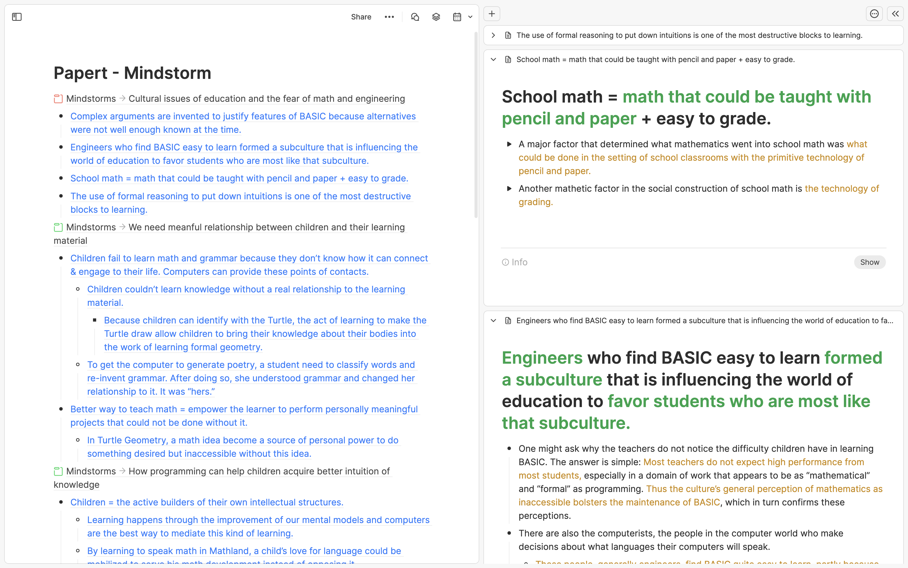
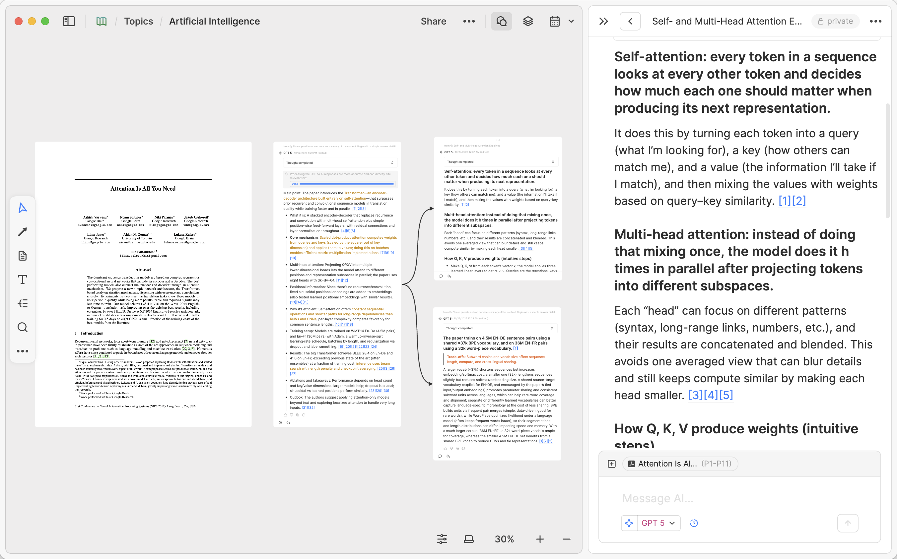
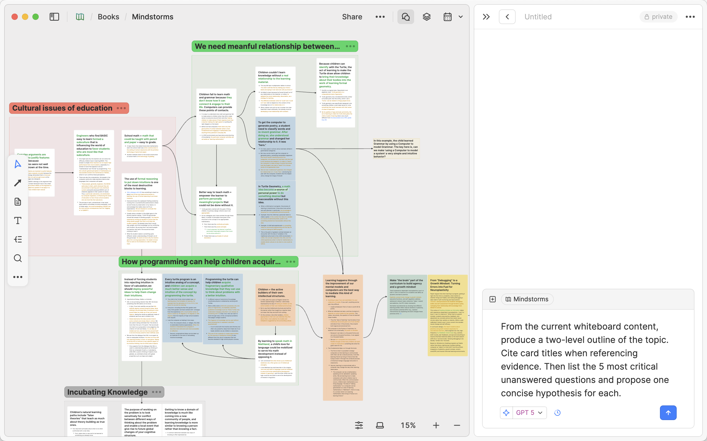
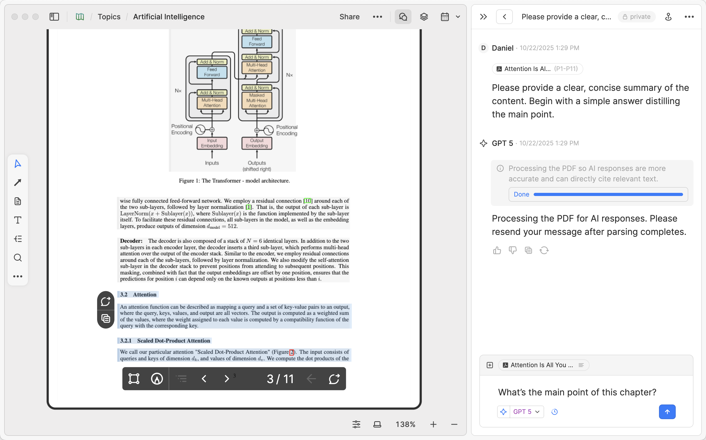

# 论文阅读与研究工作台产品规划

版本：规划 v0.5。更新日期：2026 年 10 月 17 日。

产品面向围绕一个问题持续阅读多篇论文的个人研究者，帮助用户将原始材料转化为可复用的理解，并产出可核查的研究结论。前端采用稳定的工作台结构：左侧管理入口与打开项，中间完成当前任务，右侧提供参考材料和 AI 辅助。

用户已确认产品方向为论文阅读与研究工作台，并要求参照 Heptabase 的整体界面截图规划。本文将“agent 开发范式”按使用 coding agents 分工开发来设计；产品中的 AI 功能单独定义。

首版面向桌面浏览器及 macOS / Windows 安装应用，保持单用户、本地持久化。实际实现采用 React / TypeScript / Vite / PDF.js，PDF 与研究数据保存在 IndexedDB，编辑恢复缓冲使用 localStorage。2026-10-16 接入用户指定的智谱 `glm-5.3-flash`，由本地 Node 服务保管凭据并代理流式请求，同时保留明确选择的演示模式。运行方式见 [README](../README.md)，AI 验收见 [AI 阅读记录](verification/ai-reading/README.md)。

桌面交付采用 Electron / Electron Forge，与浏览器共用界面及业务服务。固定应用来源和用户数据目录，单实例运行，退出前停止生成并等待保存；失败保留工作台，未响应时提供明确的重试或强制关闭选择。模型连接由应用自动管理，用户密钥经系统加密后保存，不包含于安装包或资料备份。完整 ZIP 备份用于浏览器与桌面之间迁移；恢复前校验来源和资产，原资料与资产在同一事务中保留一份副本。当前发布流水线生成未签名安装产物及 Release 草稿，开发者签名、公证、自动更新与跨设备同步仍未实现。分发和版本管理见 [桌面分发](desktop-distribution.md)，实际结果见 [桌面验收](verification/desktop/README.md)。

2026-10-16 AI 阅读已实现：选取材料后连续对话，AI 整理独立卡片草稿，用户修改确认，卡片保留论文与对话双来源；区域框选以截图作为证据，实际模型已通过图片冒烟。详细行为以 [产品需求](ai-reading/requirements.md)、[UX 设计](ai-reading/ux-design.md)和[开发计划](ai-reading/development-plan.md)为准；可点击[交互原型](ai-reading/prototype.html)仍仅用于设计评审。完整 OCR、复杂图表/公式语义可靠性、跨设备同步仍不在本轮范围。

2026-10-16 按 issue #1 扩展本机助手接入：统一 AI 面板输入区切换 Codex、Claude Code、OpenCode、模型直连与演示；每个研究中的对话绑定助手，历史、输入与草稿分别保留。项目授权与身份契约沿用研究和显式证据，新建原生会话处理材料范围收缩。能力和认证按运行时显示，不自动切换供应商；不涉及产品内多 agent 自治编排。交互、权限及 B0 契约见 [助手设计](agents/design.md)，实际验证及未覆盖项见 [本机助手验收](verification/agents/README.md)。

2026-10-17 用户认可[知识链路设计](knowledge-flow/README.md) v2，下文的导航、视图、对象和契约已按该方案更新，KF0–KF6 已实现并完成本轮[验证](verification/knowledge-flow/README.md)。调研显示真实研究并非线性推进，因此左栏不编号、不显示待办计数，分为“阅读”（资料、摘录）和“思考与写作”（卡片、白板、文稿）两组。材料从原文到结论逐步成熟，可逐级追溯；用户也可以从论点出发回头找依据。导入合并为一个输入框，无全文的资料可在原条目上补齐。首版只在本地识别 arXiv 和 DOI 格式，不联网。行为与验收见[需求](knowledge-flow/requirements.md)，切片见[开发计划](knowledge-flow/development-plan.md)。

2026-10-17 按 issue #3 增加[来源收录](source-intake/README.md)：从 AI 回答中的明确链接选择预览或加入当前研究；粘贴链接、DOI 和 arXiv 复用同一服务。条目先持久保存，再补元数据、原摘要并尝试取得 PDF，失败保留资料，之后可在原条目补全文。发现对话、推荐说明快照及收录备注按研究保存；全局文献和文件继续共享。普通聊天不会自动收录，不涉及 Agent 自动批量收集和浏览器扩展。实际结果以[本轮验收](verification/source-intake/README.md)为准。

2026-10-17 按试用反馈扩展连续阅读与同篇对照：PDF 默认纵向连续滚动，页码反映当前滚动位置；“分屏阅读”在中央阅读器内打开同一篇论文的两个独立位置，各自滚动、缩放和选取证据。支持上下/左右排列，中央较窄时自动上下，右侧 AI、卡片与来源仍使用原面板。引用定位主阅读位置，第二位置保持不变；关闭分屏保留第二位置，页内进度、布局按研究恢复，不复制文献实体。区域截图实际随 Codex 请求发送；系统听写不复用 Codex 客户端独有录音 UI。行为、测试与限制见[本轮验收](verification/reader-images/README.md)。

## 产品主线

2026-10-17 已接入项目会话第一版：研究绑定固定本机目录，原生聊天使用该目录；右侧统一发现、读取和管理三类助手记录，中央论文与引用定位沿用现有宿主。厂商保留原生历史，研究目录保存清单、每轮材料与可读归档；本轮增加 `Papertrail/` 中实际 PDF、图片和知识实体文件，应用共享实体及工作区 ZIP 备份继续保留。Codex 按已验证的原生 writer 锁尝试接续；外部 OpenCode／Claude Code 无法确认排他占用时只读。完整双向模型回复、原生桌面列表及项目目录独立恢复尚未验收，逐项见[实施记录](verification/project-sessions/README.md)。产品规则和后续范围见[需求](agents/project-sessions-requirements.md)、[UX 设计](agents/project-sessions-ux.md)与[原型](agents/project-sessions-prototype.html)。

研究项目是唯一对外身份，目录是项目位置。侧栏只保留一行项目名与“…”设置入口，不再另列“研究目录”。绑定后名称采用真实文件夹名，确认前预览；已有绑定在成功检查连接后同步名称，研究 ID、资料及会话归属不变。完整路径、连接状态和重连集中在项目设置；未绑定研究仍可独立命名和阅读。

2026-10-17 已实施[创建研究与目录文件](agents/research-directory-design.md)：新建研究默认新建目录，也可使用已有目录或稍后设置；右侧 Codex 沿用 `Research.directory`，切换研究时跟随。关联后自动把原始 PDF、图片、摘录、卡片、白板、文稿和可读会话保存到根目录下的 `Papertrail/`，应用保留本地恢复副本；本机聊天提交前等待目录保存。外部修改会暂停覆盖并保留原文件，暂不反向导入；完整迁移继续使用 ZIP。原生 Session 日志由 Codex 保存，文件中的原生 ID 与续接方式便于在同机同目录查找。真实文件读取与同 cwd 原生会话 list/read 已通过；独立 Codex 桌面列表、第二轮原生续接和目录独立恢复未验收，见[实现验证](verification/research-directory/README.md)。[原型](agents/research-directory-prototype.html)保留为设计基线。

按用户的原生输入区对照补充：Codex 保留材料“＋”、访问权限、模型与推理强度、技能／模式、语音入口及发送／停止。可用模型档位和权限按本机原生能力展示，完全访问须用户明确选择；截图中带黄点的附加图标暂不加入。麦克风显示“语音”，macOS 桌面点击后请求系统听写，其他平台提供系统快捷键指引；识别文字留在草稿且不自动发送，内置录音转写尚未接入。三栏结构与显式材料契约保持统一，详见[输入区验收](verification/native-composer/README.md)。

2026-10-17 修复对话提交：各助手不再额外限制单条问题为 4,000 字；仍受总请求容量与供应商上下文限制。前置检查完成、问题进入会话时清空对应输入，允许继续起草下一条；失败只在输入仍为空时恢复原问题，重试或重新生成保留当前草稿。准备期间恢复工作区会取消旧提交。图片现状：模型直连支持显式 PDF 区域图（需开启图像能力）；此次增量已为 Codex 接通显式 PDF 区域图，按本机模型目录的 inputModalities 判断所选型号；Claude Code、OpenCode 及通用图片粘贴/上传仍未接通。实际验证见[对话提交修复](verification/composer-fixes/README.md)。

同日修复 Codex 后台持锁导致的续聊中断：只有在问题尚未发送、原生续接因 writer 冲突被拒绝时，保留历史创建独立副本继续一次，常显“已恢复对话”；逻辑对话、旧来源与累计材料保留，后续沿用新原生关联。无需退出 Codex 或处理锁文件；已开始的回合不会自动重发，复制的 goal 不自动续跑。结果见[原生会话恢复验收](verification/native-session-recovery/README.md)。

2026-10-17 追加试用修复：中央分屏现在可独立选择当前研究的不同论文与知识卡片，支持论文＋论文、论文＋卡片、卡片＋卡片；两窗共用已有实体和编辑保存逻辑，不复制资料或卡片。标签栏提供“在对照窗打开”，各窗顶部可直接换内容；关闭后保留最近对照对象、布局与每篇阅读位置，按研究恢复，右侧面板独立。旧版同篇分屏偏好迁入统一 `mainSplit`，不再维护两套分屏布局状态。原生全屏时顶栏常显“退出全屏”，按钮与窗口级 ⌃⌘F/F11 均切回普通窗口；保留原生窗口框架、关闭保存保护及系统设置，详见[本轮补充验收](verification/fullscreen/README.md)。

研究问题 → 导入论文 → 阅读并留下原文证据 → 用自己的话形成卡片 → 组织支持、分歧与条件 → 写出带引用的研究结论。

一个代表性场景：用户研究“方法 A 在什么条件下优于方法 B”，导入三篇论文，对齐实验设定，将证据整理为观点卡片，在白板中标出支持与限制，最终导出一份解释适用条件的研究笔记。

用户再次打开研究时，应回到之前的位置，知道哪些论文已读、哪些结论仍待核查，并能沿引用回到原文。

## Heptabase 的逻辑与本产品的取舍

以下左列来自官方文档和截图，右列是本项目的设计推导。

| 官方逻辑 | 本产品采用的设计 |
| --- | --- |
| 知识从收集、理解走向创作 | 验证从一组论文到一份有出处结论的完整过程 |
| 卡片承载可复用的知识，白板组织它们 | 卡片正文独立保存；研究的白板引用卡片并保存布局 |
| 同一卡片可出现在多个白板 | 一条理解可用于多个问题，编辑时保持一致 |
| 左侧同时包含应用入口和打开的分页面 | 左栏只放当前研究的稳定入口与资料库；正在处理的资源统一在中央标签栏 |
| 主区旁可同时打开卡片参考或 AI | 研究任务持续留在主区，参考与辅助在右侧展开 |
| PDF、卡片、白板可成为 AI 上下文，回答可再沉淀为卡片 | 显式选择材料后对话，从回答整理独立卡片草稿，修改确认并保留双来源 |

依据：[Knowledge Lifecycle](https://wiki.heptabase.com/the-knowledge-lifecycle)、[Learn & research a topic](https://wiki.heptabase.com/the-best-way-to-acquire-knowledge-from-readings)、[Fundamental Elements](https://wiki.heptabase.com/fundamental-elements)、[User Interface Logic](https://wiki.heptabase.com/user-interface-logic)、[Work with AI](https://wiki.heptabase.com/work-with-ai)。

## 截图观察

截图均为官方 Wiki 中的产品界面图，已在浏览器放大查看；它们体现文档展示的状态，并不代表已经验证登录后应用的全部实时行为。来源与原文件见 [参考图目录](references/heptabase/README.md)。

### 导航与打开项


左侧顶部包含研究入口、创建、搜索及功能入口。官方文字将左侧下半部定义为普通、固定和分组的打开项。两者分别承担资料入口和工作上下文。

本产品保留“入口稳定、打开项可变”的层次，但入口改为当前研究内的页面（2026-10-17 知识链路方案），打开项只在中央资源标签显示，提供切换、固定、关闭及排序，沿用同一份 `openItems / active / pinnedIds`，不另建会话状态。每篇论文复用同一标签，引用只改变原文定位；关闭标签保留正文、阅读位置与右侧 AI 输入。

### 主区与参考面板



截图中左边是正在编辑的内容，右边能展开参考卡片。右侧并非只承担聊天，也承载阅读和写作所需的资料。对应本产品的右侧面板应能切换证据、卡片、文献信息与 AI。

### 白板与 AI



截图中 PDF 与笔记共同存在于白板，AI 位于独立右侧面板；对话输入附近展示引用范围。另一张截图展示了分区、卡片与连线组成的研究结构。



本产品的白板先覆盖卡片摆放、分组、连线与来源预览。双击论文预览时进入专用阅读视图，退出后恢复白板视口，让论文文字保持可读。

### PDF 选区与上下文



截图展示原文选区、附近的操作入口、页码控制以及右侧对话。它还展示了 PDF 解析状态，说明阅读就绪与 AI 处理就绪需要分开表达。

本产品将“创建证据卡片”和“加入 AI 上下文”放在选区附近。用户可以先阅读并做笔记；文本提取尚未完成时，仅限制依赖该文本的 AI 动作。

## 前端整体结构

```text
┌───────────────────┬─────────────────────────────────┬──────────────────────┐
│ 左侧导航           │ 当前对象标题 / 研究路径 / 操作     │ 右侧面板标题与模式    │
│                   ├─────────────────────────────────┤                      │
│ 当前研究 ▾  …      │ 中央资源标签（当前页面＋打开项） │ 摘录                 │
│ 搜索              ├─────────────────────────────────┤ 卡片（含找依据、     │
│ 研究主页           │ 主工作区                         │   出处链子视图）     │
│ 阅读               │                                 │ AI 对话              │
│   资料             │ 研究主页 / 资料 / 摘录 / 卡片    │                      │
│   摘录             │ PDF 阅读器 / 文献详情             │ 每次展开一种模式     │
│ 思考与写作         │ 白板 / 文稿                       │ 可收起、调宽         │
│   卡片             │                                 │                      │
│   白板 › 各白板    │ 根据当前页面或资源切换           │ AI 模式底部显示      │
│   文稿 › 各文稿    │ 保留各对象的工作位置             │ 已选上下文与输入框   │
│ 资料库  设置       │                                 │                      │
└───────────────────┴─────────────────────────────────┴──────────────────────┘
```

这张图表示推荐布局。阅读、白板与写作共用同一个应用框架，右侧功能由当前工作对象决定。

### 左侧导航

| 区域 | 内容与行为 |
| --- | --- |
| 顶部 | 当前研究切换器（含新建研究与“…”项目设置）、搜索 |
| 研究主页 | 研究问题、接着上次、结论站得住吗、最近 |
| 阅读 | 资料、摘录 |
| 思考与写作 | 卡片；白板与文稿，各自的具体条目缩进在类型下 |
| 底部 | 资料库、设置，以及存储与连接状态 |

左栏不编号、不连线，不显示“待读 / 待整理”等计数，只提供稳定入口；真实研究在这些入口之间双向往返。打开的论文、白板和文稿只显示在中央标签栏。1024px 及以下，左栏折叠为抽屉。

原全局入口的归位：收件箱 → 资料库的“未加入研究”筛选；论文库 → 研究内“资料”，跨研究用资料库；研究空间 → 研究切换器；卡片库 → 研究内“卡片”，跨研究用资料库或“添加已有卡片”；研究产出 → 研究内“文稿”。同一论文和卡片可进入多个研究。

首次进入时展示创建研究与添加资料的入口。已有资料时，研究主页的“接着上次”回到上次阅读和编辑的位置。

### 中央工作区

| 视图 | 用户任务 | 主要操作 |
| --- | --- | --- |
| 研究主页 | 让问题逐渐清楚，回到上次位置，看结论是否站得住 | 编辑问题、接着上次、找依据、去核对 |
| 资料 | 收下与挑选要读的材料 | 单一添加入口、按在读/未读/读过分组、补全文、打开阅读 |
| 文献详情 | 查看和编辑一条资料，尤其是无全文条目 | 编辑文献信息、拖入 PDF、合并重复条目、打开原链接 |
| PDF 阅读器 | 读懂单篇论文并留下原文 | 翻页、缩放、目录、搜索、选区摘录（`H`）、写成卡片（`C`）、问 AI、略读过/读完 |
| 摘录 | 回看留下的原文，取用为卡片依据 | 按论文分组、多选写成卡片或 AI 起草、不需要、看原文 |
| 资料库 | 跨研究查找与复用 | 资料/卡片标签、未加入研究筛选、加入本研究 |
| 卡片编辑器 | 写下一个可复用观点 | 编辑标题正文、添加来源、查看被哪些研究引用 |
| 研究白板 | 对比证据并组织论证 | 摆放、移动、缩放、分组、连线、打开来源 |
| 文稿（结论编辑器） | 写出带引用的结论 | 按白板结构插入卡片、点击 `[n]` 查看出处链、补引用、导出 Markdown |

阅读器保留页码与缩放；白板保留视口与布局；编辑器保留草稿及保存状态。切换视图后返回时恢复工作位置。

阅读状态为未读、在读、略读过、读完；资料页按在读、未读、读过分组，略读过算作读过。观点可标记“待核查”。界面不把未读资料或未用摘录显示为欠账，只提醒影响结论可信度的问题。

### 右侧面板

| 模式 | 使用情境 | 行为 |
| --- | --- | --- |
| 摘录 | 阅读论文或整理 | 阅读器中显示本篇摘录；其他页面显示本研究还没用到的摘录；点击定位回来源 |
| 卡片 | 整理、白板、写作或核查 | 卡片详情与编辑、未摆放卡片、按白板分区取用卡片、预览 PDF 来源页；子视图“为某卡片找依据”和文稿 `[n]` 出处链 |
| AI | 解释、比较与起草 | 多轮消息阅读、发送范围、会话历史；卡片草稿与来源预览使用同一面板的子视图 |

文献信息不再单设右侧模式：无全文条目在主区文献详情编辑，有全文的论文从阅读器工具栏打开文献信息。

MVP 采用一个可切换模式的右侧面板。右侧打开资源不应替换主区；用户可明确选择“在主区打开”。

面板可在当前研究内固定，以便编辑结论时持续查看同一份参考资料。切换研究会恢复目标研究自己的面板和 AI 上下文，固定操作不跨研究生效。

主区和参考面板分别保留自己的返回记录。编辑状态统一为 dirty、saving、saved、error。关闭打开项、切换研究或从卡片切到 AI 时都保留未保存缓冲；保存失败可重试，关闭视图不等于丢弃编辑。只有用户明确选择放弃时才移除未保存内容。资源已删除或来源文件缺失时显示可恢复入口或原因。右侧的来源页预览复用阅读器的渲染与定位能力。

### 尺寸与视觉规范建议

这些数值是本项目的布局起点，并非对 Heptabase 的像素测量。

- 左栏默认 240px，可折叠；1280px 场景自动使用 220px 左栏。右栏默认 360px，可在 320–520px 内调整，同时受主区可用宽度约束。
- 主内容区优先保留约 640px 的可用宽度；桌面 AI 对话面板默认至少约 420px，中央至少保留约 560px。AI 来源引用直接在中央定位，右侧保留回答、输入和草稿进行对照。
- 1440×900、1280×800 和 1024×800 均使用原文与 AI 并列布局；1024px 折叠导航、右栏参与布局而不覆盖原文，低于 1024px 才使用抽屉。
- 正文、工具条和边距使用统一设计变量；字体建议正文 14px、编辑内容 16px，采用 4px 间距基准。
- 用资源图标、文字与选择状态区分对象；语义颜色用于证据高亮、白板分组和待核查状态。
- 阅读区域保持低干扰，当前对象标题、保存状态与来源位置始终可找到。
- 左栏折叠、面板切换、选区菜单、搜索和编辑支持键盘操作；图标按钮有可读名称。

## 必须连贯的交互

1. 从研究打开论文，在第 3 页选一段文字按 `H` 摘录，继续阅读；之后在摘录页把它写成卡片，卡片自动关联原论文与 PDF 第几页。也可以选中后直接按 `C` 写成卡片。
2. 在白板加入该卡片，在右侧查看内容，编辑后白板和卡片库显示同一份更新。
3. 点击卡片的来源，主区打开对应 PDF 并定位；返回白板时恢复原缩放与位置。
4. 在结论编辑器插入卡片的引用，右侧保持参考材料；导出时包含文献标识、页码和摘录。
5. 将两条证据加入 AI 上下文，要求比较并连续追问；引用只指向本次实际发送的有效证据。用户从整条回答或片段整理卡片，编辑独立草稿并确认保存，原始问答保持可回查。
6. 从研究 A 切到研究 B，恢复 B 自己的打开项、面板和对话；回到 A 时恢复 A 的工作位置。
7. 研究主页提示文稿中的某张卡片没有原文依据；点击“找依据”，先在本研究摘录中挑选，没有合适的就去资料里读，在阅读器中把句子设为依据；卡片标为待核查，主页的提示变为“补引用”，在文稿中插入引用后消失。
8. 只有 DOI 的论文先收下为无全文条目；之后在原条目拖入 PDF，条目 ID、研究关联和白板摆放保持不变。

AI 上下文与当前选区分别管理。改变选区不自动扩充发送范围；正在生成的请求绑定提交时的上下文快照，切换研究后结果仍归原研究。

原文选区加入 AI 时先形成可追踪的证据对象。R1 实际发送范围包含显式证据、必要来源信息及明确展示的前序问答，不自动发送整篇 PDF 或整个研究库。移除当前证据不代表历史消息已经不含原文；需要排除旧消息时使用新会话。R2 允许发送用户确认的区域图片。

白板删除摆放实例仅移出当前白板。删除卡片正文属于全局动作，应清楚提示它的引用位置，并保留可恢复的删除方式。

## 共享对象与前端状态

### 业务对象

| 对象 | 最小职责 |
| --- | --- |
| Research | 核心问题、名称、关联文档与卡片、工作状态 |
| Document | 稳定 ID、标题、作者、年份、DOI/arXiv/URL 标识、阅读状态（含略读过）；有全文时另有文件引用、内容 hash、页数、解析状态 |
| Evidence | 界面称“摘录”。文字证据保留文档 ID、页索引、原文摘录与稳定锚点，另记来源研究、随手记、“不需要”标记；R2 另增区域类型，保留图片资产、坐标和区域说明 |
| Card | 稳定 ID、标题、正文、结构化证据引用、对话来源与创建快照、待核查状态 |
| CardDraft | AI 整理与用户编辑的独立草稿、来源、修订版本、确认入库状态 |
| Board | 所属研究、标题 |
| BoardPlacement | 白板 ID、卡片或文档引用、坐标、分组 |
| BoardEdge | 白板 ID、起终摆放实例、关系说明 |
| Draft | 所属研究、正文、结构化引用、插入过的卡片记录、保存状态 |
| Conversation | 所属研究、标题、上下文选择、问答记录、历史与归档状态 |
| AIRequest | 请求用途、实际发送快照、原始问答、模型与尝试状态；卡片编辑不改写原始回答 |

原始 PDF 按 hash 固定；替换文件建立新资产。资料可以暂时没有全文：无全文条目首次补上 PDF 时保留原 ID 与全部关联；若该 PDF 已属于另一条资料，由用户确认合并，不静默覆盖。页索引统一从 0 开始，界面显示 PDF 第几页时加 1；印刷页码另存。文字证据同时保留摘录和页索引；区域证据保留图片资产、坐标、区域说明和页索引，定位失败时仍可回到正确页并查看保存的区域图片。定位矩形不能成为唯一依据。

卡片与文档属于全局资料，研究保存关联。白板连线引用摆放实例；资料引用使用实体 ID，避免布局变化破坏来源。

在研究内新建卡片时自动关联该研究；全局已有卡片或文档通过“加入研究”动作显式关联。白板添加资料、插入卡片引用的选择器同时完成该关联，无需再弹一次确认。关联卡片时一并关联其引用证据对应的文档，移出研究不删除全局实体。AI 仅能接收已关联研究的证据；从全局资料加入上下文时，入口需明确表达“加入当前研究并用于对话”，应用服务在同一次动作中建立关联并校验。

### 界面状态

| 状态 | 保存范围 |
| --- | --- |
| 导航展开、面板宽度、外观 | 应用级 |
| 打开项、固定项、当前研究页面、右侧面板及固定状态、找依据目标卡片 | 按研究保存；资料库使用独立 library 会话，保存当前集合与筛选 |
| 阅读页码与缩放、白板视口 | 按研究与资源保存 |
| 当前选区 | 临时状态，携带研究、资源及视图实例 ID |
| AI 上下文 | 按研究和会话保存，并显式展示 |
| 会话位置与卡片草稿 | 按研究、会话和草稿恢复输入、滚动与未保存编辑 |
| 生成请求快照 | 绑定请求、研究、会话和草稿版本，保存实际使用的历史问答、证据和来源版本 |

### 统一交互契约草案

```ts
type ResourceRef = {
  kind: 'research' | 'document' | 'card' | 'board' | 'draft';
  id: string;
};

type WorkspaceScope =
  | { kind: 'research'; researchId: string }
  | { kind: 'library' };

type ResearchViewId = 'home' | 'sources' | 'excerpts' | 'cards' | 'boards' | 'drafts';
type CollectionId = 'documents' | 'cards'; // 仅资料库（library 会话）

declare function openResearchView(researchId: string, view: ResearchViewId): void;
declare function openCollection(collection: CollectionId, filter?: 'all' | 'unassigned' | 'research'): void;

declare function openResource(ref: ResourceRef, options: {
  scope: WorkspaceScope;
  target: 'main' | 'inspector';
  anchor?: { evidenceId?: string; pageIndex?: number; placementId?: string };
}): void;

declare function setSelection(selection: {
  scope: WorkspaceScope;
  viewInstanceId: string;
  selectedItems: Array<{ resourceRef: ResourceRef; placementId?: string }>;
  textRange?: { documentId: string; pageIndex: number; quote: string };
  evidenceIds: string[];
}): void;

declare function addContext(input: {
  researchId: string;
  conversationId: string;
  evidenceIds: string[];
}): void;
```

这是规划中的接口形状，实施时需补全类型与校验。资源是否可访问、是否属于允许的研究范围及证据是否有效，由应用服务统一检查。全局资料可被显式加入当前研究。

研究页面、资料库集合与资源入口共用同一个导航控制器；资料库使用 library 会话，研究页面和资源使用对应研究会话。新增的资料添加、补全文、摘录、找依据与可信度推导接口见[知识链路开发计划](knowledge-flow/development-plan.md)。所有 feature 使用统一的导航、打开资源与选区接口；不同入口不能各自实现另一套页面跳转、卡片正文或聊天状态。

## MVP 边界与发布顺序

| 阶段 | 可交付行为 | 完成标准 |
| --- | --- | --- |
| A 工作台骨架 | 用固定样例在研究、论文、卡片、白板和结论间切换 | 三栏联动成立；返回能恢复位置；关键视图截图可验收 |
| B 阅读与证据 | 导入真实 PDF、阅读、选区建卡、来源跳转、本地保存 | 刷新后数据与引用保留；文本不可选时有清楚说明 |
| C 组织与产出 | 轻量白板、卡片复用、结论编辑和 Markdown 导出 | 同一卡片多处一致；导出引用信息完整 |
| D AI 辅助 | 演示基线后推进 R1 文字多轮对话与可追溯卡片，再推进 R2 区域问答 | 请求范围可见；原始问答稳定；独立草稿确认；原文与对话双来源；真实调用分别验证 |
| E 知识链路 | 研究内导航与主页、单一添加入口、无全文条目、略读过、阅读时摘录、摘录页、找依据、可信度与出处链（KF0–KF6） | 原入口内容均可找到；schema 2 数据无损迁移；双向路径与研究隔离通过 E2E；三种宽度截图 |

当前实现和 R1 支持有文本层的 PDF；扫描件可打开。R2 通过用户框选区域图片支持图表、公式与扫描页问答，OCR 和复杂版面结构化提取后置。Markdown 导出保留引用信息，R1 增加已用卡片的对话来源文本；若需要在别人的电脑上恢复原 PDF、区域图片或完整工作区，还需另做导出包。

跨论文对比先用“方法、实验条件、结论、限制”卡片和白板分组完成；专用对比矩阵在真实使用验证后增加。联网补元数据、尝试取得 PDF 与 AI 推荐资料主动收录已接入，范围见[来源收录](source-intake/README.md)；后续候选还包括 Zotero 接入、研究内资料分组、语义检索、嵌套白板和可分享导出包。

多人实时协作、完整通用笔记生态、任意多窗格、微服务、产品内多 agent 编排及插件平台均不进入本轮开发任务。

## 设计决策

### 导航提供入口，不规定顺序

决策：材料从原文到结论的成熟方向体现在数据关系和出处链中；左栏只提供研究内的稳定入口，不编号，不显示待办计数，并支持从论点回头找依据。

理由：研究文献（Pirolli & Card 意义建构模型、Bates、Ellis、Kuhlthau、主动阅读研究）显示阅读与思考交替、问题随阅读变化；未读资料和未用摘录是常态，显示为欠账会误导用户。详见[知识链路 UX 设计](knowledge-flow/ux-design.md)。

但：用户需要自己判断下一步；研究主页用“接着上次”和“结论站得住吗”提供方向，不提供强制流程。

### 共享工作台与模块化视图

决策：使用单一应用框架和统一的主区、右侧面板宿主，功能按模块接入。

理由：用户能连续阅读与研究，coding agents 可通过固定契约并行实现各模块。

但：框架、共享类型及持久化入口会成为集成汇合点，需要单一负责人；不设计任意窗口布局。

### 资料与摆放分开

决策：原文资产不变，证据独立保存，卡片正文与白板布局分离。

理由：同一理解可以复用，来源在不同视图中都可定位。

但：需要处理原文缺失、解析失败与引用失效；跨 PDF 版本的锚点迁移后置。

### AI 对话与卡片成果分别保存

决策：AI 使用可见的材料与历史范围，原始问答完成后保持稳定。用户从整条回答或片段生成独立卡片草稿，AI 修订先预览、人工修改后确认入库，结构化引用经代码校验。卡片同时关联论文依据和产生它的对话。

理由：用户可持续修改知识成果，并保留最初的问题、解释和证据用于回查。

但：引用存在不等于结论正确，用户仍需要核对含义；上下文过大时应提示缩小范围。

## 产品验收与验证目标

发布前用固定的一组合法测试 PDF 验证：从导入到证据卡片、白板、结论导出的主线能够完成；所有声称有来源的结论都能在工作台中回到对应原文。

以下是试用期需要记录的指标，不是已有结果或承诺值：首次形成证据卡片的耗时、完成一份带来源研究笔记的比例、研究恢复是否正确、引用跳转成功情况、AI 草稿被保留和修改的情况。

agent 任务、模块所有权与逐项验收见 [开发任务清单](agent-backlog.md)。首版实现与测试的实际证据见 [验证记录](verification/README.md)；真实模型调用、OCR、完整撤销历史及附带原 PDF 的导出包仍为后续工作。


2026-10-17 知识链路实现说明：工作区升级为 schema 3；研究内入口、无全文条目、摘录整理、找依据与出处链共用现有服务。文稿 `cardRefs` 记录卡片及插入时证据，正文 `[n]` 继续指向证据。“预览引用”提供正文编号点击；“补引用”只在光标处插入编号。标识冲突的合并拒绝执行以保留来源。实际命令、三尺寸截图及验证边界见[知识链路验收](verification/knowledge-flow/README.md)。
