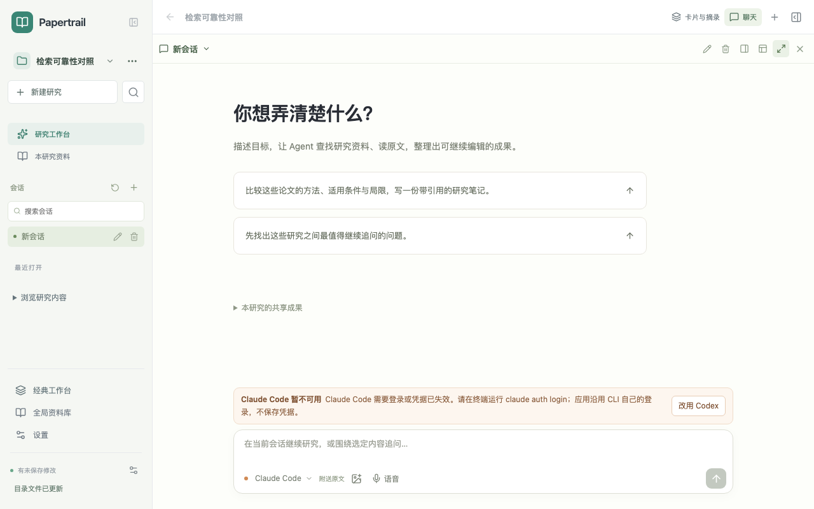
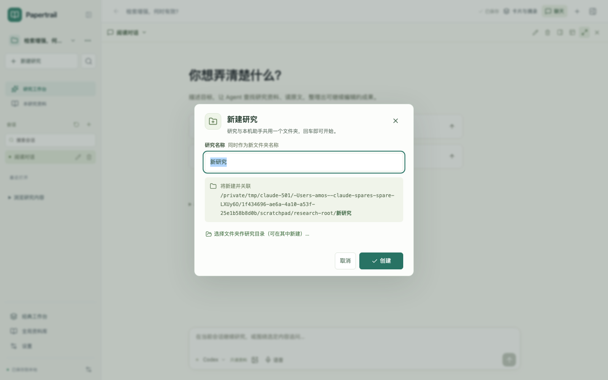
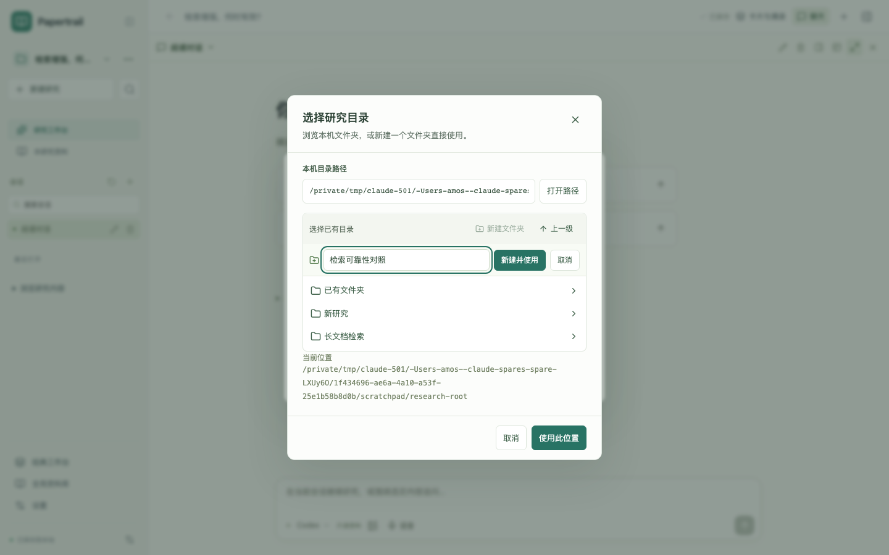
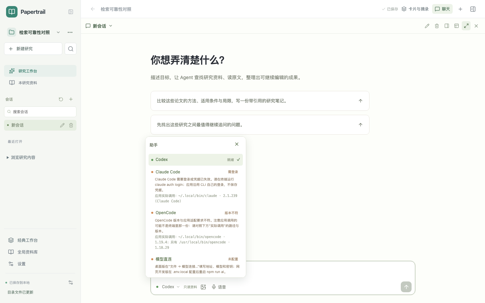
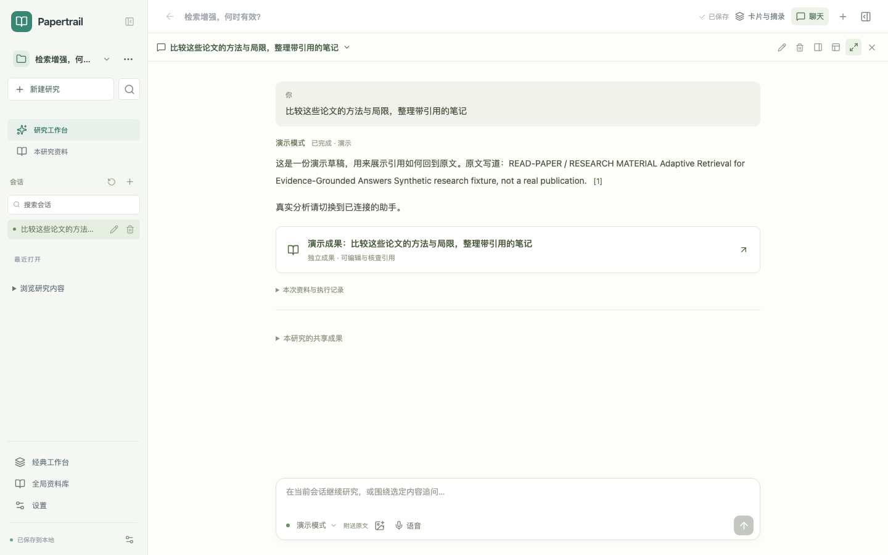
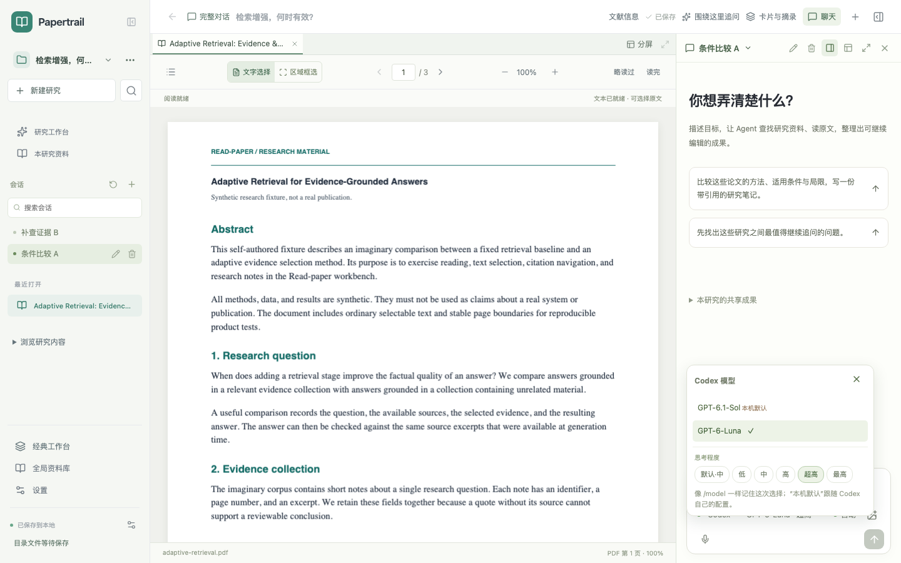
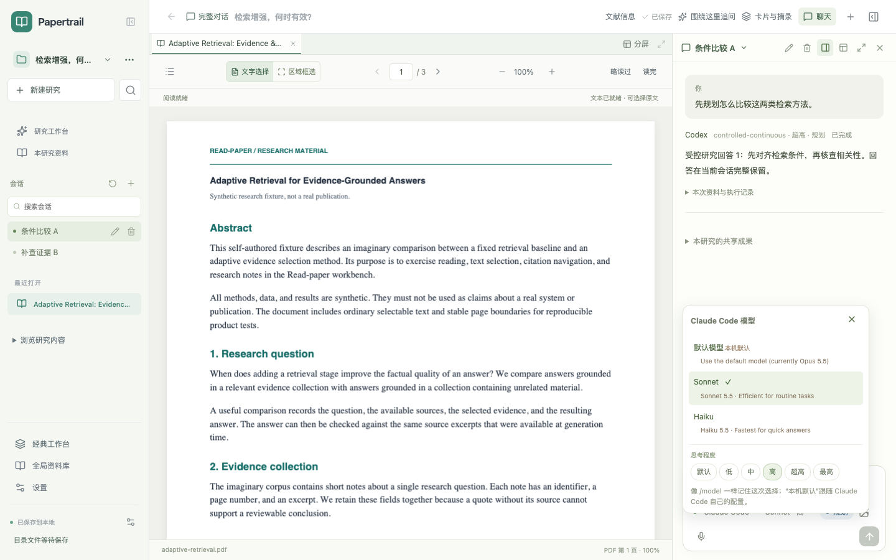
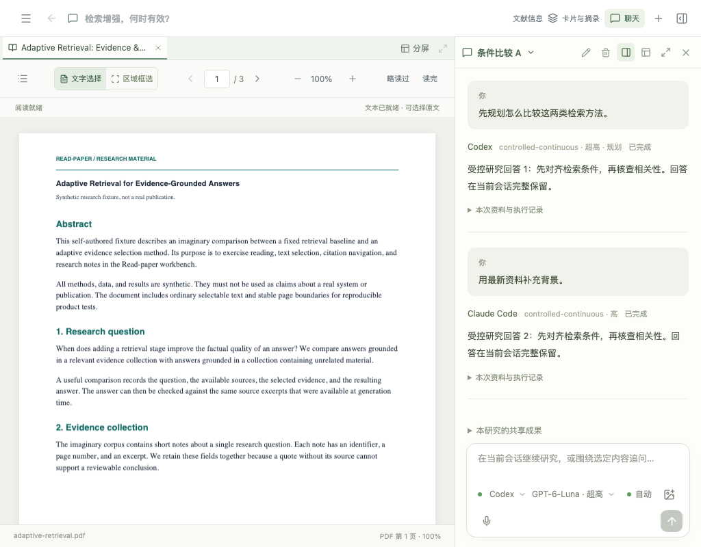
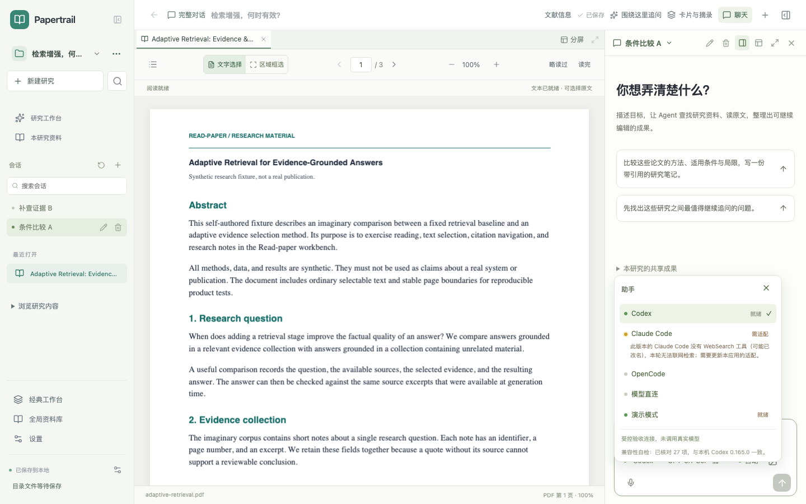
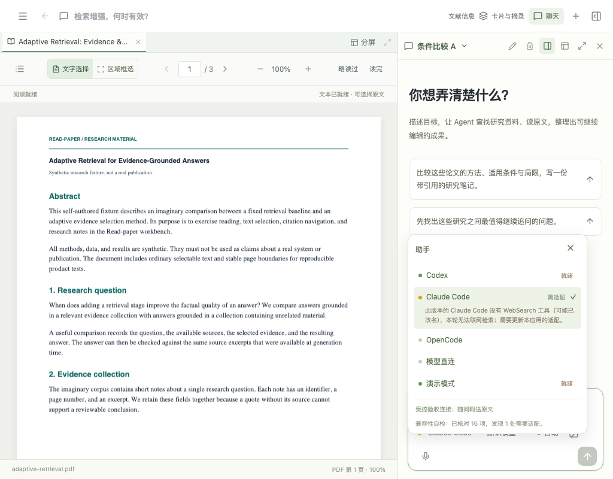

# 新建研究即关联目录、助手统一界面与连接诊断（2026-10-28）

本轮回应三个问题：新建研究时就绑定目录且能在选择时新建文件夹；切到 Codex 与 Claude Code / OpenCode 时页面为什么不同；本机助手在终端能用、应用里却连不上时如何排查。截图来自开发服务与本机真实助手服务，论文是项目自制样例。

## 1. 页面差异的原因

Agent 工作台里，聊天区按“这是不是研究会话、且连接是不是 Codex”分流：只有 Codex 渲染研究视图（`ResearchAgentHome` / `ResearchAgentDock`），其他连接落回经典 `AIPanel`，于是标题、材料行、“为这个研究选择目录”提示与输入框都换了一套。根因在服务端：`/api/ai/research/capabilities` 只给 Codex 标 `research: true`，逐页阅读、成果提交与文献检索这组研究工具只经 Codex app-server 接入。

- 模型直连、演示模式与 Claude Code / OpenCode 情况相同，也会落回经典面板。
- 经典工作台里所有连接本来就统一使用经典面板，没有这种差异。

现在所有研究会话都使用同一研究视图。Codex 仍按需逐页阅读、可检索文献与看图；Claude Code、OpenCode、模型直连与演示改为每轮随问附送本轮论文页面文字（单次预算分别约 12 万、10 万、6 万、2 万字），以一个 `papertrail-result` JSON 成果块返回，再走与 Codex 相同的 `submit_result` 引用核对写入草稿。引用必须逐字出自附送页面，否则不保存成果并在回答末尾说明。原生导入或经典记录仍保留经典面板。

## 2. 本机实测：终端能用、应用失败的原因

用已安装应用同样的 Finder 环境（`PATH=/usr/bin:/bin:/usr/sbin:/sbin` 加原有兜底目录，不读 `~/.zshrc`）直接调用各适配器的 `probe()`：

| 助手 | 应用实际调用 | 终端调用 | 结果 |
| --- | --- | --- | --- |
| Codex | `/usr/local/bin/codex` 0.139.0 | `~/.local/bin/codex` 0.165.0 | 旧版不满足材料目录隔离，报“此 Codex CLI 不能隔离材料目录”。换用 0.165.0 后 `probe` 为 ready |
| OpenCode | `/usr/local/bin/opencode` 1.18.29 | `~/.local/bin/opencode` 1.19.4 | 适配器只验证过 OpenCode 2.x 协议，两份 1.x 都会被拒绝 |
| Claude Code | `~/.local/bin/claude` 2.1.239 | 同一份 | 适配器要求 `--permission-prompts`，2.1.239 没有此参数，被误判为“缺少安全隔离参数” |

另外，运行中的 Papertrail 只有 `PATH`、`HOME` 等基础变量，没有 `~/.zshrc` 里的 `https_proxy` / `http_proxy` / `all_proxy`。本机当前直连也能访问各 API，代理不是这次的决定因素；只靠 shell 代理上网的环境里，它会直接导致连接失败。本会话的沙箱读不到钥匙串，因此没有对 Claude Code 的真实登录状态下结论。

## 3. 本轮改动

**新建研究即关联目录**

- Agent 工作台点“新建研究”打开精简窗口：名称已预填并避开重名，回车即在上次研究旁（首次为“文稿”）新建同名文件夹并关联，然后聚焦对话输入框。默认名称撞上已有文件夹时自动顺延编号；自己输入的名称撞上时，可“直接使用这个文件夹”。
- “选择文件夹作研究目录（可在其中新建）…”：桌面版系统选择器开启“新建文件夹”（`createDirectory`），选中即关联；网页版选择器内可“新建文件夹”，创建后直接作为研究目录。经典工作台的父位置／已有目录选择器同样可以新建文件夹。
- 旧研究未关联目录时，“…”项目设置从默认研究位置开始浏览，可一键“在当前位置新建「研究名」并关联”，浏览器里新建的文件夹也直接关联。
- 默认位置还在读取时就按回车，会等位置就绪后自动创建（打包应用实测：此前这次回车会被忽略）。目录服务不可用时才出现“先创建，稍后关联目录”。已关联目录的研究不再按首个问题自动改名，避免与文件夹名不一致。
- 服务端新增 `mkdir` 目录动作：只在已浏览的位置下创建，名称按跨平台规则校验，可选自动顺延编号。
- 修复既有问题：新研究的第一条会话没有时间戳，会被归入“更早”。

**连接问题自动处理**

- 桌面版启动后在后台读取登录 shell 环境（macOS 另读 `launchctl setenv`），只补入启动环境里没有的代理、服务地址、密钥、CLI 目录等变量，显式设置（包括刻意清空）的不覆盖。窗口不等待；结果写入运行环境，供之后的助手启动使用。
- 兜底 PATH 改为用户安装位置（`~/.local/bin`、`~/.opencode/bin`）优先于 `/usr/local/bin`，不再先用到过期的 npm 全局版本。
- Claude Code 不再强制要求 `--permission-prompts`：`--print` 模式下已关闭全部工具与 MCP，并保留 `--permission-mode dontAsk`；版本仍有该参数时继续传入。
- 失败分类为未安装、需登录、额度、网络、超时、版本不符，并给出下一步；Claude Code / OpenCode 失败附上 CLI 自己的输出，隐藏密钥与本轮临时目录。
- 助手旁圆点显示是否就绪；回到应用、打开助手列表或一轮失败后自动重新检测，去掉“重新检测”按钮。检测结果短时缓存（就绪 60 秒、未就绪 8 秒，失败即清除），发送前不再每次等待数秒的 CLI 检测。
- 当前助手未就绪时，输入框上方说明原因，并给出“改用 X”；失败的一轮可“改用 X 重试”。不会静默换供应商，演示模式不会被推荐为替代。
- 助手列表列出“应用实际调用”的路径与版本以及其他副本、是否已读取登录 shell 环境、存在哪些代理变量名（不显示值）。

## 4. 验证

| 检查 | 结果 |
| --- | --- |
| `npm run check` | 通过 |
| `npm test` | 54 个文件、845 项通过 |
| `npm run test:server` | 365 项通过；新增附送原文研究、成果块核对、演示／模型直连、失败分类与脱敏、目录服务等用例 |
| `npm run test:desktop` | 31 项通过；新增登录 shell 读取与合并规则；安装包白名单包含新服务模块 |
| `npm run desktop:package` | 成功，生成 `out/Papertrail-darwin-x64` |
| 打包桌面 e2e：`research-switcher`（3）、`chat-inputs`（1）、`research-directory`（2） | 通过。新建研究在隔离资料目录的 `Documents/新研究`、`Documents/新研究 2` 实际生成 `.read-paper/project.json`；系统选择器带 `createDirectory` |
| e2e：`research-switcher` 新建研究用例 | 通过：回车新建并关联 `/fixture/新研究`、`/fixture/新研究 2`，`mode: new`，聚焦输入框，取消不创建 |
| e2e：`continuous-workspace`（11）、`project-sessions`（11）、`research-directory`、`workbench-sessions`、`agent-regressions` | 通过 |
| 浏览器实测 | 新建并关联真实临时目录；选择器内新建文件夹并直接关联；Claude Code 保持研究视图；演示模式生成带引用成果；无页面错误 |

1440、1280、1024 三种宽度截图见 `screenshots/`。1024 下左栏收起，未就绪提示与“改用 Codex”仍完整可见。

**已有失败（与本轮无关）**：以下在未修改的 `HEAD` 上同样失败，原因是测试仍引用已改版的界面：`agent-workbench` 的两项（旧 `<select>`、已不存在的“会话列表”按钮）、网页版 `chat-inputs` 的两项，以及 `research-switcher` 中点击被隐藏主区和旧“资料库”按钮的两项。本轮只修正挡在改动前面的部分：网页与桌面的启动等待（主区在全宽聊天时 `aria-hidden`）、桌面“资料库”改名为“全局资料库”；`agent-workbench` 中助手切换的步骤已改为现行界面并通过，之后仍卡在旧按钮。连续批量运行时，Excalidraw 偶发“重复 React”报错，属开发服务依赖重新预构建，重启开发服务后单独与整文件运行均通过。

## 5. 未验证与限制

- Claude Code、OpenCode 与模型直连的附送原文研究只有确定性测试，真实回答质量和成果块遵循率尚未实测；本机 Claude Code 在本会话中显示需登录，OpenCode 1.x 仍不在适配范围内。
- 登录 shell 读取只在 macOS / Linux 执行，Windows 保持启动环境；修改 shell 配置后需要重启应用。
- 已安装的 0.1.19 不含本轮改动，需要重新打包安装才生效。本轮没有改动或卸载 `/usr/local/bin` 下的旧版 CLI。

## 6. 2026-11-02 补充：原生的模型、思考程度、模式与联网

用户反馈两点：输入区没有原生 CLI 那样的模型切换、思考程度和模式（如 auto）；Claude Code 登录后不能联网搜索。

**原因**

- Claude Code 适配器为了隔离，运行时固定传 `--tools ''`，WebSearch / WebFetch 一起被关掉，与登录无关。
- Codex 运行时早已支持模型、推理强度和 Plan 协作模式，但研究会话拒绝这些参数，app-server 还固定 `web_search="disabled"`；未选择时推理强度固定为 `low`，本机 `config.toml` 实际配置的是 `high`。
- 研究输入区只有助手按钮和“只读资料／附送原文”标签，没有对应入口。

**改动**

- 检测时读取各 CLI 自己的菜单：Codex 用 app-server 的 `model/list`、`config/read` 和 `collaborationMode/list`；Claude Code 用其 SDK 握手（`--input-format stream-json` 下的 `initialize`），即 `/model` 列出的模型及每个模型支持的思考程度，不发送提示词、不消耗额度。`/api/ai/research/capabilities` 随就绪状态返回 `models`、`modes`、`web` 与 Codex 当前配置的思考强度。
- 输入区在助手按钮旁增加“模型 · 思考程度”和模式按钮。模型与思考程度按助手记住（`agentRunSettings`），选“本机默认”跟随 CLI 自身配置；模式按会话记住（`agentMode`），点选或在输入框按 Shift+Tab 循环。每轮把实际使用的设置记在该轮（`runSettings`），回答标题显示“模型 · 思考程度 · 模式”。助手已不再提供的模型或思考程度不会发出，回到本机默认。
- 模式：
  - **自动**：Codex 开启原生 `web_search="live"` 与文献检索；Claude Code 只开放 `--tools WebSearch,WebFetch` 并预先允许这两个工具，权限模式保持 `dontAsk`。
  - **规划**：Codex 使用原生 Plan 协作模式，不提供 `submit_result`；Claude Code 使用 `--permission-mode plan`；附送原文路径即使返回成果块也不保存。
  - **仅资料**：不联网，也不提供文献检索。
  - OpenCode、模型直连和演示没有可单独开放的联网工具，只提供“自动”和“规划”。
- 联网结果只能以正文中的 Markdown 链接出现，引用仍只能来自本轮原文并经代码核对。Claude Code 仍为 `--safe-mode`、`--strict-mcp-config`，不开放文件、命令、MCP 或插件；Codex 研究会话仍不开 shell、审批策略为 `never`，研究会话不接受访问权限参数。
- 联网检索的查询会作为进度显示（“已联网检索：…”“读取网页：…”）。

**验证**

| 检查 | 结果 |
| --- | --- |
| `npm run check` | 通过 |
| `npm test` | 55 个文件、847 项通过；新增设置筛选与持久化校验 |
| `npm run test:server` | 368 项通过；新增 Claude Code 菜单解析与运行参数、研究接口按模式传参与工具筛选、Codex 研究会话默认沿用配置且不扩大权限 |
| `npm run test:desktop` | 31 项通过 |
| e2e：`agent-run-controls`（新增） | 通过：选择模型与思考程度、Shift+Tab 切模式、每轮请求携带设置、按助手记住、刷新保留，1440/1280/1024 无横向溢出 |
| e2e：`continuous-workspace`、`agent-regressions`、`workbench-sessions`、`research-directory`、`project-sessions`、`drawing-question`、`composer-controls` | 通过 |
| 本机真实 Codex 0.165.0（经本机研究服务） | 检测返回 8 个原生模型与配置的 `high`；“自动”指定 `gpt-6.1-sol`／`low`，实际联网检索并返回带链接的回答；“规划”只返回计划、无成果写入 |
| 本机 Claude Code 2.1.316 | `initialize` 返回 Default、Opus、Fable、Sonnet、Haiku 及各自思考程度；CLI 接受 `--tools WebSearch,WebFetch --permission-mode plan --model sonnet --effort high`（init 事件确认）。本会话环境中 OAuth 无法刷新，**真实回答与实际联网未验证** |

**已有失败（与本轮无关）**：`codex-region-images` 两项在未修改的 `HEAD` 上同样失败（选区菜单已无“摘录”按钮）；`agent-workbench`、`chat-inputs`、`research-switcher` 中此前记录的 6 项不变。

**限制**：

- OpenCode 的模型与联网未接入，适配器仍只支持 2.x。
- 模型直连只显示设置中的模型。
- Claude Code 的规划模式在 `--print` 下没有交互确认，计划以文字返回，确认后需切回“自动”继续。
- 已安装的 0.1.19 不含这些改动。

## 7. 2026-11-03 补充：CLI 升级后的兼容性自检

用户问：Codex 或 Claude Code 升级后，应用能否自动适配，而不是每次都要人工改。

**结论**：菜单内容本就随检测现读，升级后自动跟上，包括模型列表、每个模型的思考档位、默认模型和是否有 Plan 模式；你记住的模型被下架时会回到本机默认。CLI 改了调用方式时（参数、协议方法、联网工具名）仍需更新本应用，这次补上的自检就是让这类变化在助手列表里提前可见，而不是用到时才失败。自检不调用模型、不耗额度。

**实测发现的风险**：Claude Code 遇到不认识的工具名会静默丢弃。以 `--tools WebSearchX,WebFetch` 启动时，init 事件只列出 `["WebFetch"]`，也不报错。工具一旦改名，应用照常回答但不再联网。这一项只有运行时的 init 事件能看到，SDK 握手（`initialize`）不列工具。

**自检内容**（`server/agent-selfcheck.mjs`）

| 助手 | 时机 | 核对 | 不一致时 |
| --- | --- | --- | --- |
| Claude Code | 检测 | `--help` 中运行必需的 10 个参数（新增 `--print`、`--output-format`、`--verbose`、`--disable-slash-commands`、`--mcp-config`），以及 `--permission-mode` 可选值含 `dontAsk` | 不连接，写明缺少哪个参数，说明“版本较旧请升级；已是新版本则需更新本应用的适配” |
| Claude Code | 检测 | 可选参数 `--model`、`--effort`、`--allowedTools`，`--permission-mode` 含 `plan`；模型菜单能读出 | 隐藏对应入口（模型、思考程度、联网、规划），标“需适配”并写明原因；运行时也拒绝这些设置 |
| Claude Code | 每轮 init 事件 | 实际开放的工具与 MCP 是否与本轮请求一致；要求联网时 WebSearch / WebFetch 是否都在；规划时 `permissionMode` 是否为 `plan` | 出现未请求的工具或 MCP：在模型回答前停止本轮（`isolation_failed`，归类“版本不符”）；联网工具缺失或规划未生效：本轮继续，并给出进度提示，连接标“需适配” |
| Codex | 检测，每个版本一次 | `codex app-server generate-json-schema --experimental` 导出的协议说明：研究用到的 9 个请求方法、4 个通知、`item/tool/call`、`thread/start` 与 `turn/start` 的字段、`web_search` 可取 `live`、`webSearch` / `plan` 记录类型，共 25 项；另核对模型目录非空、Plan 协作模式仍在 | 按影响合并成句，例如“协议缺少 effort：所选思考程度不会生效”；导不出或解析不了协议说明时写“未完成协议自检”，不冒充通过 |

运行时发现的问题记在该连接上，直到 CLI 版本变化才清除；回答结束后应用会重新读取连接状态。OpenCode 仍只有原有的 v2 版本与参数门槛。

**顺带修复**

- Codex 的版本号此前一直读不到：真实 app-server 的 user agent 以客户端名开头（`read_paper/0.165.0 …`），原正则只匹配 `codex/…`。现已能显示版本，自检也按版本缓存。
- 新模块已加入安装包允许清单（`forge.config.cjs`）。桌面测试“生产服务的相对模块依赖都包含在安装包中”最初就因此失败，已修正。

**验证**

| 检查 | 结果 |
| --- | --- |
| `npm run check` | 通过 |
| `npm test` | 847 项通过 |
| `npm run test:server` | 375 项通过。新增：自检纯函数；Claude 可选参数缺失时只隐藏入口、必需参数缺失时不连接；init 事件出现多余工具或 MCP 时停止、联网工具缺失时提示；Codex 协议缺字段时给出对应影响、每个版本只核对一次、无法导出时标“未完成”；研究接口携带自检结果，运行时发现的问题保留到版本变化，无 `--allowedTools` 时不提供联网 |
| `npm run test:desktop` | 31 项通过 |
| e2e：`agent-run-controls`（含新增自检显示用例） | 2 项通过；1440 与 1024 截图，无横向溢出；标“需适配”的助手仍可发送 |
| e2e：`agent-workbench`、`chat-inputs`、`research-switcher`、`agent-regressions`、`agents` | 失败项与此前记录相同，无新增，详见下方 |
| 本机真实 Codex 0.165.0（经本机研究服务） | 就绪，版本 0.165.0，自检核对 27 项，无需适配 |
| 本机真实 Claude Code 2.1.316 | 用真实 `--help` 核对 15 项，无缺失、无需适配；真实运行在联网＋规划与普通两种设置下都通过 init 核对（工具分别为 `[WebFetch, WebSearch]` 与 `[]`，无 MCP），随后因本机 OAuth 过期返回需登录。研究服务检测为“需登录”，所以没有显示 Claude 的自检结果 |

**已有失败（与本轮无关）**：`agent-workbench`、`chat-inputs`、`research-switcher` 中此前记录的 6 项不变。`agents.spec.ts:179` 卡在原文选区的“摘录”按钮，在未修改的 `HEAD` 上同样失败。

**限制**：

- Codex 的核对是静态的，只证明方法和字段仍存在，不证明语义没变。协议说明导出本身是实验功能，被移除时只能标“未完成”。
- Claude Code 的联网工具名只能在运行时核对，升级后的第一轮才会发现。
- 自检只能发现问题，不能替代适配：发现后仍需更新本应用。
