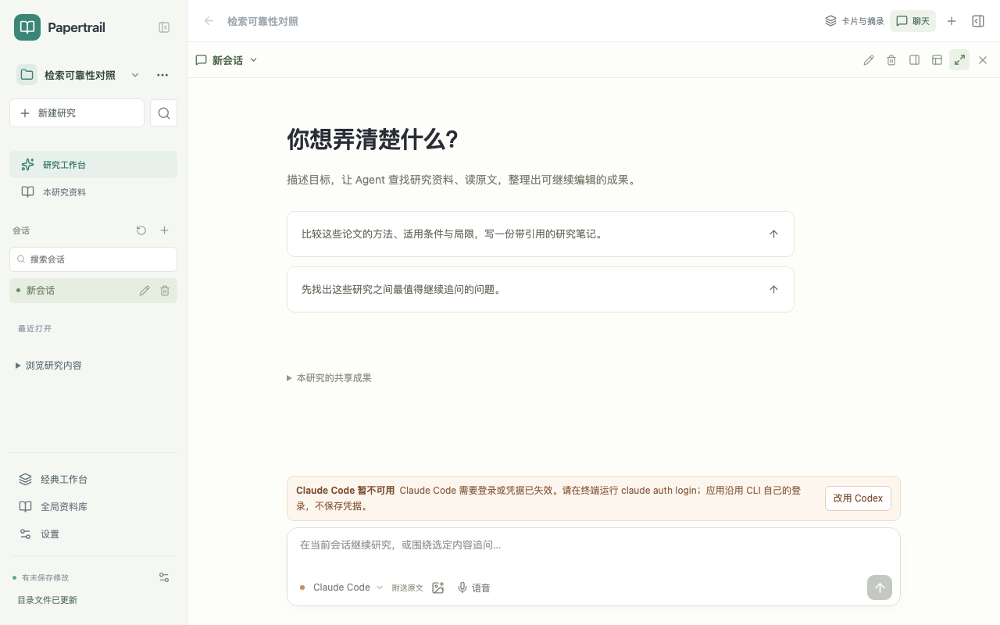
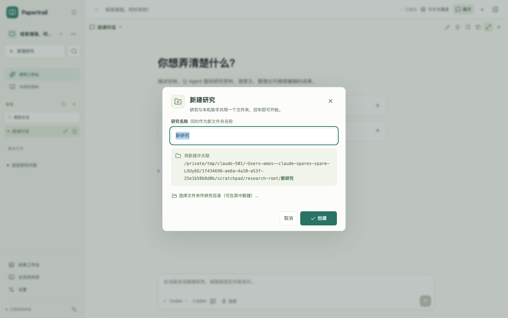
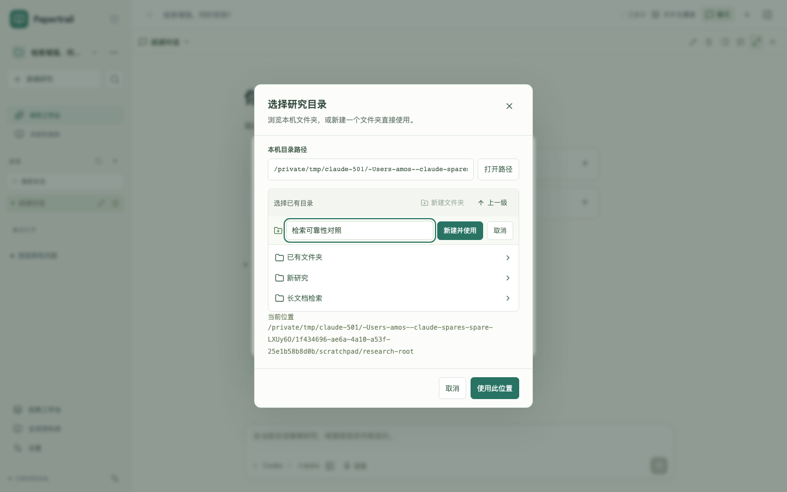
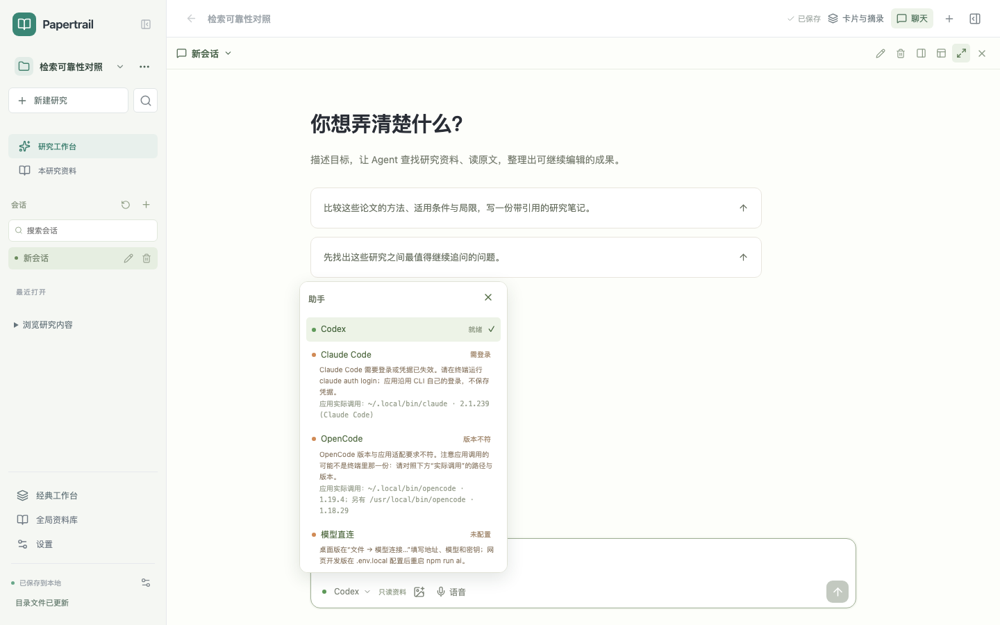
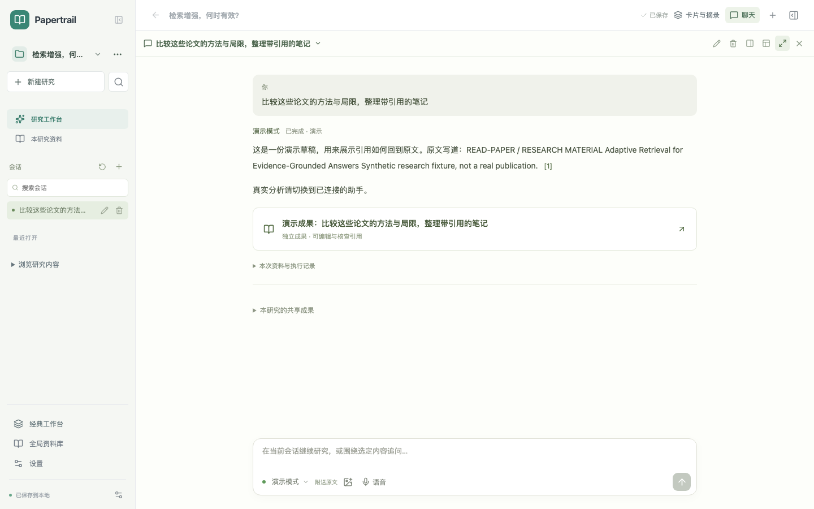

# 新建研究即关联目录、助手统一界面与连接诊断（2026-10-28）

本轮回应三个问题：新建研究时就绑定目录且能在选择时新建文件夹；切到 Codex 与 Claude Code / OpenCode 时页面为什么不同；本机助手在终端能用、应用里却连不上时如何排查。截图来自开发服务与本机真实助手服务，论文是项目自制样例。

## 1. 页面差异的原因

Agent 工作台里，聊天区按“这是不是研究会话、且连接是不是 Codex”分流：只有 Codex 渲染研究视图（`ResearchAgentHome` / `ResearchAgentDock`），其他连接落回经典 `AIPanel`，于是标题、材料行、“为这个研究选择目录”提示与输入框都换了一套。根因在服务端：`/api/ai/research/capabilities` 只给 Codex 标 `research: true`，逐页阅读、成果提交与文献检索这组研究工具只经 Codex app-server 接入。

- 模型直连、演示模式与 Claude Code / OpenCode 情况相同，也会落回经典面板。
- 经典工作台里所有连接本来就统一使用经典面板，没有这种差异。

现在所有研究会话都使用同一研究视图。Codex 仍按需逐页阅读、可检索文献与看图；Claude Code、OpenCode、模型直连与演示改为每轮随问附送本轮论文页面文字（单次预算分别约 12 万、10 万、6 万、2 万字），以一个 `papertrail-result` JSON 成果块返回，再走与 Codex 相同的 `submit_result` 引用核对写入草稿。引用必须逐字出自附送页面，否则不保存成果并在回答末尾说明。原生导入或经典记录仍保留经典面板。

## 2. 本机实测：终端能用、应用失败的原因

用已安装应用同样的 Finder 环境（`PATH=/usr/bin:/bin:/usr/sbin:/sbin` 加原有兜底目录，不读 `~/.zshrc`）直接调用各适配器的 `probe()`：

| 助手 | 应用实际调用 | 终端调用 | 结果 |
| --- | --- | --- | --- |
| Codex | `/usr/local/bin/codex` 0.139.0 | `~/.local/bin/codex` 0.165.0 | 旧版不满足材料目录隔离，报“此 Codex CLI 不能隔离材料目录”。换用 0.165.0 后 `probe` 为 ready |
| OpenCode | `/usr/local/bin/opencode` 1.18.29 | `~/.local/bin/opencode` 1.19.4 | 适配器只验证过 OpenCode 2.x 协议，两份 1.x 都会被拒绝 |
| Claude Code | `~/.local/bin/claude` 2.1.239 | 同一份 | 适配器要求 `--permission-prompts`，2.1.239 没有此参数，被误判为“缺少安全隔离参数” |

另外，运行中的 Papertrail 只有 `PATH`、`HOME` 等基础变量，没有 `~/.zshrc` 里的 `https_proxy` / `http_proxy` / `all_proxy`。本机当前直连也能访问各 API，代理不是这次的决定因素；只靠 shell 代理上网的环境里，它会直接导致连接失败。本会话的沙箱读不到钥匙串，因此没有对 Claude Code 的真实登录状态下结论。

## 3. 本轮改动

**新建研究即关联目录**

- Agent 工作台点“新建研究”打开精简窗口：名称已预填并避开重名，回车即在上次研究旁（首次为“文稿”）新建同名文件夹并关联，然后聚焦对话输入框。默认名称撞上已有文件夹时自动顺延编号；自己输入的名称撞上时，可“直接使用这个文件夹”。
- “选择文件夹作研究目录（可在其中新建）…”：桌面版系统选择器开启“新建文件夹”（`createDirectory`），选中即关联；网页版选择器内可“新建文件夹”，创建后直接作为研究目录。经典工作台的父位置／已有目录选择器同样可以新建文件夹。
- 旧研究未关联目录时，“…”项目设置从默认研究位置开始浏览，可一键“在当前位置新建「研究名」并关联”，浏览器里新建的文件夹也直接关联。
- 默认位置还在读取时就按回车，会等位置就绪后自动创建（打包应用实测：此前这次回车会被忽略）。目录服务不可用时才出现“先创建，稍后关联目录”。已关联目录的研究不再按首个问题自动改名，避免与文件夹名不一致。
- 服务端新增 `mkdir` 目录动作：只在已浏览的位置下创建，名称按跨平台规则校验，可选自动顺延编号。
- 修复既有问题：新研究的第一条会话没有时间戳，会被归入“更早”。

**连接问题自动处理**

- 桌面版启动后在后台读取登录 shell 环境（macOS 另读 `launchctl setenv`），只补入启动环境里没有的代理、服务地址、密钥、CLI 目录等变量，显式设置（包括刻意清空）的不覆盖。窗口不等待；结果写入运行环境，供之后的助手启动使用。
- 兜底 PATH 改为用户安装位置（`~/.local/bin`、`~/.opencode/bin`）优先于 `/usr/local/bin`，不再先用到过期的 npm 全局版本。
- Claude Code 不再强制要求 `--permission-prompts`：`--print` 模式下已关闭全部工具与 MCP，并保留 `--permission-mode dontAsk`；版本仍有该参数时继续传入。
- 失败分类为未安装、需登录、额度、网络、超时、版本不符，并给出下一步；Claude Code / OpenCode 失败附上 CLI 自己的输出，隐藏密钥与本轮临时目录。
- 助手旁圆点显示是否就绪；回到应用、打开助手列表或一轮失败后自动重新检测，去掉“重新检测”按钮。检测结果短时缓存（就绪 60 秒、未就绪 8 秒，失败即清除），发送前不再每次等待数秒的 CLI 检测。
- 当前助手未就绪时，输入框上方说明原因，并给出“改用 X”；失败的一轮可“改用 X 重试”。不会静默换供应商，演示模式不会被推荐为替代。
- 助手列表列出“应用实际调用”的路径与版本以及其他副本、是否已读取登录 shell 环境、存在哪些代理变量名（不显示值）。

## 4. 验证

| 检查 | 结果 |
| --- | --- |
| `npm run check` | 通过 |
| `npm test` | 54 个文件、845 项通过 |
| `npm run test:server` | 365 项通过；新增附送原文研究、成果块核对、演示／模型直连、失败分类与脱敏、目录服务等用例 |
| `npm run test:desktop` | 31 项通过；新增登录 shell 读取与合并规则；安装包白名单包含新服务模块 |
| `npm run desktop:package` | 成功，生成 `out/Papertrail-darwin-x64` |
| 打包桌面 e2e：`research-switcher`（3）、`chat-inputs`（1）、`research-directory`（2） | 通过。新建研究在隔离资料目录的 `Documents/新研究`、`Documents/新研究 2` 实际生成 `.read-paper/project.json`；系统选择器带 `createDirectory` |
| e2e：`research-switcher` 新建研究用例 | 通过：回车新建并关联 `/fixture/新研究`、`/fixture/新研究 2`，`mode: new`，聚焦输入框，取消不创建 |
| e2e：`continuous-workspace`（11）、`project-sessions`（11）、`research-directory`、`workbench-sessions`、`agent-regressions` | 通过 |
| 浏览器实测 | 新建并关联真实临时目录；选择器内新建文件夹并直接关联；Claude Code 保持研究视图；演示模式生成带引用成果；无页面错误 |

1440、1280、1024 三种宽度截图见 `screenshots/`。1024 下左栏收起，未就绪提示与“改用 Codex”仍完整可见。

**已有失败（与本轮无关）**：以下在未修改的 `HEAD` 上同样失败，原因是测试仍引用已改版的界面：`agent-workbench` 的两项（旧 `<select>`、已不存在的“会话列表”按钮）、网页版 `chat-inputs` 的两项，以及 `research-switcher` 中点击被隐藏主区和旧“资料库”按钮的两项。本轮只修正挡在改动前面的部分：网页与桌面的启动等待（主区在全宽聊天时 `aria-hidden`）、桌面“资料库”改名为“全局资料库”；`agent-workbench` 中助手切换的步骤已改为现行界面并通过，之后仍卡在旧按钮。连续批量运行时，Excalidraw 偶发“重复 React”报错，属开发服务依赖重新预构建，重启开发服务后单独与整文件运行均通过。

## 5. 未验证与限制

- Claude Code、OpenCode 与模型直连的附送原文研究只有确定性测试，真实回答质量和成果块遵循率尚未实测；本机 Claude Code 在本会话中显示需登录，OpenCode 1.x 仍不在适配范围内。
- 登录 shell 读取只在 macOS / Linux 执行，Windows 保持启动环境；修改 shell 配置后需要重启应用。
- 已安装的 0.1.19 不含本轮改动，需要重新打包安装才生效。本轮没有改动或卸载 `/usr/local/bin` 下的旧版 CLI。
