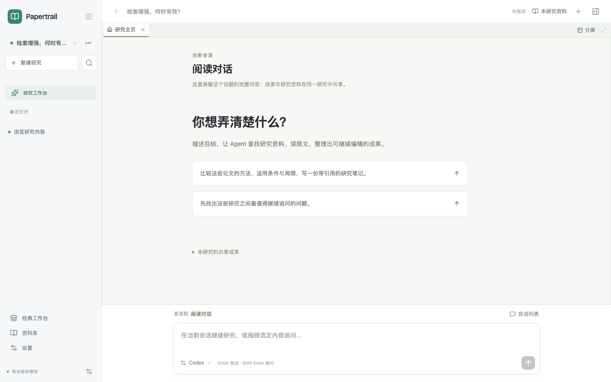

# Agent 工作台合入最新 main 的验证

2026-10-21，用户要求推送并合并。将累计成果保存为 68c6291，再在隔离工作树中移植到 main b683390；没有用旧分支覆盖主线。[PR #28](https://github.com/alovwang-sys/Read-paper/pull/28) 记录最终远端状态。

逐项融合多窗格／编辑位置、原生持续会话与长历史、Pi、资料获取和研究导图；新增工作台与绘图问答复用既有 pane 渲染。桌面协议和打包白名单保留 main 的模块并加入 research／literature。绘图仅选区、只读分析、引用与持久化约束继续生效。

本机 check、build、671 项单元、318 项服务端、27 项桌面协议通过；Agent 会话 7 条、绘图选区 5 条及旧聊天白板 5 条定向浏览器验证通过。完整 258 条浏览器及三个平台的打包烟测由 PR CI 执行，最终通过状态以 PR 对应 head 的 Required checks 为准。历史视觉模型验证继续见[绘图问答](../../agent-native-evolution/implementation/drawing-agent/README.md)，这次整合没有再次请求真实模型。

旧回归用例的默认界面明确固定为经典模式；新版 Agent 两个会话文件使用空 storageState 验证真实新用户默认入口。配置使用独立 JSON fixture，避免 config 导入应用 TypeScript 后与 spec 的 ESM 加载冲突。桌面回归通过可见 UI 切到经典并首次展开面板；不修改产品默认值，不放宽业务断言。经典导航复用原有 nav，避免双层同名导航；Agent 初始化与自动切换仅在加载成功后运行。未知存储版本的原始数据库、错误页面、重试入口和无页面异常均通过原回归验证，[恢复页截图](screenshots/storage-recovery-1440.png)来自本次修复。白板选区的原文路径适配主线公开“摘录 → 加入 AI”入口，仍验证原问题、原文、页码和卡片来源链。

本机 darwin-arm64 实际打包、启动和正常退出已验证：新用户首次出现唯一 Agent 输入，右参考区默认关闭；切回经典、展开参考区、打开新建研究对话框均成功。研究目录两条真实桌面用例通过，覆盖原生目录选择、PDF／卡片实际文件、外部修改保护和重启。DOM 记录见 [desktop-first-window.json](desktop-first-window.json)。

[切回经典](screenshots/classic-ready-1440.png) · [原新建研究流程](screenshots/classic-create-dialog-1440.png)

此记录不宣称已发布新安装包、已签名或新接入其他助手图片研究工具。原 checkout 与累计成果提交保留；根目录 test-results-* 临时产物未推送。

最终整合的 258 项浏览器回归已在本机分段全部覆盖。远端 CI 首轮无测试断言失败，但单 worker 完整回归超过原 Checks 的 20 分钟总时限（run 39555224350）；将该任务上限调至 40 分钟，测试范围、断言、重试和并行度均保持原配置。仍以最终 head 的 Required checks 为合并条件。
