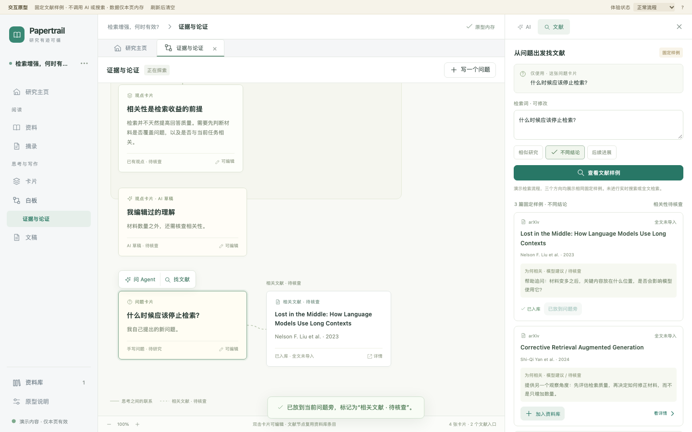

# 白板局部研究第一版原型验证

日期：2026 年 10 月 20 日。对象为保留的 [prototype-v1.html](../prototype-v1.html)，仅验证第一版交互设计。用户随后确认继续，正式功能及当前边界见[实施验收](implementation/README.md)。第二轮上下文及连续探索的验证使用独立的 [context-v2](context-v2/README.md) 记录，不沿用下列 20 项作为新版验证结果。

## 已完成检查

使用项目已有的 Playwright 依赖运行原型交互检查，20 项通过，浏览器页面运行错误为 0；详细检查项与截图清单见 [checks.json](checks.json)。未运行生产构建、生产全量测试或真实模型／学术 API 请求，本轮没有修改生产代码或依赖。

主 agent 另通过 Codex 内置浏览器实际点击复核：白板问题 → 找文献 → 展示候选 → 查看摘要概述及 arXiv 来源 → 加入资料库 → 放到当前问题旁 → 点选这篇论文 → 问 Agent。右侧明确显示仅使用文献标题与摘要，没有声称读过全文。此前也实际提交了一次模拟追问，并确认回答提供整理为卡片和接着找文献入口。

自动交互检查还覆盖：收起再展开保留输入；回答先编辑再成卡；用户主动新建和编辑问题；同篇同问题不重复摆放；同篇在不同问题下复用资料、创建不同摆放；空结果、失败重试与 1024px 导航抽屉。新问题放置的实际结果见下图。

## 三种窗口尺寸

已实际查看 1440×900 的摆放截图、1280×800 和 1024×800 的候选结果截图，检查主区、右侧和操作入口的可读性。页面无整体横向溢出；1024px 左栏收进抽屉，白板与右侧面板仍同时可见。画布自身允许滚动。

| 尺寸 | 局部提问 | 文献结果 | 放回问题旁 |
| --- | --- | --- | --- |
| 1440×900 | [查看](board-ai-1440.png) | [查看](results-1440.png) | [查看](placed-1440.png) |
| 1280×800 | [查看](board-ai-1280.png) | [查看](results-1280.png) | [查看](placed-1280.png) |
| 1024×800 | [查看](board-ai-1024.png) | [查看](results-1024.png) | [查看](placed-1024.png) |

这些截图来自本项目的设计原型，不是已实施功能的证据，也不是竞品截图。

## 复看方式

项目现有开发服务运行时打开[第一版原型](http://127.0.0.1:5173/docs/whiteboard-research/prototype-v1.html)。没有服务时从项目根目录运行 README 中已有的 `npm run dev`，使用实际启动地址；不需要新增依赖。HTML 也可直接用浏览器打开。

在初始问题旁点击“找文献 → 查看文献样例”，再点击标题或“看详情”。加入资料库后，“放到当前问题旁”可用。点“写一个问题”可以自己补充；双击普通卡片可编辑。文献节点选中后可以继续问 Agent，双击查看文献详情。

可直接查看 `?state=results`、`answer`、`detail`、`empty`、`error`、`closed`。顶部“体验状态”可切换模拟空结果与失败；失败页有重试入口。

## 原型与生产能力的边界

固定三篇真实论文只用于演示；查询词和方向可编辑，但不会改变这组三篇样例。问答是预设模拟。资料库、摆放与卡片只保留在本页内存，刷新清空。

每个问题可恢复最近一问一答；完整多轮消息历史、历史搜索批次和滚动位置恢复尚未在原型演示。多研究持久化隔离、真实全文获取与阅读、PDF 原文证据、绘图文字转问题、多选／分区上下文及真实助手接入也未验证，均保留在正式实施验收中。
